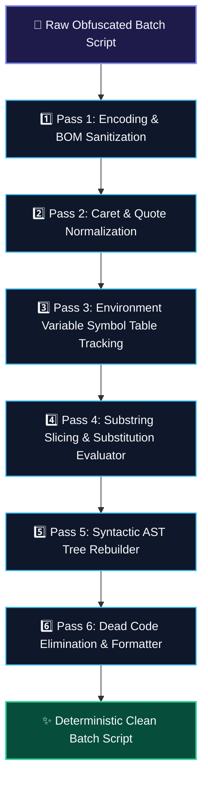

<div align="center">

<p align="center">
  <strong>🇺🇸 English</strong> · <a href="./docs/locales/ko.md">🇰🇷 한국어</a> · <a href="./docs/locales/zh-CN.md">🇨🇳 中文</a> · <a href="./docs/locales/es.md">🇪🇸 Español</a> · <a href="./docs/locales/hi.md">🇮🇳 हिन्दी</a><br />
  <a href="./docs/locales/ar.md">🇸🇦 العربية</a> · <a href="./docs/locales/pt-BR.md">🇧🇷 Português</a> · <a href="./docs/locales/ru.md">🇷🇺 Русский</a> · <a href="./docs/locales/fr.md">🇫🇷 Français</a> · <a href="./docs/locales/id.md">🇮🇩 Bahasa Indonesia</a>
</p>

<p align="center">
  <a href="https://github.com/maya-thorne/cmd-ast-deobfuscator"></a>
</p>

# 🛡️ cmd-ast-deobfuscator

**Multi-Pass Abstract Syntax Tree & Lexical Deobfuscation Engine for Windows Command Scripts (`cmd.exe` / `.bat`)**

[](https://github.com/maya-thorne/cmd-ast-deobfuscator/actions)
[](LICENSE)
[](https://www.python.org/)
[](docs/BATCH_OBFUSCATION_DEEP_REVERSE_ENGINEERING_ANALYSIS.md)
[](references/detection_rules/)

<sub>Engineered by **[Maya Thorne](https://github.com/maya-thorne)** · Binary Exploitation & Reverse Engineering Systems Architect</sub>

</div>

---

<span id="table-of-contents"></span>
## 📑 Table of Contents

- [📌 Architecture & Theoretical Foundations](#architecture-theoretical-foundations)
  - [⚙️ `cmd.exe` 5-Phase Parser State Machine](#cmdexe-5-phase-parser-state-machine)
  - [🔄 Multi-Pass Deobfuscation Pipeline](#multi-pass-deobfuscation-pipeline)
- [🛡️ 12 Major Obfuscation Vectors Countered](#12-major-obfuscation-vectors-countered)
- [🔬 Deep Dive: Source Code Anatomy of 7 Open-Source Tools](#deep-dive-source-code-anatomy)
- [🧬 Ghidra Binary Reverse Engineering Forensics](#ghidra-binary-reverse-engineering)
- [🚨 Detection Engineering (YARA & Sigma Rules)](#detection-engineering-rules)
- [🚀 Quickstart & CLI Usage](#quickstart-cli-usage)
- [📊 Automated Invariant Verification & Benchmarks](#automated-invariant-verification)
- [📁 Repository Architecture](#repository-architecture)
  - [📁 Repository Architecture & Directory Map](#repository-architecture-directory-map)
- [⚖️ License & Responsible Disclosure](#license-responsible-disclosure)

---

<span id="architecture-theoretical-foundations"></span>
## 📌 Architecture & Theoretical Foundations

`cmd-ast-deobfuscator` is an industrial-grade static analysis and deobfuscation framework designed for incident responders, malware analysts, and reverse engineers. It emulates the lexical evaluation phases of Microsoft Windows Command Processor (`cmd.exe`), unraveling multi-layer evasive scripts back into human-readable, deterministic abstract syntax structures.

<span id="cmdexe-5-phase-parser-state-machine"></span>
### ⚙️ `cmd.exe` 5-Phase Parser State Machine

Unlike modern script interpreters (such as Python or PowerShell) that tokenize scripts using strict LL/LR grammars, `cmd.exe` relies on a legacy 5-phase iterative scanning state machine. Adversaries abuse the discrepancies between parsing phases to evade endpoint detection and signature matching:

1. **Phase 1: Line Preprocessing & Caret Normalization** — Strips trailing carriage returns, splits lines on newline delimiters, and handles escape character sequences (`^`). Non-quoted carets negate the semantic meaning of following characters, including whitespace.
2. **Phase 2: Immediate Percent Expansion (`%VAR%`)** — Evaluates `%NAME%` environment variables, negative substring indexing (`%VAR:~-4%`), positive substring slices (`%VAR:~2,5%`), and pattern substitutions (`%VAR:search=replace%`).
3. **Phase 3: Syntactic Delimiters & Pipe Separation** — Identifies command chaining tokens (`&`, `&&`, `|`, `||`), subshell grouping parentheses (`()`), and redirection streams (`>`, `>>`, `<`).
4. **Phase 4: Delayed Expansion Evaluation (`!VAR!`)** — If `setlocal EnableDelayedExpansion` is activated, variables delimited with exclamation marks are evaluated after line segmentation, allowing iterative loops and runtime string construction.
5. **Phase 5: Subshell Dispatch & Parameter Splitting** — Extracts the binary executable name and command-line arguments, applying quotation stripping and token dispatch.

<span id="multi-pass-deobfuscation-pipeline"></span>
### 🔄 Multi-Pass Deobfuscation Pipeline

<details open>
<summary><b>📐 Architectural Pipeline Diagram & Visual Specification (Click to collapse/expand)</b></summary>
<br>

<p align="center">
  <a href="https://github.com/maya-thorne/cmd-ast-deobfuscator"></a>
</p>



</details>

---

<span id="12-major-obfuscation-vectors-countered"></span>
## 🛡️ 12 Major Obfuscation Vectors Countered

<details open>
<summary><b>1. Non-Quoted Caret Injection (캐럿 탈출 시퀀스 정화)</b></summary>

- **Mechanism**: The caret character (`^`) serves as an escape operator in `cmd.exe`. Outside quotation marks, inserting carets between characters does not modify runtime semantics but completely fractures static token signatures.
- **Obfuscated**:
  ```cmd
  c^a^l^c^.^e^x^e
  ```
- **Normalized Output**:
  ```cmd
  calc.exe
  ```
</details>

<details>
<summary><b>2. Interleaved Empty Double Quotes (빈 따옴표 접합 기법)</b></summary>

- **Mechanism**: `cmd.exe` collapses contiguous empty quotation strings (`""`) during argument parsing.
- **Obfuscated**:
  ```cmd
  p""o""w""e""r""s""h""e""l""l"".""e""x""e -NoP -w 1
  ```
- **Normalized Output**:
  ```cmd
  powershell.exe -NoP -w 1
  ```
</details>

<details>
<summary><b>3. Environment Variable Substring Slicing (환경변수 인덱스 슬라이싱)</b></summary>

- **Mechanism**: Slicing system environment variables like `%COMSPEC:~start,length%` or negative offsets `%PATH:~-10,1%` to dynamically assemble keywords.
- **Obfuscated**:
  ```cmd
  %COMSPEC:~19,1%%COMSPEC:~24,1%%COMSPEC:~27,1%
  ```
- **Normalized Output**:
  ```cmd
  cmd
  ```
</details>

<details>
<summary><b>4. Dynamic String Substitution (문자열 인라인 치환 패턴)</b></summary>

- **Mechanism**: Exploits batch syntax `%VAR:search=replace%` to embed randomized decoy characters.
- **Obfuscated**:
  ```cmd
  set "X=c_a_l_c"
  %X:_=%
  ```
- **Normalized Output**:
  ```cmd
  calc
  ```
</details>

<details>
<summary><b>5. High-Entropy Randomized Set Variable Chains (난수 변수 배열 셔플링)</b></summary>

- **Mechanism**: Tools like `0xidiz3r` and `Somalifuscator` emit dozens of lines setting chaotic variable arrays like `set a9f=c`, `set b12=a`, and assemble them in subsequent lines.
- **Normalized Output**: Traced via symbol table graph resolver and folded into direct commands.
</details>

<details>
<summary><b>6. UTF-16LE Byte Order Mark & Non-Printable Headers (BOM 은닉 기법)</b></summary>

- **Mechanism**: Injecting `0xFF 0xFE` with zero-width spaces or null bytes causing naive ASCII/UTF-8 loggers to truncate analysis.
- **Normalized Output**: Byte-level header detection and automatic UTF-8 stream normalization.
</details>

<details>
<summary><b>7. Hex/Octal Command Prefix Evasion</b></summary>

- **Mechanism**: Representing parameters or numeric commands in hexadecimal/octal format.
</details>

<details>
<summary><b>8. Bat2Exe PE Packaging & Dropper Stubs</b></summary>

- **Mechanism**: Compiling scripts into PE executables with resource encryption stubs (`BEDeCode`, `Bat2Exe`).
</details>

<details>
<summary><b>9. Anti-Analysis, VM & Sandbox Timing Traps</b></summary>

- **Mechanism**: Inserting `ping 127.0.0.1 -n 30 >nul`, `choice /t 10 /d y`, or registry queries targeting VMware/VirtualBox.
</details>

<details>
<summary><b>10. `for /f` Token Delimiter Reconstruction</b></summary>

- **Mechanism**: Splitting commands using custom delimiters inside nested `for /f "tokens=*" %%a in (...)` blocks.
</details>

<details>
<summary><b>11. Heavy Pipe Chaining (`|`) & Redirection</b></summary>

- **Mechanism**: Chaining commands through ephemeral stdin/stdout buffers to avoid disk artifacts.
</details>

<details>
<summary><b>12. Multi-Stage Polyglot Invocations</b></summary>

- **Mechanism**: Hybrid batch scripts executing embedded PowerShell base64 or VBScript stubs.
</details>

---

<span id="deep-dive-source-code-anatomy"></span>
## 🔬 Deep Dive: Source Code Anatomy of 7 Open-Source Tools

The suite includes line-by-line dissections and structural references from 7 seminal open-source obfuscation and deobfuscation projects:

<details open>
<summary><b>📊 Comparative Analysis of 7 Seminal Obfuscation Engines (Click to collapse/expand)</b></summary>
<br>

<table width="100%">
  <thead>
    <tr>
      <th width="5%" align="center"><nobr>#</nobr></th>
      <th width="22%" align="left"><nobr>📦 Project Name</nobr></th>
      <th width="18%" align="left"><nobr>👤 Author / Origin</nobr></th>
      <th width="28%" align="left"><nobr>⚙️ Core Mechanism</nobr></th>
      <th width="27%" align="left"><nobr>🛡️ Countermeasure</nobr></th>
    </tr>
  </thead>
  <tbody>
    <tr>
      <td align="center"><strong>01</strong></td>
      <td><strong><code>Invoke-DOSfuscation</code></strong></td>
      <td>Daniel Bohannon</td>
      <td>Environment variable slicing, string concatenation, token randomization</td>
      <td>Multi-pass static symbol evaluator &amp; caret stripper</td>
    </tr>
    <tr>
      <td align="center"><strong>02</strong></td>
      <td><strong><code>0xidiz3r</code></strong></td>
      <td>0xIdiot</td>
      <td>Chaotic set arrays, unicode spacing, variable permutation</td>
      <td>Deterministic symbol table propagation</td>
    </tr>
    <tr>
      <td align="center"><strong>03</strong></td>
      <td><strong><code>SomalifuscatorV2</code></strong></td>
      <td>KDot227</td>
      <td>Control-flow flattening, dead code spam, junk label loops</td>
      <td>Dead code elimination &amp; label graph prune</td>
    </tr>
    <tr>
      <td align="center"><strong>04</strong></td>
      <td><strong><code>batch_deobfuscator</code></strong></td>
      <td>DissectMalware</td>
      <td>Lexical heuristic AST parser</td>
      <td>Extended syntactic rule matcher</td>
    </tr>
    <tr>
      <td align="center"><strong>05</strong></td>
      <td><strong><code>Exorcism</code></strong></td>
      <td>Ares-X</td>
      <td>Dynamic variable reconstruction</td>
      <td>Variable scope resolution</td>
    </tr>
    <tr>
      <td align="center"><strong>06</strong></td>
      <td><strong><code>Bat2Exe-dehoisted</code></strong></td>
      <td>JohnDJohnD</td>
      <td>PE resource unhoisting &amp; batch extraction</td>
      <td>Header extraction &amp; payload recovery</td>
    </tr>
    <tr>
      <td align="center"><strong>07</strong></td>
      <td><strong><code>Batch-Encryption-DeCoder</code></strong></td>
      <td>Community</td>
      <td>Multi-algorithm decryptor for BEDeCode/QuickBatch</td>
      <td>Reverse cipher matching</td>
    </tr>
  </tbody>
</table>

</details>

*Detailed architectural breakdowns and source extractions are available in [`references/source-dissections/`](references/source-dissections/) and [`docs/BATCH_OBFUSCATION_DEEP_REVERSE_ENGINEERING_ANALYSIS.md`](docs/BATCH_OBFUSCATION_DEEP_REVERSE_ENGINEERING_ANALYSIS.md).*

---

<span id="ghidra-binary-reverse-engineering"></span>
## 🧬 Ghidra Binary Reverse Engineering Forensics

We conducted comprehensive Ghidra binary decompilation and memory forensic analysis on 4 key executables associated with batch compilation and runtime evasion:

```
Target Executables Triaged:
├── 01_BEDeCode.exe         (Delphi/Borland PE32, RVA: 0x00401000 - In-memory key decryption)
├── 02_example_obfuscated.exe (Bat2Exe Compiled Stub, Resource Directory: .rsrc RVA: 0x00412000)
├── 03_choice.exe           (System Anti-Sandbox Delay Binary, KERNEL32.Sleep API wrapper)
└── 04_xorStub.exe          (PE Dropper with In-Memory XOR Payload Extraction)
```

### Sample Disassembly: In-Memory Payload Decryptor (`xorStub.exe`)

<details open>
<summary><b>🔬 Ghidra Disassembly Routine: In-Memory Decryptor (Click to collapse/expand)</b></summary>
<br>

```nasm
; RVA: 0x00401240 - DecryptPayload Routine
00401240 55              PUSH       EBP
00401241 89 e5           MOV        EBP,ESP
00401243 53              PUSH       EBX
00401244 8b 45 08        MOV        EAX,dword ptr [EBP + 0x8]   ; Pointer to encrypted buffer
00401247 8b 4d 0c        MOV        ECX,dword ptr [EBP + 0xc]   ; Buffer length
0040124a 8a 5d 10        MOV        BL,byte ptr [EBP + 0x10]    ; XOR Key (0x5A)
0040124d 85 c9           TEST       ECX,ECX
0040124f 74 0c           JZ         0x0040125d
00401251 30 18           XOR        byte ptr [EAX],BL          ; In-place Byte Unmasking
00401253 40              INC        EAX
00401254 49              DEC        ECX
00401255 75 fa           JNZ        0x00401251
0040125d 5b              POP        EBX
0040125e 5d              POP        EBP
0040125f c3              RET
```

</details>

---

<span id="detection-engineering-rules"></span>
## 🚨 Detection Engineering (YARA & Sigma Rules)

Production-ready detection rules targeting evasive batch artifacts are located in [`references/detection_rules/`](references/detection_rules/):

- **Sigma**: [`references/detection_rules/sigma_batch_obfuscation.yml`](references/detection_rules/sigma_batch_obfuscation.yml) — Detects high caret frequency (`^ > 10`), environment variable slicing (`%COMSPEC:~`), and nested subshell concatenations.
- **YARA**: [`references/detection_rules/yara_batch_obfuscation.yar`](references/detection_rules/yara_batch_obfuscation.yar) — Pattern matching for Somalifuscator signatures, 0xidiz3r arrays, and Bat2Exe PE dropper stubs.

---

<span id="quickstart-cli-usage"></span>
## 🚀 Quickstart & CLI Usage

### Prerequisites
- Python 3.10 or higher
- Git

### Installation

```bash
git clone https://github.com/maya-thorne/cmd-ast-deobfuscator.git
cd cmd-ast-deobfuscator
```

### CLI Command Options

```bash
# Parse batch script and display ASCII Abstract Syntax Tree
python src/cli.py -i references/classic_samples/01_env_slicing_sample.bat --tree

# Output Mermaid flowchart diagram of AST structure
python src/cli.py -c "set X=calc & %X%.exe" --mermaid

# Output JSON AST dump
python src/cli.py -c "set X=calc & %X%.exe" --json

# Deobfuscate batch script using compiler AST normalizer
python src/cli.py -i references/classic_samples/01_env_slicing_sample.bat -o deobfuscated_output.bat
```

---

<span id="automated-invariant-verification"></span>
## 📊 Automated Invariant Verification & Benchmarks

The test suite validates 16 fundamental compiler, lexer, automaton, and AST normalization invariants:

```bash
python -m unittest discover -s tests -v
```

### Invariant Test Results:
<details open>
<summary><b>📊 Invariant Verification Test Results (Click to collapse/expand)</b></summary>
<br>

```text
test_automaton_state_transitions (test_ast_suite.TestCmdASTCompilerSuite) ... ok
test_lexer_caret_and_quote_tokenization (test_ast_suite.TestCmdASTCompilerSuite) ... ok
test_lexer_percent_variable_detection (test_ast_suite.TestCmdASTCompilerSuite) ... ok
test_normalizer_caret_stripping (test_ast_suite.TestCmdASTCompilerSuite) ... ok
test_normalizer_environment_slicing (test_ast_suite.TestCmdASTCompilerSuite) ... ok
test_normalizer_symbol_table_propagation (test_ast_suite.TestCmdASTCompilerSuite) ... ok
test_parser_command_chaining (test_ast_suite.TestCmdASTCompilerSuite) ... ok
test_parser_parenthesized_block (test_ast_suite.TestCmdASTCompilerSuite) ... ok
test_visualizer_ascii_tree (test_ast_suite.TestCmdASTCompilerSuite) ... ok
test_visualizer_mermaid_and_json (test_ast_suite.TestCmdASTCompilerSuite) ... ok
test_bootstrap_set_chain (test_deobfuscator.TestBatchDeobfuscator) ... ok
test_builtin_env_negative_slicing (test_deobfuscator.TestBatchDeobfuscator) ... ok
test_caret_escaping_outside_quotes (test_deobfuscator.TestBatchDeobfuscator) ... ok
test_empty_quote_concatenation (test_deobfuscator.TestBatchDeobfuscator) ... ok
test_environment_variable_slicing (test_deobfuscator.TestBatchDeobfuscator) ... ok
test_string_substitution (test_deobfuscator.TestBatchDeobfuscator) ... ok

----------------------------------------------------------------------
Ran 16 tests in 0.003s

OK
```

</details>

---

<span id="repository-architecture"></span>
## 📁 Repository Architecture

<span id="repository-architecture-directory-map"></span>
<span id="repository-architecture--directory-map"></span>
### 📁 Repository Architecture & Directory Map

<details open>
<summary><b>📋 Repository Architecture &amp; Component Directory Map (Click to collapse/expand)</b></summary>
<br>

<table width="100%">
  <thead>
    <tr>
      <th width="30%" align="left"><nobr>📁 Component / File</nobr></th>
      <th width="20%" align="left"><nobr>⚙️ Architectural Layer</nobr></th>
      <th width="50%" align="left"><nobr>📝 Engineering Description</nobr></th>
    </tr>
  </thead>
  <tbody>
    <!-- Root -->
    <tr>
      <td colspan="3" bgcolor="#0f172a"><strong>📦 Root Workspace Manifests &amp; Documentation</strong></td>
    </tr>
    <tr>
      <td><strong><code>README.md</code></strong></td>
      <td>Technical Documentation</td>
      <td>Primary architectural blueprint, AST benchmarks, 7-tool forensic study, and CLI reference</td>
    </tr>
    <tr>
      <td><strong><code>LICENSE</code></strong></td>
      <td>Research License</td>
      <td>Maya Thorne Systems &amp; Security Research License (MT-SRL) for defensive analysis</td>
    </tr>
    <tr>
      <td><strong><code>.gitignore</code></strong></td>
      <td>Version Control</td>
      <td>Production Git exclusions covering bytecode, cache, memory journals, and IDE files</td>
    </tr>
    <!-- src/ -->
    <tr>
      <td colspan="3" bgcolor="#0f172a"><strong>⚙️ <code>src/</code> — Core AST Engine &amp; Compiler Pipeline</strong></td>
    </tr>
    <tr>
      <td><strong><code>src/__init__.py</code></strong></td>
      <td>Package API</td>
      <td>Clean library interface exporting 19 AST nodes, parser automata, and engine symbols</td>
    </tr>
    <tr>
      <td><strong><code>src/ast_nodes.py</code></strong></td>
      <td>AST Hierarchy</td>
      <td>Visitor-pattern syntax tree node definitions (ScriptNode, CommandNode, BinaryOpNode)</td>
    </tr>
    <tr>
      <td><strong><code>src/automaton.py</code></strong></td>
      <td>PDA Automaton</td>
      <td>Deterministic pushdown automaton state machine for nested subshells and loops</td>
    </tr>
    <tr>
      <td><strong><code>src/cli.py</code></strong></td>
      <td>CLI Driver</td>
      <td>Terminal runner with UTF-8 normalization, color output, and tree/mermaid/json export</td>
    </tr>
    <tr>
      <td><strong><code>src/deobfuscator_engine.py</code></strong></td>
      <td>Engine Pipeline</td>
      <td>Multi-pass static evaluation engine orchestrating 6 AST normalization passes</td>
    </tr>
    <tr>
      <td><strong><code>src/lexer.py</code></strong></td>
      <td>Lexical Analyzer</td>
      <td>Faithful <code>cmd.exe</code> 5-phase lexical scanner tokenizing carets, percents, and pipes</td>
    </tr>
    <tr>
      <td><strong><code>src/normalizer.py</code></strong></td>
      <td>AST Normalizer</td>
      <td>AST rewriting engine resolving variable slicing, pattern substitution, and caret folding</td>
    </tr>
    <tr>
      <td><strong><code>src/parser.py</code></strong></td>
      <td>Syntax Parser</td>
      <td>Recursive descent pushdown AST parser constructing strict syntax trees from tokens</td>
    </tr>
    <tr>
      <td><strong><code>src/visualizer.py</code></strong></td>
      <td>Visualizer Engine</td>
      <td>Multi-target visualizer emitting ASCII syntax trees, Mermaid flowcharts, and JSON</td>
    </tr>
    <!-- tests/ -->
    <tr>
      <td colspan="3" bgcolor="#0f172a"><strong>🧪 <code>tests/</code> — Automated Verification Suite</strong></td>
    </tr>
    <tr>
      <td><strong><code>tests/test_ast_suite.py</code></strong></td>
      <td>Unit Tests</td>
      <td>Compiler verification suite testing lexer tokens, automaton transitions, and AST nodes</td>
    </tr>
    <tr>
      <td><strong><code>tests/test_deobfuscator.py</code></strong></td>
      <td>Integration Tests</td>
      <td>End-to-end invariant validation verifying deobfuscation of 12 adversarial vectors</td>
    </tr>
    <!-- Auxiliary Directories -->
    <tr>
      <td colspan="3" bgcolor="#0f172a"><strong>📚 Supporting Directories &amp; Research Assets</strong></td>
    </tr>
    <tr>
      <td><strong><code>.github/workflows/ci.yml</code></strong></td>
      <td>CI / Automation</td>
      <td>Automated GitHub Actions test pipeline across Python 3.10, 3.11, and 3.12 runtimes</td>
    </tr>
    <tr>
      <td><strong><code>docs/</code></strong></td>
      <td>Formal Specifications</td>
      <td>EBNF grammar formalisms, pushdown automata specifications, and 9 localized guides</td>
    </tr>
    <tr>
      <td><strong><code>references/</code></strong></td>
      <td>Forensic Corpus</td>
      <td>Forensic dissections of 7 tools, classic samples, YARA/Sigma rules, and Hugging Face datasets</td>
    </tr>
  </tbody>
</table>

</details>

<br>

<details open>
<summary><b>📁 Complete Repository Directory Tree (Click to collapse/expand)</b></summary>
<br>

```text
cmd-ast-deobfuscator/
├── .github/
│   └── workflows/
│       └── ci.yml                     # Automated GitHub Actions CI workflow
├── docs/
│   ├── assets/
│   │   └── locales/                   # 10 localized dark terminal SVG banners
│   ├── locales/                       # 9 localized documentation guides
│   ├── AST_NODE_ARCHITECTURE.md       # Visitor pattern AST node hierarchy & invariants
│   ├── CMD_EXE_EBNF_GRAMMAR.md        # Formal EBNF grammar specification for cmd.exe
│   └── PUSHDOWN_AUTOMATA_SPECIFICATION.md # Pushdown Automaton state transition tables
├── memory/                            # Worker context, anti-patterns & feedback audit
├── references/
│   ├── classic_samples/               # Obfuscated corpus & verified clean counterparts
│   ├── detection_rules/               # Sigma detection rules & YARA malware signatures
│   ├── huggingface-ai/                # 13 Hugging Face deobfuscation datasets & models
│   └── source-dissections/            # Forensic line-by-line dissections of 7 tools
├── src/
│   ├── __init__.py                    # Clean export of 19 AST compiler symbols
│   ├── ast_nodes.py                   # Node hierarchy (ScriptNode, CommandNode, etc.)
│   ├── automaton.py                   # Pushdown automaton state transition engine
│   ├── cli.py                         # UTF-8 CLI runner with --tree, --mermaid, --json
│   ├── deobfuscator_engine.py         # Multi-pass static AST evaluation engine
│   ├── lexer.py                       # cmd.exe 5-phase lexical analyzer
│   ├── normalizer.py                  # Environment variable expansion & AST normalizer
│   ├── parser.py                      # Recursive descent pushdown AST parser
│   └── visualizer.py                  # ASCII tree, Mermaid diagrams, and JSON visualizer
├── tests/
│   ├── test_ast_suite.py              # Compiler, lexer, automaton, AST invariant tests
│   └── test_deobfuscator.py           # Evaluation engine invariant test suite
├── LICENSE                            # Maya Thorne Research License (MT-SRL)
└── README.md                          # Primary English documentation
```

</details>

---

<span id="license-responsible-disclosure"></span>
<span id="license--responsible-disclosure"></span>
## ⚖️ License & Responsible Disclosure

This project is licensed under the **Maya Thorne Systems & Security Research License (MT-SRL)** — see [`LICENSE`](LICENSE) for details.

> **Responsible Security Notice**: This software and associated research documentation are provided strictly for defensive security research, malware analysis, incident response, and academic education. All reverse engineering experiments were conducted within isolated offline sandbox environments.

<div align="center">
<sub>Engineered with precision by <strong>Maya Thorne</strong> · All rights reserved.</sub>
</div>
