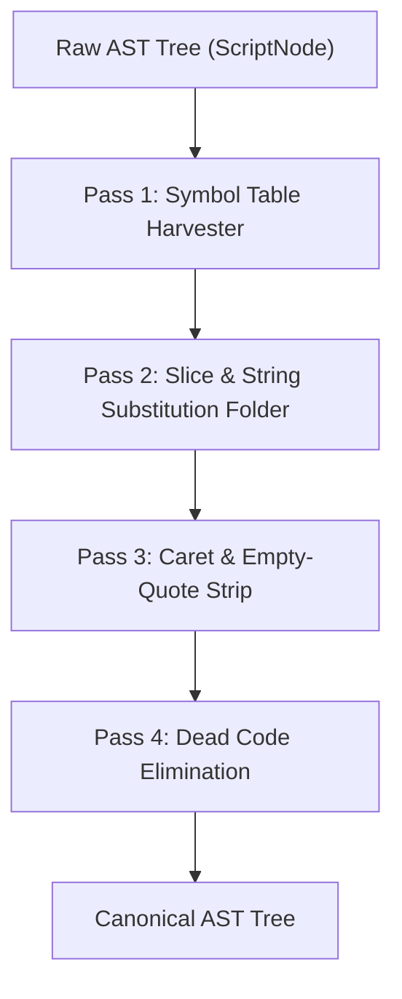

# 🌳 AST Node Architecture & Reduction Specifications

This document outlines the design of the Abstract Syntax Tree (AST) node hierarchy and the semantic reduction algorithms utilized by `cmd-ast-deobfuscator`.

---

## 1. Node Topology

```
ASTNode (Base)
├── ScriptNode               (Root container for statements)
├── CommandNode              (Executable target + argument nodes)
├── AssignmentNode           (Variable declarations: set VAR=VAL)
├── VarExpandNode            (Variable references: %VAR%, !VAR!, slices)
├── LiteralNode              (Atomic text tokens, quoted/unquoted)
├── ChainNode                (Sequential & conditional connectors: &, &&, ||)
├── PipeNode                 (Dataflow pipes: |)
├── BlockNode                (Compound statement blocks: ( ... ))
└── RedirectNode             (Stream redirects: >, >>, <)
```

---

## 2. Visitor Pattern & Reduction Pipeline

The AST Normalizer traverses the tree using a multi-pass visitor pattern:



### Transformation Rules:
1. **Constant Propagation**:
   $$\text{AssignmentNode}(var, val) \implies \text{symbols}[var] \leftarrow val$$
2. **Substring Slicing Reduction**:
   $$\text{VarExpandNode}(name, start, len) \implies \text{LiteralNode}(symbols[name][start : start + len])$$
3. **Empty Quote Pruning**:
   $$\text{LiteralNode}(\text{"\"\""}) \implies \text{LiteralNode}(\text{""})$$
4. **Caret Normalization**:
   $$\text{LiteralNode}(\text{"\^a\^b\^c"}) \implies \text{LiteralNode}(\text{"abc"})$$

---

## 3. Complexity Guarantees

- **Time Complexity**: $O(N)$ where $N$ is the token length of the script.
- **Space Complexity**: $O(M)$ where $M$ is the number of active variables in the symbol table and max recursion stack depth.
