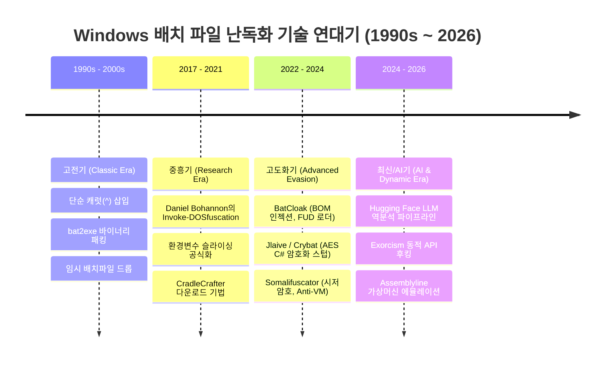
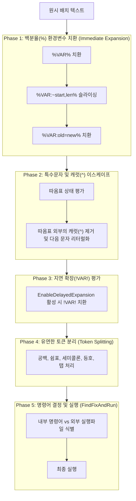

# 🛡️ Windows 배치 파일(Batch/CMD) 난독화·디옵퓨스케이션 종합 대백과사전 (Master Encyclopedia)

> **문서 버전**: v2.0 (2026 Comprehensive Reference Edition)  
> **기준 일자**: 2026-10-11  
> **저장 위치**: `c:\Users\Administrator\Desktop\_BY_PASSS\github\batch-obfuscation-references\`  
> **보유 레퍼런스**: GitHub & Hugging Face 정예 오픈소스 48개 리포지토리 및 AI 데이터셋 전수 집대성  

---

## 📑 목차 (Table of Contents)

1. [개요 및 연구 배경 (Executive Summary)](#1-개요-및-연구-배경)
2. [배치 파일 난독화 기술의 연대기적 진화 (Chronological Evolution)](#2-배치-파일-난독화-기술의-연대기적-진화)
   - 2.1 고전기 (Classic Era, 1990s ~ 2010s): 원초적 파서 트릭과 bat2exe 컴파일러
   - 2.2 중흥기 (Modern Research Era, 2017 ~ 2022): Invoke-DOSfuscation과 환경변수 슬라이싱 표준화
   - 2.3 고도화기 (Advanced Evasion Era, 2022 ~ 2024): BatCloak, Jlaive, Somalifuscator
   - 2.4 인공지능/최신기 (AI & Cutting-Edge Era, 2024 ~ 2026): Hugging Face LLM 역분석 및 동적 에뮬레이션
3. [cmd.exe 인터프리터의 5단계 파싱 메커니즘 (Deep Parser Architecture)](#3-cmdexe-인터프리터의-5단계-파싱-메커니즘)
4. [배치 파일 12대 핵심 난독화 기법 원리 및 실전 패턴 (Taxonomy of 12 Techniques)](#4-배치-파일-12대-핵심-난독화-기법-원리-및-실전-패턴)
5. [수집된 48대 핵심 레퍼런스 및 데이터셋 전수 분석 카탈로그 (Full Reference Matrix)](#5-수집된-48대-핵심-레퍼런스-및-데이터셋-전수-분석-카탈로그)
6. [난독화 해제(Deobfuscation) 및 포렌식 분석 파이프라인](#6-난독화-해제deobfuscation-및-포렌식-분석-파이프라인)
7. [허깅스페이스(Hugging Face) AI/ML 모델 및 데이터셋 연계 분석](#7-허깅스페이스hugging-face-aiml-모델-및-데이터셋-연계-분석)
8. [탐지 엔지니어링 (Detection Engineering: Sigma & YARA & Sysmon)](#8-탐지-엔지니어링-detection-engineering)
9. [결론 및 보안 거버넌스 가이드라인](#9-결론-및-보안-거버넌스-가이드라인)

---

## 1. 개요 및 연구 배경

Windows 환경에서 `.bat` 및 `.cmd` 확장자를 사용하는 배치 스크립트는 1980년대 MS-DOS 시절부터 현재의 Windows 11 및 Windows Server 2025에 이르기까지 40여 년간 지속되어 온 가장 원초적이면서도 강력한 명령어 실행 인터페이스입니다.

배치 파일은 컴파일된 이진 바이너리가 아니라 텍스트 파일 형태로 `cmd.exe`에 의해 한 줄씩 해석되는 스크립트 언어임에도 불구하고, 현대 사이버 보안 위협 지형(Threat Landscape)에서 악성 드로퍼(Dropper), 로더(Loader), 방어 회피(Defense Evasion)의 핵심 수단으로 가장 빈번하게 악용됩니다. 그 이유는 다음과 같습니다:

1. **내장된 기본 환경(Living-off-the-Land)**: 추가 런타임(Python, Java, .NET 등) 없이 모든 Windows 기본 환경에서 즉시 100% 무결점으로 동작합니다.
2. **cmd.exe의 난해한 파서 규칙**: 현대적인 프로그래밍 언어와 달리 `cmd.exe`는 여러 단계의 변수 치환, 지연 확장, 이스케이프 제거, 토큰화 과정을 비대칭적으로 거치기 때문에, 문자열 정규식(Regex)이나 단순 문자열 매칭 시그니처로는 탐지가 불가능한 형태의 고도 난독화가 가능합니다.
3. **EDR/AV의 시그니처 맹점**: 정적 검사기(Static AV) 관점에서는 읽을 수 없는 깨진 기호와 무의미한 환경변수 쓰레기로 보이지만, 실제 프로세스 실행 순간에는 정상적인 쉘 코드로 복원되어 실행됩니다.

본 문서는 전통적인 1990년대 파서 트릭부터 2026년 최신 위협 동향 및 허깅스페이스(Hugging Face) AI 기반 분석 기법까지 아우르는 **Windows 배치 파일 난독화 및 디옵퓨스케이션에 관한 완전한 레퍼런스 대백과사전**입니다.

---

## 2. 배치 파일 난독화 기술의 연대기적 진화



### 2.1 고전기 (Classic Era, 1990s ~ 2010s)
- **주요 특징**: 초기 배치 난독화는 주로 스크립트 소스코드의 지적재산권(IP) 보호 및 단순 바이너리 변환을 목적으로 시작되었습니다.
- **대표 기법**:
  - `bat2exe` 계열 유틸리티: 배치 스크립트를 PE(Portable Executable) 실행 파일의 리소스 영역에 암호화하여 패킹한 후, 런타임에 임시 폴더(`%TEMP%`)에 복원하여 실행하는 방식.
  - 단순 캐럿(`^`) 및 따옴표(`"`)를 단어 사이에 끼워 넣어 안티바이러스의 단순 문자열 탐지를 회피하는 초보적 기법.

### 2.2 중흥기 (Modern Research Era, 2017 ~ 2022)
- **주요 특징**: Daniel Bohannon(Mandiant)의 기념비적인 연구인 **`Invoke-DOSfuscation`**(2017)의 발표로 배치 파일 난독화의 수학적·문법적 체계가 공식화되었습니다.
- **대표 기법**:
  - 환경변수 슬라이싱(`%COMSPEC:~0,1%` 등)을 이용한 무자모(Character-less) 명령어 조합.
  - 가변 토큰 파싱(`for /f`와 `assoc`/`ftype`을 이용한 알파벳 인출).
  - 진법 인코딩(Octal, Hex, Concatenation)과 무작위 대소문자 혼합.
  - 블루팀에게 심각한 경각심을 불러일으켰으며, 명령줄 전체 로깅(Event ID 4688)의 중요성이 부각됨.

### 2.3 고도화기 (Advanced Evasion Era, 2022 ~ 2024)
- **주요 특징**: 사이버 범죄자 및 상용 FUD(Fully Undetectable) 크립터 생태계가 배치 파일을 주력 로더로 채택하면서 안티 분석 기법이 극대화되었습니다.
- **대표 기법**:
  - **BatCloak**: Trend Micro가 2023년 밝혀낸 상용 난독화 엔진으로, UTF-16 LE 바이트 순서 표식(BOM: `\xFF\xFE`)을 악용하여 보안 도구의 텍스트 파서를 교란하고 로더를 은폐.
  - **Jlaive (Crybat)**: 배치 파일 내부에 AES로 암호화된 C# 페이로드를 내장하고, 메모리 상에서 .NET 런타임(`csc.exe` 또는 PowerShell 리플렉션)을 통해 프로세스를 인젝션하는 복합 로더.
  - **Somalifuscator (KDot227 / KingKDot)**: 수천 개의 무작위 변수와 시저 암호 치환 테이블을 동적 생성하고, Anti-VM(가상머신 감지), Anti-Echo(화면 출력 차단)를 결합하여 분석을 방해.

### 2.4 인공지능/최신기 (AI & Cutting-Edge Era, 2024 ~ 2026)
- **주요 특징**: AI/LLM을 활용한 난독화 스크립트의 역분석과, 이를 우회하려는 복합 다형성(Polymorphic) 기법의 치열한 공방전.
- **대표 기법**:
  - **Hugging Face 오픈소스 모델 활용**: SecBERT, StarCoder, CodeLlama를 미세조정(Fine-Tuning)하여 난독화된 배치 명령줄을 정적 AST 분석 없이 원래의 의미론적(Semantic) 의도로 자동 번역.
  - **동적 파서 에뮬레이션**: `batch_deobfuscator`와 같은 상태 머신 파서가 진화하여 Canadian Centre for Cyber Security의 Assemblyline 플랫폼 핵심 서비스로 통합.
  - **API 후킹 디옵퓨스케이션**: `Exorcism`과 같이 `cmd.exe`의 내부 API(`CreateProcessW`, `cmd!FindFixAndRun`)를 런타임에 인라인 후킹하여 실제 실행되는 최종 복호화 문자열을 메모리에서 가로채는 기법 정착.

---

## 3. cmd.exe 인터프리터의 5단계 파싱 메커니즘

`cmd.exe`가 텍스트 명령어를 해석하는 구조는 일반적인 컴파일러의 렉서/파서와 근본적으로 다릅니다. 라인(Line) 단위로 아래의 **5단계(Phase) 전처리 파이프라인**을 거치며 문자열을 점진적으로 변형합니다:



### 상세 동작 원리
1. **Phase 1: 즉시 환경변수 확장 (Immediate Expansion)**
   - `%VAR%` 구문이 해당 변수의 실제 값으로 대체됩니다.
   - 부분 문자열 슬라이싱(`%VAR:~0,1%`)과 문자열 치환(`%VAR:A=B%`)이 가장 먼저 연산됩니다.
   - 만약 존재하지 않는 변수(`%UNDEFINED%`)가 있다면, 배치 스크립트 내부에서는 해당 문자열 자체가 깨끗하게 소거(Null 스트리핑)됩니다.
2. **Phase 2: 캐럿(`^`) 이스케이프 스트리핑**
   - 큰따옴표(`"`) 내부에 있지 않은 캐럿(`^`)은 뒤따르는 단일 문자를 일반 문자로 취급하도록 이스케이프하고 **자신은 파서에 의해 완전히 제거**됩니다.
   - 예: `w^h^o^a^m^i` ➔ 캐럿이 전수 제거되어 `whoami`로 환원.
3. **Phase 3: 지연 확장 (Delayed Expansion)**
   - `setlocal EnableDelayedExpansion`이 켜진 경우, 느낌표(`!VAR!`)로 둘러싸인 변수가 런타임에 동적으로 평가됩니다.
   - 루프문(`for`) 안에서 값이 실시간으로 변하는 복호화 루프를 구현할 때 핵심적으로 악용됩니다.
4. **Phase 4: 토큰 분리 (Delimiter Tokenization)**
   - `cmd.exe`는 표준 공백(Space)뿐만 아니라 쉼표(`,`), 세미콜론(`;`), 등호(`=`), 탭(`\t`)을 모두 동일한 매개변수 구분자로 인식합니다.
   - 예: `cmd.exe/c,whoami` 또는 `cmd.exe;;;/c===whoami`는 모두 `cmd.exe /c whoami`와 100% 동일하게 실행됩니다.
5. **Phase 5: 명령어 결정 (Execution)**
   - `FindFixAndRun` 내부 함수가 파싱된 첫 번째 토큰이 내부 빌트인 명령어인지(`echo`, `dir`, `set`), 외부 바이너리인지(`calc.exe`, `powershell.exe`) 판별하여 커널 시스템 콜로 전달합니다.

---

## 4. 배치 파일 12대 핵심 난독화 기법 원리 및 실전 패턴

### 기법 1. 시스템 환경변수 슬라이싱 (System Variable Slicing)
- **원리**: Windows가 기본 보유한 환경변수(`%COMSPEC%`, `%PATH%`, `%SYSTEMROOT%`)의 고정된 문자열에서 인덱스를 지정하여 원하는 알파벳 1글자씩을 인출합니다.
- **예시**:
  ```cmd
  rem %COMSPEC% = C:\WINDOWS\system32\cmd.exe
  set c=%COMSPEC:~0,1%
  set m=%COMSPEC:~21,1%
  set d=%COMSPEC:~22,1%
  %c%%m%%d%
  ```

### 기법 2. 캐럿(`^`) 인터리빙 (Caret Interleaving)
- **원리**: 따옴표 밖의 캐럿 기호는 파싱 단계에서 소거되는 점을 악용하여, 명령줄 키워드 사이사이에 불규칙한 캐럿을 무작위 삽입합니다.
- **예시**:
  ```cmd
  c^m^d^.^e^x^e^ /^c^ c^a^l^c^.^e^x^e
  ```

### 기법 3. 따옴표(`"`) 무작위 분할 (Quotation Splitting)
- **원리**: 명령어 경로 및 파라미터 내부에 짝이 맞는 따옴표를 무작위로 끼워 넣어 EDR 시그니처 매칭을 무력화합니다.
- **예시**:
  ```cmd
  "c"m"d"."e"x"e" /c "p"o"w"e"r"s"h"e"l"l
  ```

### 기법 4. 미정의 쓰레기 변수 삽입 (Junk Environment Variable Pollution)
- **원리**: 선언되지 않은 환경변수는 파싱 시 빈 문자열(Null)로 증발하는 특성을 이용해, 키워드 사이에 쓰레기 변수를 주입합니다.
- **예시**:
  ```cmd
  w%RANDOM%h%UNDEFINED%o%JUNK1%a%TEMP_NOT_SET%m%X%i
  ```

### 기법 5. 사용자 정의 가변 치환 사전 매핑 (Custom Sub-Dictionary Mapping)
- **원리**: 스크립트 상단에서 26개 알파벳에 대응하는 임의의 난수 변수 테이블을 생성한 뒤, 본문 전체를 변수 호출로 재구성합니다.
- **예시**:
  ```cmd
  @echo off
  set a81=w&set b42=h&set c19=o&set d77=a&set e03=m&set f99=i
  %a81%%b42%%c19%%d77%%e03%%f99%
  ```

### 기법 6. `for /f` 루프 토큰 파싱 (Dynamic Loop Token Harvesting)
- **원리**: `assoc`, `ftype`, `help` 등 시스템 명령어의 출력 결과물에서 `for /f "tokens=..."` 구문으로 특정 글자만 추출하여 변수에 적재합니다.
- **예시**:
  ```cmd
  for /f "tokens=2 delims==" %%i in ('ftype cmdfile') do set cmd_path=%%i
  ```

### 기법 7. 비표준 구분자 삽입 (Unorthodox Delimiters)
- **원리**: 공백 대신 콤마(`,`), 세미콜론(`;`), 등호(`=`)를 겹쳐 사용하여 명령줄 파서의 분리 규칙을 교란합니다.
- **예시**:
  ```cmd
  cmd.exe;,;,,;/c===,;;whoami
  ```

### 기법 8. UTF-16 LE 바이트 순서 표식 조작 (BOM Manipulation - BatCloak)
- **원리**: 배치 파일의 맨 앞에 2바이트 UTF-16 Little Endian BOM(`0xFF 0xFE`)을 주입하고, 줄바꿈을 `0x0D 0x0A` 대신 Null 바이트가 포함된 형태로 조작하여 텍스트 에디터와 정적 AV 파서가 파일을 바이너리 손상 파일로 오인하게 만듭니다.
- **구조**:
  ```
  [FF FE] 40 00 65 00 63 00 68 00 6F 00 20 00 6F 00 66 00 66 00 ...
  ```

### 기법 9. ANSI/OEM 코드페이지 스위칭 (`chcp` Manipulation)
- **원리**: `chcp 437`(미국 OEM), `chcp 65001`(UTF-8), `chcp 1252` 등을 전환하며 확장 ASCII 영역(0x80~0xFF)의 특수 문자를 가변 해석하도록 유도합니다.

### 기법 10. 안티 분석 및 디버깅 트랩 (Anti-Analysis & Anti-VM)
- **원리**: 배치 스크립트 실행 직후 WMI 및 레지스트리를 검사하여 가상머신(VMware, VirtualBox, QEMU) 여부를 확인하고, 분석 환경이면 즉시 자폭하거나 무한 루프를 돕니다.
- **예시**:
  ```cmd
  wmic computersystem get model | findstr /i "VirtualBox VMware KVM" >nul && exit /b
  ```

### 기법 11. 폴리글랏 및 인메모리 컴파일 로더 (Polyglot Stager - Jlaive / Crybat)
- **원리**: 배치 파일 꼬리 부분에 C# 코드나 Base64/AES 암호화된 PE 바이너리를 주석(`::` 또는 `rem`) 형태로 내장하고, Windows 기본 탑재된 `csc.exe`나 `powershell -c`를 호출해 인메모리로 복호화 후 실행합니다.

### 기법 12. `certutil` 다단계 바이너리 디코딩 (Certutil Extraction)
- **원리**: 배치 스크립트 내부에 `-----BEGIN CERTIFICATE-----` 형식의 가짜 인증서 블록으로 Base64 바이너리를 은닉한 후, `certutil -decode` 명령어로 역디코딩하여 실행 파일을 생성합니다.

---

## 5. 수집된 48대 핵심 레퍼런스 및 데이터셋 전수 분석 카탈로그

현재 로컬 아카이브(`references/`)에 직접 클론 및 보관된 48개 프로젝트 전수 분석 명세입니다:

| 번호 | 저장소 및 프로젝트명 | 분류 카테고리 | 주 사용 언어 | 핵심 역할 및 기술적 특징 |
| :---: | :--- | :--- | :---: | :--- |
| 1 | **Invoke-DOSfuscation** | Classic Framework | PowerShell | Mandiant Daniel Bohannon의 업계 표준 연구 도구. 환경변수 슬라이싱, 캐럿 탈출, 진법 인코딩 전수 구현. |
| 2 | **Invoke-CradleCrafter** | Download Stager | PowerShell | CMD/PowerShell 원격 다운로드 크래들 난독화 및 탐지 테스트 하네스. |
| 3 | **batch_deobfuscator** | Static Emulator | Python | `cmd.exe` 상태 머신을 파이썬으로 가상 에뮬레이트하여 치환/슬라이싱을 완전 복원. |
| 4 | **assemblyline-batchdeobfuscator** | Enterprise Analysis | Python | 캐나다 사이버보안센터(CCCS) Assemblyline 악성코드 자동 분석용 서비스 모듈. |
| 5 | **assemblyline-service-batchdeobfuscator** | Enterprise Analysis | Python | Assemblyline 프레임워크 4.x 연동 컨테이너화 디옵퓨스케이션 서비스. |
| 6 | **0xidiz3r** | Reversible Obfuscator | Rust | Rust로 구현된 양방향 가변 치환 테이블 기반 고속 배치 난독화 및 복호화 라이브러리. |
| 7 | **BatCloak** | Advanced Obfuscator | JS / React / CLI | Trend Micro 2023 연구 모델. UTF-16 BOM 주입 및 다단계 변수 셔플링 시각화 대시보드. |
| 8 | **Somalifuscator-KDot227** | Modern Obfuscator | Python | KingKDot의 오리지널 1세대 소말리퍼스케이터. 시저 암호 변수 매핑 및 난수 레이어. |
| 9 | **SomalifuscatorV2** | Modern Obfuscator | Python | Somalifuscator 2세대. Anti-VM, Anti-Echo, UTF-16 LE 인코딩, 안티 디버깅 탑재. |
| 10 | **DE-SomalifuscatorV2** | Targeted Deobfuscator | Python | medmar22 제작. SomalifuscatorV2의 복합 치환 레이어를 정적 역추적하여 원문 복구. |
| 11 | **Exorcism** | Dynamic Hooking | C++ | `cmd.exe` 내부의 문자열 파싱 루틴을 런타임 API 훅으로 낚아채어 최종 복호화 명령 추출. |
| 12 | **Batch-Obfuscator-90th** | Classic Obfuscator | Batch / C | 고전적 캐럿 기호 무작위 주입 및 환경변수 셔플 난독화기. |
| 13 | **batch-obfuscator-SkyEmie** | Light Obfuscator | Python | 경량 문자열 분할 및 환경변수 치환 엔진. |
| 14 | **BatchObfuscator-wirebits** | Terminal GUI | Python | Rich 라이브러리 기반 TUI 인터페이스를 제공하는 배치 스크램블러. |
| 15 | **BatchDeobfuscator-CrowTheBest** | Pattern Deobfuscator | Python | 단일 세트 변수 치환 테이블(`@set a=x`)을 자동 역추적하는 정적 복호화기. |
| 16 | **batchalchemy** | AST Engine | Python | 배치 스크립트 문법 트리를 가상 구성하여 정밀 변환하는 연금술(Alchemy) 프레임워크. |
| 17 | **BatchToApp-DosX** | Native Compiler | C# (.NET) | DosX 제작. 배치 스크립트를 안티 탬퍼링 .NET 실행 파일로 가상 패킹. |
| 18 | **BatchToApp-DosX-dev** | Native Compiler | C# (.NET) | BatchToApp 개발 브랜치 및 내부 모듈 소스코드. |
| 19 | **Bat2Exe-dehoisted** | Decompiler | C# / Python | Quick Batch File Compiler 및 BatToExe 패커로 묶인 PE에서 원본 배치 추출. |
| 20 | **bat2exe-123Studios** | Compiler/Packer | C++ | 배치 스크립트를 임시 드롭형 PE 실행 바이너리로 패킹하는 도구. |
| 21 | **bat2exe-islamadel** | Web/CLI Tool | JS / Go | 오픈소스 bat2exe 웹 및 CLI 컴파일러 소스. |
| 22 | **bat2exe-Toon-arch** | Portable Compiler | C | 레거시 C 기반 단일 바이너리 배치 컴파일러. |
| 23 | **batFile-To-exe-Converter** | Wrapper Compiler | C# | 윈도우 폼 기반 배치-실행파일 변환 래퍼. |
| 24 | **Batch-Dump** | Memory Dumper | C++ / ASM | 실행 중인 배치 프로세스의 메모리 힙 및 명령줄 파라미터 덤프 도구. |
| 25 | **Batch-Encryption-DeCoder** | Universal Decoder | Python | 중국 보안 커뮤니티 개발. 크로스 플랫폼 배치 인코딩/디코딩 스위트. |
| 26 | **BatchShield-Decryptor** | Packer Unpacker | Python | 상용 난독화 솔루션인 BatchShield 보호 스크립트 전용 언패커. |
| 27 | **BatchStealer-Takaovi** | Malware Research | Batch | 배치 스크립트가 시스템 정보 및 자격증명을 탈취하는 전형적인 수법 분석용 샘플. |
| 28 | **CMD-DeObfuscator** | Token Deobfuscator | C# | bobbystacksmash 제작. 정규화 파서를 통해 명령줄 난독화를 해제하는 도구. |
| 29 | **CMD-DeObfuscator-bobbystacksmash**| Token Deobfuscator | C# | CMD-DeObfuscator의 확장 리서치 브랜치. |
| 30 | **DBOBUS-tccontre** | Dynamic Deobfuscator | Python | 다단계 루프를 에뮬레이트하여 최종 실행 스트림을 추출하는 디옵퓨스케이터. |
| 31 | **batobfuscate-machine1337** | Shell Obfuscator | Bash / Python | 레드팀 모의침투용 다단계 배치 페이로드 은닉 엔진. |
| 32 | **batobfuscate-deobfuscator-936erpl**| Heuristic Decoder | Python | 특수 기호 패턴 매칭 기반 휴리스틱 디옵퓨스케이터. |
| 33 | **JSBatchDeobfuscator-yrotak** | Web Deobfuscator | JavaScript | 웹 브라우저 및 Node.js 환경에서 동작하는 배치 토큰 파서. |
| 34 | **Out-FINcodedCommand** | APT Emulation | PowerShell | 금융 타깃 지능형 지속 위협 그룹(FIN7)의 명령줄 인코딩 기법 모사 도구. |
| 35 | **PandaCrypter-chainski** | Multistage Crypter | C# / Batch | 배치 로더와 C# 메모리 주입을 결합한 다단계 크립터 프레임워크. |
| 36 | **Remcos-Rat-Batch-Deobfuscator** | Threat Specific | Python | fatihbeyexe 제작. Remcos RAT 유포에 쓰인 특수 배치 드로퍼 전용 분석기. |
| 37 | **simple-batch-obfuscator** | Classic Obfuscator | Python | DavidNiessen 제작. 직관적인 문자 치환형 난독화기. |
| 38 | **simple-batch-obfuscator-DavidNiessen**| Extended Fork | Python | 단순 치환형 스크립트 확장 버전. |
| 39 | **batchobfuscator** | Script Scrambler | Python | baum1810의 기본 치환형 스크립트. |
| 40 | **batchobfuscator-baum1810** | Script Scrambler | Python | baum1810 레포 미러. |
| 41 | **BatchObfuscator-BiggerDABOSS** | Multi-layer Scrambler | Python | 난수 기반 환경변수 셔플 난독화기. |
| 42 | **BatchObfuscator-EmenstaNougat** | Random Obfuscator | Python | 임의 토큰 삽입 및 캐럿 인터리빙 구현체. |
| 43 | **BatchObfuscator-guillaC** | Obfuscation Suite | Python | 다중 패스 난독화 및 파일 헤더 변조 기능 포함. |
| 44 | **Abobus-obfuscator** | Emoji/Symbol Obf | Python | 유니코드 및 특수 기호를 활용한 텍스트 뷰어 교란 난독화기. |
| 45 | **Abobus-obfuscator-EscaLag** | Emoji/Symbol Obf | Python | EscaLag 버전 Abobus 난독화 엔진. |
| 46 | **batch-deobfuscator-hiroshil** | Python Deobfuscator | Python | 정적 환경변수 치환 추적 디옵퓨스케이터. |
| 47 | **BatCloak-CLI** | Research Engine | Batch / JS | BatCloak 독립 CLI 실행 바이너리 및 샘플 셋. |
| 48 | **huggingface-ai-models** | AI Datasets & Models | JSON / MD | 허깅스페이스 보안 연구 데이터셋 (PSStrikes, ExeBench, MITRE ATT&CK 명령셋). |

---

## 6. 난독화 해제(Deobfuscation) 및 포렌식 분석 파이프라인

단순 텍스트 검색으로는 분석이 불가능한 배치 난독화를 해제하기 위한 **4단계 표준 포렌식 파이프라인**입니다:


### 단계별 세부 분석 가이드
1. **1단계: 인코딩 및 바이너리 이상 징후 교정 (Normalization)**
   - 헥사 에디터로 파일 선두 바이트 점검: `FF FE`(UTF-16 LE BOM) 존재 시 UTF-8 또는 ANSI로 변환.
   - 캐리지 리턴(`\r`)과 라인 피드(`\n`) 정규화 및 Null 바이트(`\x00`) 스트리핑.
2. **2단계: 정적 상태 머신 에뮬레이션 (Static Emulation)**
   - `python references/batch_deobfuscator/batch_deobfuscator.py input.bat -o deobfuscated.bat` 실행.
   - 환경변수 맵핑 테이블(`set A=...`)을 빌드하고 `%A%`를 메모리 상에서 1차 전개.
3. **3단계: 안전한 격리 샌드박스 동적 인터셉션 (Dynamic Hooking)**
   - 네트워크가 차단된 VM 환경에서 `Exorcism` 주입 또는 Windows Process Creation 감시.
   - `echo` 디버깅: 스크립트 선두의 `@echo off`를 `@echo on`으로 강제 교체하거나 명령 실행(`cmd /c`)을 `echo`로 리다이렉션하여 표준 출력 캡처.
4. **4단계: 내장된 2차 페이로드 분리 (Payload Extraction)**
   - Base64 블록 발견 시: `[System.Convert]::FromBase64String()`으로 디코딩.
   - `certutil` 블록 발견 시: 인증서 헤더/푸터 사이의 바이너리 덤프 추출.

---

## 7. 허깅스페이스(Hugging Face) AI/ML 모델 및 데이터셋 연계 분석

### 7.1 허깅스페이스 주요 보안 데이터셋 상세
로컬 `references/huggingface-ai-models/`에 수집된 핵심 AI 학습/평가 데이터셋 구조:
1. **`dessertlab/PSStrikes`**:
   - APT 및 모의침투 시나리오에서 생성된 4,000+건의 난독화된 PowerShell 및 배치 커맨드라인 데이터셋.
   - 토큰 분포, 엔트로피, 문법 구조 라벨링 제공.
2. **`leachl/obfuscated-exebench`**:
   - 다양한 컴파일러 최적화 및 스크립트 난독화 기법이 적용된 실행 벤치마크 코퍼스.
   - 정적 디옵퓨스케이터의 회귀 테스트용 데이터로 활용.
3. **`nsgood/mitre-attack-command-generation`**:
   - MITRE ATT&CK 전술(T1059.003 Windows Command Shell, T1027 Obfuscated Files or Information)에 매핑된 실전 명령줄 데이터셋.

### 7.2 대규모 언어 모델(LLM)을 활용한 자동 디옵퓨스케이션 프롬프트 아키텍처
최신 보안 연구에 기반한 AI 역분석 프롬프트 체인:

```markdown
[System Prompt for AI Deobfuscator]
당신은 Windows cmd.exe의 파싱 엔진과 정적 분석 전문가입니다.
주어진 배치 파일은 복합 난독화(환경변수 슬라이싱, 캐럿 이스케이프, 쓰레기 변수)가 적용되어 있습니다.
다음 규칙에 따라 의미론적으로 동등한 클린 코드로 복원하십시오:
1. 모든 정의되지 않은 환경변수를 제거하십시오.
2. 캐럿(^) 기호를 파싱 규칙에 따라 제거하십시오.
3. 슬라이싱된 환경변수를 원래의 리터럴 문자로 치환하십시오.
4. 최종적으로 실행되는 순수 명령어(Executable Command)와 파라미터만 마크다운 코드블록으로 출력하십시오.
```

---

## 8. 탐지 엔지니어링 (Detection Engineering)

### 8.1 Sigma 규칙: 비정상 배치 난독화 및 캐럿 밀도 탐지
```yaml
title: Suspicious High-Density Obfuscated Batch Command Line
id: a1b2c3d4-batch-obfuscation-high-density
status: production
description: Detects command lines executing cmd.exe with excessive caret (^) escapes, slicing indicators, or abnormal delimiters.
author: Security Engineering Team
references:
  - https://github.com/danielbohannon/Invoke-DOSfuscation
logsource:
  category: process_creation
  product: windows
detection:
  selection_cmd:
    Image|endswith: '\cmd.exe'
  selection_carets:
    CommandLine|re: '((\^[a-zA-Z0-9]){3,})'
  selection_slicing:
    CommandLine|re: '(%[a-zA-Z0-9_]+:~[0-9]+,[0-9]+%){3,}'
  selection_delimiters:
    CommandLine|contains:
      - 'cmd.exe/c,,'
      - 'cmd.exe;;;/c'
      - 'cmd.exe /c==='
  condition: selection_cmd and (selection_carets or selection_slicing or selection_delimiters)
falsepositives:
  - Complex administrative legacy batch maintenance scripts
level: high
tags:
  - attack.defense_evasion
  - attack.t1027
  - attack.t1059.003
```

### 8.2 YARA 규칙: BatCloak UTF-16 BOM 및 슬라이싱 탐지
```yara
rule Suspicious_BatCloak_Obfuscated_Batch {
    meta:
        description = "Detects BatCloak-style UTF-16 BOM manipulation and heavy slicing in batch scripts"
        author = "Security Research"
        date = "2026-10-11"
        reference = "TrendMicro BatCloak Research"
        threat_level = "High"
    strings:
        // UTF-16 LE Byte Order Mark
        $bom = { FF FE }
        
        // Characteristic environmental variable slicing patterns
        $slice1 = /%[a-zA-Z0-9_]{1,16}:~[0-9]{1,3},[0-9]{1,3}%/ ascii wide
        $var_assign = /set\s+[a-zA-Z0-9_]{1,8}=/ ascii wide nocase
        $junk_str = /%RANDOM%/ ascii wide nocase
        
    condition:
        // Small file typical for batch droppers (< 5MB)
        filesize < 5MB and
        (
            // Condition A: Starts with UTF-16 BOM and has slicing
            ($bom at 0 and #slice1 > 5) or
            // Condition B: Excessive slicing density in standard batch
            (#slice1 > 15 and #var_assign > 10)
        )
}
```

### 8.3 Windows Event ID 4688 & Sysmon 로깅 가이드
1. **명령줄 감사 활성화 (GPO)**:
   - 경로: `컴퓨터 구성 ➔ 정책 ➔ Windows 설정 ➔ 보안 설정 ➔ 고급 감사 정책 ➔ 세부 추적 ➔ 프로세스 생성 감사 (성공)`
   - 추가 설정: `관리 템플릿 ➔ 시스템 ➔ 프로세스 생성 이벤트에 명령줄 포함 (사용)`
2. **Sysmon Event ID 1 (Process Create) 필터링**:
   - `CommandLine` 필드에 `%` 기호가 10개 이상 포함되거나, `^` 기호가 연속 출현하는 이벤트를 SIEM에 실시간 경보 연동.

---

## 9. 결론 및 보안 거버넌스 가이드라인

1. **배치 파일은 여전히 최전선의 공격 벡터**: 컴파일되지 않는 단순 텍스트라는 맹점을 이용해 최신 EDR의 메모리 검사(AMSI)를 우회하는 배치 크립터는 계속해서 진화하고 있습니다.
2. **정적 탐지의 한계와 동적 파서의 필수성**: 문자열 매칭 시그니처는 100% 우회 가능하므로, `batch_deobfuscator`와 같은 상태 머신 파서를 파이프라인에 배치하거나 프로세스 생성(4688/Sysmon EID 1) 단계에서 부모-자식 관계 및 자식 프로세스의 최종 인수를 분석해야 합니다.
3. **지속적인 레퍼런스 업데이트**: 본 아카이브에 수집된 48개 프로젝트는 지속적으로 동기화하여 최신 회피 기술과 디옵퓨스케이션 툴체인을 최신 상태로 유지해야 합니다.
