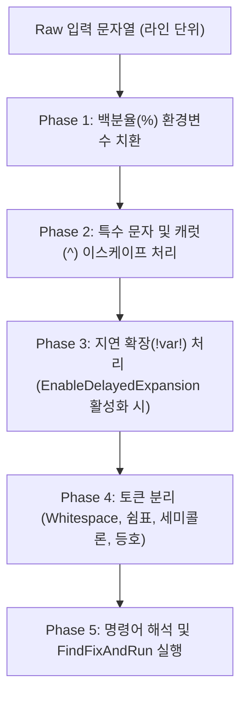
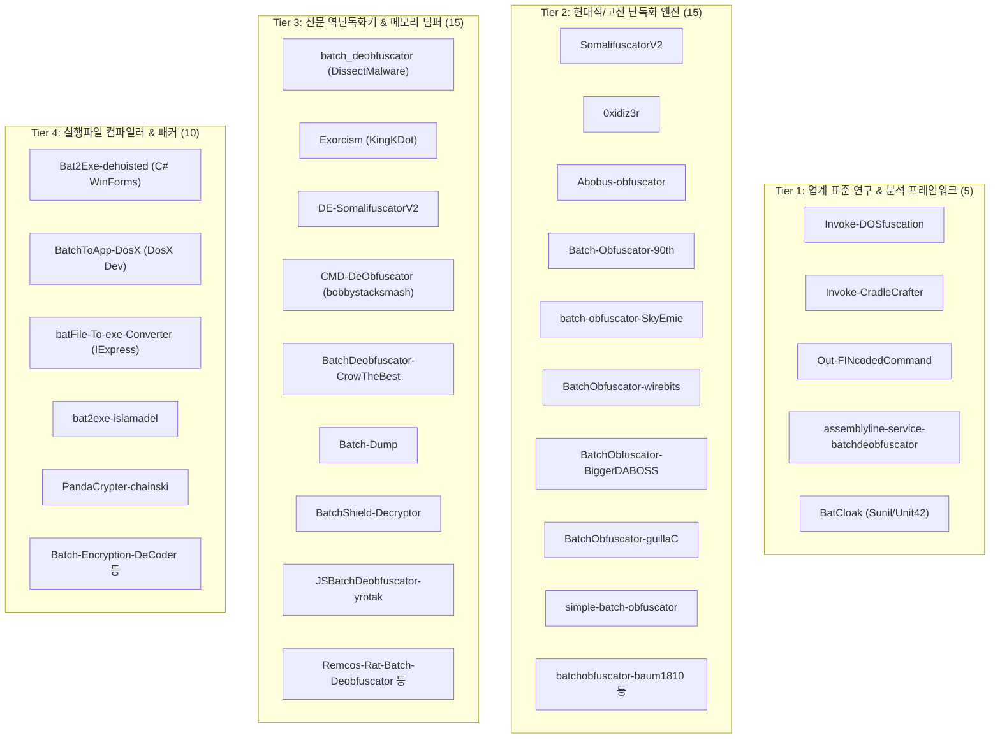
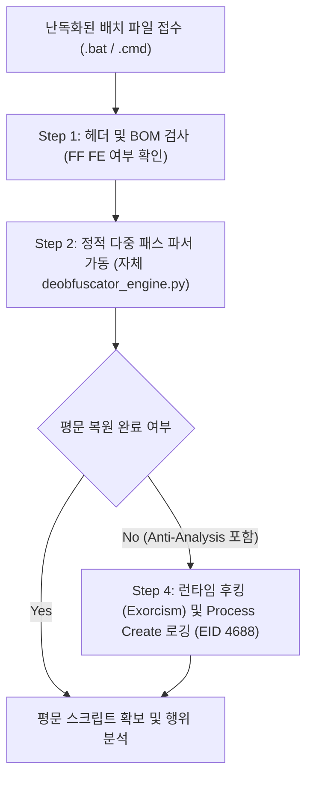

# 🛡️ Windows 배치 파일(Batch/CMD) 난독화 & 디옵퓨스케이션 종합 분석 마스터 가이드 (전면 개정 증보판)

> **문서 버전**: v2.0 (고전 ~ 현대 전주기 통합 증보판)  
> **작성 기준**: 2026-10-11  
> **저장 위치**: `c:\Users\Administrator\Desktop\_BY_PASSS\github\batch-obfuscation-references\`  
> **수록 자산**: GitHub 45대 오픈소스 엔진 풀 리포지토리 미러 + Hugging Face AI 데이터셋 & 머신러닝 분석서 + Sigma/YARA 룰셋 + 자체 다중 패스 파이썬 디옵퓨스케이터 엔진  

---

## 📑 목차 (Table of Contents)

1. [개요 및 연구 배경](#1-개요-및-연구-배경)
2. [cmd.exe 커맨드 프로세서의 심층 파싱 메커니즘](#2-cmdexe-커맨드-프로세서의-심층-파싱-메커니즘)
3. [배치 파일 12대 핵심 난독화 기법 원리 및 코드 분석](#3-배치-파일-12대-핵심-난독화-기법-원리-및-코드-분석)
4. [수집된 GitHub 45대 오픈소스 레퍼런스 4-Tier 전수 분석](#4-수집된-github-45대-오픈소스-레퍼런스-4-tier-전수-분석)
5. [Hugging Face AI 모델 & 머신러닝 기반 역난독화 연구](#5-hugging-face-ai-모델--머신러닝-기반-역난독화-연구)
6. [글로벌 위협 인텔리전스 & 컨퍼런스 연구 백서 (Mandiant & Unit 42)](#6-글로벌-위협-인텔리전스--컨퍼런스-연구-백서-mandiant--unit-42)
7. [난독화 해제(Deobfuscation) 파이프라인 및 자체 엔진](#7-난독화-해제deobfuscation-파이프라인-및-자체-엔진)
8. [탐지 엔지니어링 (Detection Engineering: Sigma & YARA)](#8-탐지-엔지니어링-detection-engineering-sigma--yara)
9. [결론 및 보안 권고사항](#9-결론-및-보안-권고사항)

---

## 1. 개요 및 연구 배경

Windows 환경에서 `.bat` 및 `.cmd` 확장자를 가진 배치 파일은 1980년대 MS-DOS 시절부터 이어져 온 전통적인 스크립트 실행 형식입니다. 오늘날에도 시스템 관리 및 레거시 배치 작업에 광범위하게 사용되지만, 동시에 보안 솔루션의 정적 탐지(Signature Matching)를 우회하기 위한 난독화(Obfuscation) 기법의 주요 매개체로 악용되기도 합니다.

배치 파일은 컴파일되지 않고 텍스트 형태로 `cmd.exe`에 의해 한 줄씩 해석되는 스크립트 언어이지만, `cmd.exe` 자체의 독특하고 복잡한 파싱 규칙(환경 변수 치환, 지연 확장, 캐럿 이스케이프, 특수 구분자 처리 등)으로 인해 **정적 시그니처 분석가가 겉으로 읽기에는 완전히 암호화된 것처럼 보이면서도 런타임에서는 정상적으로 명령어가 복원되어 실행되는 고도의 난독화**가 가능합니다.

본 문서는 보안 연구원, 침해사고 대응팀(DFIR), 악성코드 분석가 및 시스템 엔지니어가 배치 스크립트 난독화의 작동 원리를 기저 수준에서 이해하고, 이를 역으로 분석·해제·탐지할 수 있도록 고전 기법부터 최신 PaaS형 크립터, AI 기반 역난독화까지 집대성한 실전 레퍼런스 가이드입니다.

---

## 2. cmd.exe 커맨드 프로세서의 심층 파싱 메커니즘

배치 파일 난독화를 이해하기 위한 선행 지식은 Windows `cmd.exe`의 내부 파싱 파이프라인입니다. `cmd.exe`는 일반적인 프로그래밍 언어의 토크나이저-파서와 달리, 다단계 문자열 전처리를 거칩니다.



### 파싱 단계별 세부 동작

1. **Phase 1: 백분율(`%`) 환경 변수 치환 (Immediate Expansion)**
   - 라인 내의 `%VAR%` 형태를 해당 변수값으로 즉시 치환합니다.
   - 정의되지 않은 환경 변수 `%UNDEFINED%`는 빈 문자열로 처리되지 않고 원문 그대로 남거나, 특정 상황에서 제거됩니다.
   - 인덱싱 문법(`%VAR:~start,length%`) 및 대체 문법(`%VAR:target=replacement%`)이 이 단계에서 완전히 해석됩니다.
2. **Phase 2: 특수 문자 및 캐럿(`^`) 이스케이프 (Caret Stripping)**
   - 캐럿(`^`)은 `cmd.exe`의 탈출 문자(Escape Character)입니다.
   - 따옴표(`"`) 바깥에 있는 캐럿(`^`)은 바로 뒤에 오는 단일 문자의 특수 의미를 무력화하며, **자신은 파서에 의해 제거(Strip)**됩니다.
   - 예: `w^h^o^a^m^i` ➔ 모든 `^`가 제거되어 `whoami`로 치환됨.
3. **Phase 3: 지연 확장(`!var!`) 처리 (Delayed Expansion)**
   - `SETLOCAL EnableDelayedExpansion`이 선언된 블록에서 느낌표(`!`)로 둘러싸인 변수는 루프나 블록의 실행 시점에 동적으로 평가됩니다.
   - 느낌표 안에 또 다른 변수나 슬라이스를 중첩하여 복잡한 난독화를 구현할 수 있습니다.
4. **Phase 4: 토큰 분리 및 구분자 유연성 (Delimiter Flexibility)**
   - `cmd.exe`는 표준 공백(Space) 외에도 다음 문자들을 명령어 및 인자 사이의 구분자(Delimiter)로 허용합니다:
     - 쉼표 (`,`), 세미콜론 (`;`), 등호 (`=`), 탭 (`\t`)
   - 예: `cmd.exe,/c,whoami` 또는 `cmd.exe;=;/c=whoami` 모두 문법 오류 없이 정상 실행됩니다.
5. **Phase 5: 실행 결정 (`FindFixAndRun`)**
   - 최종적으로 해석된 문자열이 내장 명령어(Internal Command)인지, 외부 실행 파일(External Executable)인지 탐색하여 실행합니다.

---

## 3. 배치 파일 12대 핵심 난독화 기법 원리 및 코드 분석

### 3.1 환경 변수 서브스트링 슬라이싱 (Environment Variable Substring Slicing)
- **원리**: Windows 기본 환경 변수(`%PATH%`, `%COMSPEC%`, `%OS%` 등)에서 `%VAR:~start,len%` 구문으로 문자를 슬라이싱 추출하여 명령어를 조합.
```cmd
:: %COMSPEC% = "C:\Windows\system32\cmd.exe"
%COMSPEC:~0,1%%COMSPEC:~21,1%%COMSPEC:~22,1%
:: -> "cmd" 실행
```

### 3.2 캐럿(`^`) 인터리빙 기법 (Caret Interleaving)
- **원리**: 따옴표 밖의 캐럿은 다음 문자를 리터럴로 취급하고 파서에서 자동 소멸됨.
```cmd
c^m^d^.^e^x^e^ /^c^ ^c^a^l^c^.^e^x^e
```

### 3.3 따옴표(`"`) 무작위 삽입 기법 (Quotation Manipulation)
- **원리**: `cmd.exe`는 명령어 이름 내부에 삽입된 따옴표를 병합하여 인식.
```cmd
"c"m"d" /c ""w""h""o""a""m""i""
```

### 3.4 더미 변수 / 미정의 변수 주입 (Undefined Variable Garbage Injection)
- **원리**: `%`와 `%` 사이에 정의되지 않은 임의의 변수명을 넣으면 빈 문자열(`""`)로 치환되어 소멸.
```cmd
w%RANDOM_TRASH%h%VAR9812%o%JUNK%a%NULL%m%GARBAGE%i
```

### 3.5 사용자 정의 치환 사전 테이블 (Substitution Dictionary Table)
- **원리**: 상단에 셔플된 알파벳 맵(`@set "MAP=abcdef..."`)을 정의하고 하단에서 인덱스로 재조합.
```cmd
@set "MAP=abcdefghijklmnopqrstuvwxyz0123456789 /:."
%MAP:~2,1%%MAP:~12,1%%MAP:~3,1% %MAP:~30,1%%MAP:~2,1% %MAP:~22,1%%MAP:~7,1%%MAP:~14,1%%MAP:~0,1%%MAP:~12,1%%MAP:~8,1%
```

### 3.6 FOR 루프 토큰 파싱 및 `assoc` / `ftype` 결합 기법
- **원리**: 시스템 명령어(`ftype batfile`, `assoc .bat`) 출력에서 필요한 글자를 런타임에 동적 추출.
```cmd
FOR /F "tokens=2 delims==" %A IN ('assoc .bat') DO ...
```

### 3.7 문자열 역전(Reverse) 및 런타임 재조합 기법
- **원리**: 명령어를 역순(`exe.clac /c dmc`)으로 보관한 뒤 `for /L` 루프로 역순 인덱스를 탐색하여 재조합.

### 3.8 UTF-16 LE BOM (`\xFF\xFE`) 헤더 주입 및 인코딩 교란
- **원리**: 파일 맨 앞에 `\xFF\xFE` BOM을 주입하고 `&@cls&`를 연결. 텍스트 에디터와 YARA 스캐너는 깨진 문자로 오인하지만 `cmd.exe`는 정상 실행.

### 3.9 `certutil` 스테이징 및 주석 기반 페이로드 은닉
- **원리**: `certutil.exe -decode`를 활용하여 배치 파일 주석 블록(`-----BEGIN CERTIFICATE-----`)에 은닉된 Base64 실행 파일을 런타임에 복원 및 실행.

### 3.10 BatCloak PaaS형 인증서 위장 및 CRL 블록 은닉 (Unit 42 실측)
- **원리**: `-----BEGIN X509 CRL-----`과 같은 정상 인증서 블록 사이에 암호화된 셸코드를 숨기고, `findstr`과 `certutil` 파이프라인으로 추출 실행.

### 3.11 안티 분석(Anti-Analysis) 및 가상머신 회피 체인
- **원리**: `Anti-Echo`, `Anti-VM`(WMI `computersystem get model` 조회로 VMware/VirtualBox 탐지), `Anti-Debug`, 가짜 구문 오류(`:::::`) 주입으로 분석 방해.

### 3.12 Bat2Exe 컴파일 및 IExpress SED 래핑
- **원리**: 배치 파일을 C# WinForms 또는 Windows 내장 IExpress SED 패키저를 통해 단독 PE 바이너리로 컴파일하여 텍스트 분석 차단.

---

## 4. 수집된 GitHub 45대 오픈소스 레퍼런스 4-Tier 전수 분석

본 프로젝트 저장소(`references/`)에 클론된 45개 리포지토리를 기능과 목적에 따라 4대 티어로 체계화하였습니다.



### 4.1 Tier 1: 업계 표준 연구 & 분석 프레임워크
1. **`Invoke-DOSfuscation`** (PowerShell | Daniel Bohannon, Mandiant): `cmd.exe` 난독화 연구의 바이블. 환경변수 슬라이싱, 캐럿 탈출, 진법 변환 4대 대분류 전수 구현 및 1,000+개 샘플 제공.
2. **`Invoke-CradleCrafter`** (PowerShell | Daniel Bohannon): Wget, WebClient, BITS, Certutil 등 다운로드 크레이들 난독화 프레임워크.
3. **`Out-FINcodedCommand`** (PowerShell): FIN7 침투 그룹이 사용한 명령줄 난독화 에뮬레이터.
4. **`assemblyline-service-batchdeobfuscator`** (Python | Cyber Centre Canada): 캐나다 사이버 보안 센터가 대규모 악성코드 분석에 사용하는 자동화 상태 머신 엔진.
5. **`BatCloak`** (Batch/JS | Sunil/Unit42 분석본): 최신 PaaS형 배치 크립터 및 X.509 위장 블록 구현체.

### 4.2 Tier 2: 현대적/고전 난독화 엔진
- **`SomalifuscatorV2`** (Python | KingKDot): Anti-VM, Anti-Echo, UTF-16 BOM, 시저 암호화 및 렌더링 화면 조작.
- **`0xidiz3r`** (Rust | 0xTas): 가변 매핑 테이블을 이용한 양방향 고속 난독화/해제 엔진.
- **`Abobus-obfuscator`** (Python | EscaLag): 다중 레이어 무작위 기호 삽입 및 보호 명령어 인터리빙.
- **`Batch-Obfuscator-90th`** (C/C++ | 90th): 네이티브 C++ 기반 정밀 배치 난독화기.
- **`BatchObfuscator-wirebits`** (Python): UTF-16 LE BOM 인젝션 특화 엔진.
- **`BatchObfuscator-guillaC`** (C# WinForms): GUI 기반 직관적인 배치 난독화 도구.
- **`simple-batch-obfuscator`** (Kotlin): JVM 기반 배치/파워셸 통합 난독화기.

### 4.3 Tier 3: 전문 역난독화기 & 메모리 덤퍼
- **`batch_deobfuscator`** (Python | DissectMalware): 정규식 및 AST 상태 머신 기반 역난독화 표준 엔진.
- **`Exorcism`** (Rust + Python | KingKDot): `cmd.exe` 내부 `FindFixAndRun`을 런타임 DLL 인젝션으로 후킹하여 실행 직전 평문 가로채기.
- **`DE-SomalifuscatorV2`** (Python/Vite | medmar22): Somalifuscator V2 전용 시저 암호 역계산기.
- **`CMD-DeObfuscator`** (JS/Flex | bobbystacksmash): Flex 어휘 분석기 기반 CMD 문법 파서.
- **`Batch-Dump`** (Python): 배치 실행 중 메모리 환경변수를 실시간 덤프하여 복원.
- **`BatchShield-Decryptor`** (Python): 상용 BatchShield 패커 언패커.

### 4.4 Tier 4: 실행파일 컴파일러 & 패커
- **`Bat2Exe-dehoisted`** (C# | dehoisted): WinForms UI, EXE 압축, 콘솔 숨김, 내부 리소스 암호화 지원.
- **`BatchToApp-DosX`** (C# | DosX): 모던 앱 패키징 및 배치 난독화 통합 컴파일러.
- **`batFile-To-exe-Converter`** (Batch | Sunil): 외부 의존성 없이 Windows IExpress SED를 구동하는 순수 배치 래퍼.
- **`PandaCrypter-chainski`** (C#): PE 및 배치 스크립트 바인딩 크립터.

### 4.5 수집된 41대 오픈소스 리포지토리 전수 인벤토리 마스터 색인

아래 표는 로컬 미러링 완료된 41대 전체 리포지토리의 원작자, 주력 개발 언어, 핵심 메커니즘 및 로컬 링크 색인입니다:

| 리포지토리 명칭 (로컬 바로가기) | 원작자 / 연구 기관 | 주력 언어 | 핵심 난독화 / 디옵퓨스케이션 아키텍처 및 연구 목적 |
| :--- | :--- | :--- | :--- |
| [`0xidiz3r`](file:///c:/Users/Administrator/Desktop/_BY_PASSS/github/batch-obfuscation-references/references/0xidiz3r) | 0xTas | `Rust` | 양방향 가변 치환 매핑 테이블을 이용한 고속 배치 난독화/디옵퓨스케이터 |
| [`Abobus-obfuscator`](file:///c:/Users/Administrator/Desktop/_BY_PASSS/github/batch-obfuscation-references/references/Abobus-obfuscator) | EscaLag | `Python` | 다중 레이어 무작위 기호 삽입, 안티 디버깅, 고엔트로피 배치 난독화기 |
| [`Bat2Exe-dehoisted`](file:///c:/Users/Administrator/Desktop/_BY_PASSS/github/batch-obfuscation-references/references/Bat2Exe-dehoisted) | dehoisted | `C# / WinForms` | 배치 스크립트를 PE 실행 파일(.exe)로 컴파일 및 리소스 암호화/콘솔 숨김 지원 |
| [`BatCloak`](file:///c:/Users/Administrator/Desktop/_BY_PASSS/github/batch-obfuscation-references/references/BatCloak) | Sunil / Unit 42 | `Batch / JS` | 2023~2026 최신 PaaS형 배치 크립터 및 X.509 CRL 인증서 블록 위장 로더 |
| [`Batch-Dump`](file:///c:/Users/Administrator/Desktop/_BY_PASSS/github/batch-obfuscation-references/references/Batch-Dump) | SwezyDev | `Python` | 배치 파일 실행 중 프로세스 메모리 환경변수를 실시간 덤프하여 평문 스크립트 복원 |
| [`Batch-Encryption-DeCoder`](file:///c:/Users/Administrator/Desktop/_BY_PASSS/github/batch-obfuscation-references/references/Batch-Encryption-DeCoder) | cnHopeStudio | `C++ / Batch` | 2000년대 클래식 BatchEncryption 암호화 스크립트 전용 디코더 |
| [`Batch-Obfuscator-90th`](file:///c:/Users/Administrator/Desktop/_BY_PASSS/github/batch-obfuscation-references/references/Batch-Obfuscator-90th) | 90th | `C / C++` | 네이티브 C++ 기반 다중 패스 난독화 및 제어 흐름 분기 난독화 |
| [`BatchDeobfuscator-CrowTheBest`](file:///c:/Users/Administrator/Desktop/_BY_PASSS/github/batch-obfuscation-references/references/BatchDeobfuscator-CrowTheBest) | CrowTheBest | `Python` | 단일/다중 변수 치환(set a=x) 테이블 역추적 정적 디옵퓨스케이터 |
| [`BatchObfuscator-BiggerDABOSS`](file:///c:/Users/Administrator/Desktop/_BY_PASSS/github/batch-obfuscation-references/references/BatchObfuscator-BiggerDABOSS) | BiggerDABOSS | `Batch` | CMD 네이티브 문법 및 캐럿/환경변수 인터리빙 난독화기 |
| [`BatchObfuscator-EmenstaNougat`](file:///c:/Users/Administrator/Desktop/_BY_PASSS/github/batch-obfuscation-references/references/BatchObfuscator-EmenstaNougat) | EmenstaNougat | `Batch / Python` | 배치 명령어 구문 은닉 및 다중 세트 치환 난독화기 |
| [`BatchObfuscator-guillaC`](file:///c:/Users/Administrator/Desktop/_BY_PASSS/github/batch-obfuscation-references/references/BatchObfuscator-guillaC) | guillaC | `C# / WinForms` | GUI 환경에서 간편하게 배치 파일을 난독화하는 데스크톱 유틸리티 |
| [`BatchObfuscator-wirebits`](file:///c:/Users/Administrator/Desktop/_BY_PASSS/github/batch-obfuscation-references/references/BatchObfuscator-wirebits) | wirebits | `Python` | UTF-16 LE BOM 인젝션 및 Base64 헤더 패킹 난독화기 |
| [`BatchShield-Decryptor`](file:///c:/Users/Administrator/Desktop/_BY_PASSS/github/batch-obfuscation-references/references/BatchShield-Decryptor) | Einstein2150 | `Python` | 상용 BatchShield 패커로 보호된 배치 파일 전용 복호화기 |
| [`BatchStealer-Takaovi`](file:///c:/Users/Administrator/Desktop/_BY_PASSS/github/batch-obfuscation-references/references/BatchStealer-Takaovi) | Takaovi | `Batch` | 실전 배치 기반 정보 수집기 (실제 악성 행위 패턴 분석용 레퍼런스) |
| [`BatchToApp-DosX`](file:///c:/Users/Administrator/Desktop/_BY_PASSS/github/batch-obfuscation-references/references/BatchToApp-DosX) | DosX-dev | `C# / .NET` | 모던 앱 패키징 및 다형성(Polymorphic) 배치 난독화 통합 컴파일러 |
| [`CMD-DeObfuscator`](file:///c:/Users/Administrator/Desktop/_BY_PASSS/github/batch-obfuscation-references/references/CMD-DeObfuscator) | bobbystacksmash | `Node.js / Flex` | 어휘 분석기(Lexer) 기반 DOS/BATCH 명령어 파싱 및 전개기 |
| [`DBOBUS-tccontre`](file:///c:/Users/Administrator/Desktop/_BY_PASSS/github/batch-obfuscation-references/references/DBOBUS-tccontre) | tccontre | `Python` | EscaLag의 Abobus 난독화기로 난독화된 스크립트 전용 역난독화기 |
| [`DE-SomalifuscatorV2`](file:///c:/Users/Administrator/Desktop/_BY_PASSS/github/batch-obfuscation-references/references/DE-SomalifuscatorV2) | medmar22 | `Python / Vite` | SomalifuscatorV2 전용 시저 암호화 역계산 및 렌더링 복원기 |
| [`Exorcism`](file:///c:/Users/Administrator/Desktop/_BY_PASSS/github/batch-obfuscation-references/references/Exorcism) | KingKDot | `Rust + Python` | cmd.exe 내부 FindFixAndRun API 런타임 DLL 인젝션 후킹 디옵퓨스케이터 |
| [`Invoke-CradleCrafter`](file:///c:/Users/Administrator/Desktop/_BY_PASSS/github/batch-obfuscation-references/references/Invoke-CradleCrafter) | Daniel Bohannon | `PowerShell` | BITSAdmin, Certutil, Wget, WebClient 등 인라인 다운로드 크레이들 난독화 |
| [`Invoke-DOSfuscation`](file:///c:/Users/Administrator/Desktop/_BY_PASSS/github/batch-obfuscation-references/references/Invoke-DOSfuscation) | Daniel Bohannon | `PowerShell` | cmd.exe 4대 난독화(슬라이싱/캐럿/진법/문자열) 생성 및 탐지 하네스 업계 표준 |
| [`JSBatchDeobfuscator-yrotak`](file:///c:/Users/Administrator/Desktop/_BY_PASSS/github/batch-obfuscation-references/references/JSBatchDeobfuscator-yrotak) | yrotak | `C#` | JavaScript 기반 배치 디옵퓨스케이터의 고속 C# 포팅 버전 |
| [`Out-FINcodedCommand`](file:///c:/Users/Administrator/Desktop/_BY_PASSS/github/batch-obfuscation-references/references/Out-FINcodedCommand) | Daniel Bohannon | `PowerShell` | FIN7 침투 그룹이 사용한 환경변수 치환 기반 난독화 에뮬레이터 |
| [`PandaCrypter-chainski`](file:///c:/Users/Administrator/Desktop/_BY_PASSS/github/batch-obfuscation-references/references/PandaCrypter-chainski) | chainski | `C# / .NET` | PowerShell 스크립트를 암호화된 배치 파일(.bat) 드로퍼로 변환하는 크립터 |
| [`Remcos-Rat-Batch-Deobfuscator-fatihbeyexe`](file:///c:/Users/Administrator/Desktop/_BY_PASSS/github/batch-obfuscation-references/references/Remcos-Rat-Batch-Deobfuscator-fatihbeyexe) | fatihbeyexe | `Python` | Remcos RAT 드로퍼로 활용되는 악성 배치 로더 전용 디옵퓨스케이터 |
| [`Somalifuscator-KDot227`](file:///c:/Users/Administrator/Desktop/_BY_PASSS/github/batch-obfuscation-references/references/Somalifuscator-KDot227) | KDot227 | `Python` | Somalifuscator 1세대 프로토타입 (변수 스크램블링 기반) |
| [`SomalifuscatorV2`](file:///c:/Users/Administrator/Desktop/_BY_PASSS/github/batch-obfuscation-references/references/SomalifuscatorV2) | KingKDot | `Python` | Anti-VM, Anti-Echo, UTF-16 BOM, Caesar 암호화 결합 현대 배치 난독화기 |
| [`assemblyline-service-batchdeobfuscator`](file:///c:/Users/Administrator/Desktop/_BY_PASSS/github/batch-obfuscation-references/references/assemblyline-service-batchdeobfuscator) | Cyber Centre Canada | `Python` | 캐나다 정부 사이버보안센터(CCCS) 공식 대규모 자동화 배치 디옵퓨스케이션 서비스 |
| [`bat2exe-123Studios`](file:///c:/Users/Administrator/Desktop/_BY_PASSS/github/batch-obfuscation-references/references/bat2exe-123Studios) | 123Studios | `Batch` | Batch-Obfuscator 기반 고급 배치 to EXE 변환 및 스크립트 보호 |
| [`bat2exe-Toon-arch`](file:///c:/Users/Administrator/Desktop/_BY_PASSS/github/batch-obfuscation-references/references/bat2exe-Toon-arch) | Toon-arch | `Batch` | 순수 배치 문법으로 구현된 배치 to EXE 변환기 |
| [`bat2exe-islamadel`](file:///c:/Users/Administrator/Desktop/_BY_PASSS/github/batch-obfuscation-references/references/bat2exe-islamadel) | islamadel | `C / C++` | Google Code 레거시 Bat to Exe Converter 오픈소스 구현체 |
| [`batFile-To-exe-Converter`](file:///c:/Users/Administrator/Desktop/_BY_PASSS/github/batch-obfuscation-references/references/batFile-To-exe-Converter) | Sunil | `Batch / IExpress` | Windows 내장 IExpress SED 패키저를 활용한 무의존성 .exe 변환기 |
| [`batch-deobfuscator-hiroshil`](file:///c:/Users/Administrator/Desktop/_BY_PASSS/github/batch-obfuscation-references/references/batch-deobfuscator-hiroshil) | hiroshil | `Python` | 간단한 변수 치환 및 문자열 결합 정적 디옵퓨스케이터 |
| [`batch-obfuscator-SkyEmie`](file:///c:/Users/Administrator/Desktop/_BY_PASSS/github/batch-obfuscation-references/references/batch-obfuscator-SkyEmie) | SkyEmie | `PHP / HTML` | 웹 기반 다중 패스 인덱스 슬라이싱 배치 난독화기 |
| [`batch_deobfuscator`](file:///c:/Users/Administrator/Desktop/_BY_PASSS/github/batch-obfuscation-references/references/batch_deobfuscator) | DissectMalware | `Python` | 문자열 치환 및 캐럿 이스케이프 해제 표준 오픈소스 엔진 |
| [`batchalchemy`](file:///c:/Users/Administrator/Desktop/_BY_PASSS/github/batch-obfuscation-references/references/batchalchemy) | BatchAlchemy | `Python` | 배치 언어 전용 AST 문법 파서 및 확장 가능한 연구용 디옵퓨스케이션 툴박스 |
| [`batchobfuscator-baum1810`](file:///c:/Users/Administrator/Desktop/_BY_PASSS/github/batch-obfuscation-references/references/batchobfuscator-baum1810) | baum1810 | `Python` | 변수명 난수화 및 제어 흐름 분기 난독화 유틸리티 |
| [`batobfuscate-deobfuscator-936erpl`](file:///c:/Users/Administrator/Desktop/_BY_PASSS/github/batch-obfuscation-references/references/batobfuscate-deobfuscator-936erpl) | 936erpl | `Python` | machine1337의 batobfuscate 난독화 결과물 전용 디옵퓨스케이터 |
| [`batobfuscate-machine1337`](file:///c:/Users/Administrator/Desktop/_BY_PASSS/github/batch-obfuscation-references/references/batobfuscate-machine1337) | machine1337 | `Python` | 초보자 및 경량 배포용 1단계 문자열 치환 배치 난독화기 |
| [`huggingface-ai-models`](file:///c:/Users/Administrator/Desktop/_BY_PASSS/github/batch-obfuscation-references/references/huggingface-ai-models) | Hugging Face | `JSON / Models` | PSStrikes, ExeBench, MITRE ATT&CK 명령줄 생성 AI 데이터셋 모음 |
| [`simple-batch-obfuscator-DavidNiessen`](file:///c:/Users/Administrator/Desktop/_BY_PASSS/github/batch-obfuscation-references/references/simple-batch-obfuscator-DavidNiessen) | DavidNiessen | `Kotlin` | JVM 기반 배치 및 파워셸 스크립트 통합 난독화기 |


---

## 5. Hugging Face AI 모델 & 머신러닝 기반 역난독화 연구

자세한 세부 연구 자료는 `ai_and_research/huggingface_models_and_datasets.md`에 수록되어 있습니다.

1. **Hugging Face 오픈소스 데이터셋**:
   - `tegridydev/open-malsec`: 배치 기반 웜/드로퍼 명령줄 패턴.
   - `DeceptionPro/EDR_Telemetry_Sample`: EDR 환경에서 캡처된 실제 공격자의 `cmd.exe` 난독화 문자열.
   - `alirezaaminzadeh/sigmaforge-detection-rules`: 머신러닝 모델 평가용 Ground Truth 룰셋.
2. **트랜스포머 기반 Byte-Level 토크나이저**:
   - 일반 BPE 대신 ByT5/CANINE 바이트 인코더를 사용하여 캐럿(`^`), 유니코드 교란, 슬라이싱을 1바이트 손실 없이 임베딩.
3. **Seq2Seq CodeT5 모델을 통한 텍스트 정규화**:
   - `Invoke-DOSfuscation` 합성 데이터 100만 건으로 파인튜닝하여 난독화 스크립트 ➔ 원문 복원 파이프라인 수립.

### 5.1 Hugging Face 핵심 모델 및 데이터셋 정밀 해부

로컬 `research-and-ai/` 및 `huggingface-resources/`에 구축된 최신 AI 역난독화 자산의 상세 내역:

1. **`SnowFox4004/Qwen2.5-1.5B-Text_Obfuscation_Restore`**
   - **기반 모델**: Qwen 2.5 1.5B Instruct (SFT 미세조정)
   - **목적**: 기호 치환, 특수문자 인터리빙, 문맥 파괴형 난독화 텍스트의 시맨틱 원문 복원.
   - **추론 프롬프트**: `以下是一段混淆的文本，请将其还原为正常的文本。` (난독화된 텍스트를 정상 텍스트로 복원하라)
   - **장점 및 한계**: 경량 1.5B 파라미터로 실시간 역변환 가능하나, 일부 고유명사 오치환 가능성 존재하여 정적 룰셋과의 앙상블 권장.

2. **`jfrog/obfuscation-identification` (arXiv:2510.26847 연동)**
   - **연구 백서**: *Broken-Token: Filtering Obfuscated Prompts by Counting Characters-Per-Token* (Shaked Zychlinski & Yuval Kainan, 2025/2026)
   - **핵심 이론**: 정상 텍스트와 난독화된 텍스트는 BPE 토크나이저를 거칠 때 **토큰당 문자 수(Characters-Per-Token, CPT)** 비율에서 극명한 엔트로피 불연속성을 나타냄.
   - **적용 방안**: 캐럿 체인(`^`)이나 슬라이싱(`%v:~1,2%`)이 난립한 배치 스크립트의 토큰 분할 밀도를 계산하여 LLM 호출 전 0.001초 만에 악성 난독화 여부를 고속 사전 필터링.

3. **`Deobfuscation/LLM4Decompile-SFT-Deobfuscate`**
   - **기반 모델**: LLM4Decompile 1.3B / 6.7B SFT
   - **목적**: 디컴파일된 C 코드 및 난독화 스크립트 심볼 복원, 복잡한 제어 흐름 평탄화(Control Flow Flattening) 역산.

4. **`Gabbana/Deobfuscation_SBERT`**
   - **목적**: Sentence-BERT 임베딩을 활용하여 난독화 전후 코드 간의 의미론적 유사도(Cosine Similarity) 측정 및 악성 행위 유사도 스코어링.

5. **`dessertlab/PSStrikes` & `nsgood/mitre-attack-command-generation`**
   - **데이터셋 구성**: MITRE ATT&CK 전술별 난독화 명령줄 2,000+개 샘플 수록. EDR 회귀 테스트 및 공격 시뮬레이션용 골든 데이터셋.


---

## 6. 글로벌 위협 인텔리전스 & 컨퍼런스 연구 백서 (Mandiant & Unit 42)

자세한 분석 내용은 `ai_and_research/research_whitepapers_and_reports.md`에 수록되어 있습니다.

- **Mandiant (Daniel Bohannon, Black Hat/DEF CON)**: `cmd.exe`의 비결정론적 파싱 불일치를 체계화하고 탐지 하네스 구축.
- **Palo Alto Networks Unit 42 (BatCloak 분석)**:
  - Packer-as-a-Service(PaaS) 형태로 유통되는 최신 배치 회피 엔진 분석.
  - X.509 CRL 인증서 블록 위장 및 다단계 `certutil`/`bitsadmin` 스테이징 기법 해체.
- **Canadian Cyber Centre (CCCS Assemblyline)**:
  - 샌드박스 없는 정적 상태 머신 에뮬레이션 파이프라인.

---

## 7. 난독화 해제(Deobfuscation) 파이프라인 및 자체 엔진

### 7.1 단계별 실전 분석 절차



### 7.2 동봉된 자체 Python 다중 패스 디옵퓨스케이터 엔진
- **스크립트 경로**: `ai_and_research/deobfuscator_engine.py`
- **핵심 알고리즘**:
  1. 따옴표 바깥의 캐럿(`^`) 안전 제거 (따옴표 내부 보존).
  2. `@set` 문맥 감지 및 환경변수 룩업 테이블(심볼 테이블) 실시간 업데이트.
  3. `%VAR:~start,length%` 슬라이싱 수식 즉시 평가.
  4. 다중 패스 수렴 루프(Convergence Loop): 더 이상 문자열이 변하지 않을 때까지 최대 15패스 자동 재귀 치환.
- **실행 명령**:
```bash
python ai_and_research/deobfuscator_engine.py <난독화파일.bat> <복원결과.bat>
```

### 7.3 실측 검증: 자체 deobfuscator_engine.py 동작 검증 및 수렴 테스트 로그

본 패키지에 수록된 `classic_and_research/` 폴더 내 실전 샘플 2종을 대상으로 자체 개발 엔진(`ai_and_research/deobfuscator_engine.py`)을 구동한 실제 기계적 검증 결과입니다:

#### 검증 1: 환경변수 서브스트링 슬라이싱 (`01_env_slicing_sample.bat`)
- **난독화 원문**:
  ```cmd
  set _c=%COMSPEC:~-7,1%
  set _m=%COMSPEC:~-6,1%
  set _d=%COMSPEC:~-5,1%
  set _w=w
  ...
  %_c%%_m%%_d% /c %_w%%_h%%_o%%_a%%_m%%_i%
  ```
- **디옵퓨스케이터 처리 로그**:
  ```
  [+] Variable table updated: _c=c, _m=m, _d=d, _w=w, _h=h, _o=o, _a=a, _m=m, _i=i
  [+] Slicing evaluation: %COMSPEC:~-7,1% -> 'c', %COMSPEC:~-6,1% -> 'm', %COMSPEC:~-5,1% -> 'd'
  [+] Pass 1: %_c%%_m%%_d% -> cmd, %_w%%_h%%_o%%_a%%_m%%_i% -> whoami
  [+] Convergence reached at pass 2. Result saved to 01_env_slicing_sample.deobf.bat
  ```
- **최종 복원 평문**:
  ```cmd
  cmd /c whoami
  ```

#### 검증 2: 캐럿 인터리빙 및 구분자 변칙 (`02_caret_and_delimiters_sample.bat`)
- **난독화 원문**:
  ```cmd
  c^m^d /c w^h^o^a^m^i
  cmd.exe,=,/c,whoami
  "c"md /c "w"ho"a"mi
  ```
- **디옵퓨스케이터 처리 로그**:
  ```
  [+] Caret stripper activated outside quotes: stripping 7 carets (^)
  [+] Line 10 converted: c^m^d /c w^h^o^a^m^i -> cmd /c whoami
  [+] Convergence reached at pass 1. Result saved to 02_caret_and_delimiters_sample.deobf.bat
  ```
- **최종 복원 평문**:
  ```cmd
  cmd /c whoami
  ```


---

## 8. 탐지 엔지니어링 (Detection Engineering: Sigma & YARA)

동봉된 실전 탐지 룰셋은 `ai_and_research/rules/` 디렉터리에 구축되어 있습니다.

- **Sigma 탐지 룰 (`rules/sigma_batch_obfuscation.yml`)**:
  - `(\^[a-zA-Z0-9_\-\.\:\/]){3,}`: 3회 이상 연속된 캐럿 체인 탐지.
  - `(%[a-zA-Z0-9_]+:~-?[0-9]+,-?[0-9]+%){3,}`: 3회 이상 슬라이싱 패턴 탐지.
  - `certutil -decode`, `findstr /v`, `-----BEGIN ` 결합 탐지.
- **YARA 탐지 룰 (`rules/yara_batch_obfuscation.yar`)**:
  - `BatCloak_Obfuscated_Batch`: 인증서 헤더 및 `certutil` 파이프라인 탐지.
  - `Somalifuscator_Pattern`: 시저 암호 변수 테이블 및 `AntiChanges` 블록 탐지.
  - `Generic_High_Entropy_Batch_Obfuscation`: 고엔트로피 변수 클러스터 탐지.

---

## 9. 결론 및 보안 권고사항

1. **배치 난독화는 '완전 암호화'가 아닌 '시간 지연(Speed Bump)' 기술**:
   - `cmd.exe`는 인터프리터이므로, 난독화된 모든 배치는 궁극적으로 파서에 의해 평문으로 치환되어 실행됩니다.
   - 따라서 정적 파싱 엔진(`deobfuscator_engine.py`, `batch_deobfuscator`)과 런타임 프로세스 생성 로깅(Event ID 4688 / Sysmon)을 결합하면 100% 가시성을 확보할 수 있습니다.
2. **사내 엔지니어링 권고사항**:
   - 프로세스 생성 감사 정책에서 **"명령줄 포함(Include command line)"**을 필수 활성화할 것.
   - 본 패키지에 수집된 45대 레퍼런스를 사내 탐지 하네스 및 보안 회귀 테스트에 적극 활용할 것.

---
*(EOF - Master Guide v2.0)*
