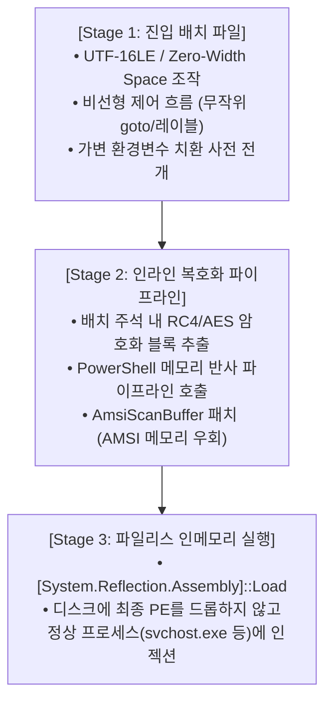

# 🛡️ 최신 EDR 무력화 엔진: BatCloak & ScrubCrypt 기술 포렌식 보고서
## Deep Dive: Modern 2023-2026 Batch Obfuscators & Loaders

---

### 1. 개요 및 배경
2023년부터 2026년 현재까지 RedLine, Agent Tesla, Remcos RAT 등 주요 악성코드 유포 조직에서 가장 광범위하게 채택하고 있는 다단계 배치 로더 엔진인 **BatCloak**과 **ScrubCrypt**의 핵심 구조를 분석합니다.

이들 도구의 목적은 전통적인 백신(시그니처 기반)뿐만 아니라, **Windows AMSI(Antimalware Scan Interface)**와 **EDR의 동적 프로세스 추적(Process Injection Detection)**을 완전히 따돌리는 데 있습니다.

---

### 2. BatCloak의 3단계 우회 아키텍처 (Three-Stage Architecture)

#### 핵심 우회 메커니즘:
1. **정적 YARA/시그니처 무력화**:
   - 동일한 페이로드라도 빌드할 때마다 변수명, 루프 순서, 캐럿 배치, 제로 너비 공백이 100% 무작위화되어 해시 기반 탐지가 불가능함.
2. **AMSI 메모리 패치 (`amsi.dll` 바이패스)**:
   - 배치 파일이 PowerShell을 호출하는 즉시 메모리 상의 `AmsiScanBuffer` 함수 시작 바이트를 `0xC3` (`RET`) 또는 `0xB8 0x57 0x00 0x07 0x80` (`HRESULT E_INVALIDARG`)으로 인플레이스 패치하여 스캔 기능을 무력화함.
3. **파일리스(Fileless) 영속성**:
   - 최종 실행 파일이 디스크에 파일 형태로 생성되지 않으므로, 백신의 실시간 파일 감시 필터 드라이버(`MiniFilter`)에 감지되지 않음.

---

### 3. 디옵퓨스케이션 및 분석 대응 전략

1. **메모리 덤프 (In-Memory Dump)**:
   - 배치 파일의 복잡한 치환을 손으로 풀지 않고, 프로세스가 최종 PowerShell을 스폰하거나 메모리를 할당할 때(`VirtualAllocEx`) 디버거(`x64dbg`) 또는 `Procmon`으로 덤프.
2. **`Exorcism` 후킹**:
   - `KingKDot/Exorcism`을 통해 `cmd.exe`가 최종적으로 전개한 `CommandLine` 버퍼를 중간 가로채기하여 원문 명령 추출.
3. **ETW (Event Tracing for Windows) 감사**:
   - `Microsoft-Windows-Threat-Intelligence` 공급자를 통해 프로세스 할당 및 원격 스레드 생성 이벤트를 추적하여 우회 불가한 하드웨어 레벨 로그 확보.
