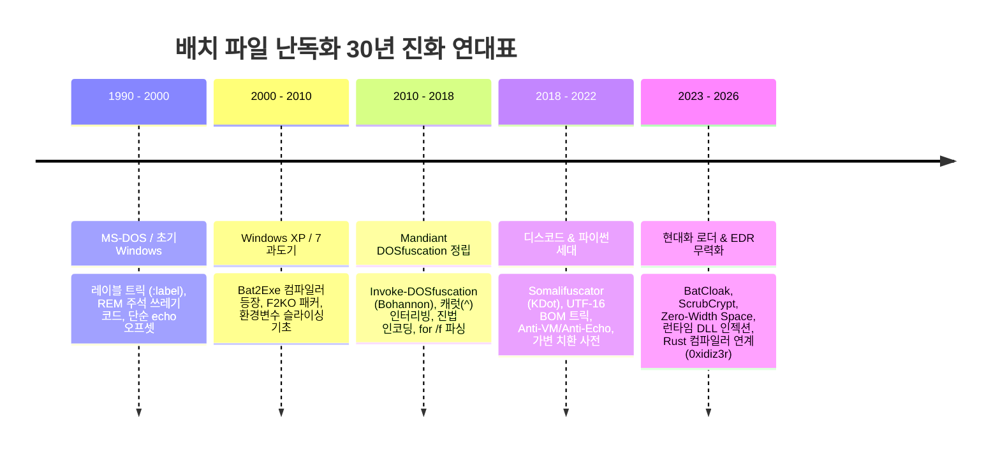

# 📜 배치 파일 난독화 30년 진화사 (1990s ~ 2026s)
## Classic to Modern Batch/CMD Obfuscation & Evasion Evolution

본 문서는 MS-DOS 시대의 원시적 배치 파일 트릭부터 2024~2026년 최신 사이버 위협 행위자(APT, 초고도화 로더)들이 사용하는 현대적 난독화·패커 기법까지 30여 년간의 기술적 진화 과정을 집대성한 심층 분석서입니다.

---

## ⏳ 1. 시대별 진화 타임라인 (Evolution Timeline)

---

## 🔬 2. 시대별 핵심 메커니즘 상세 해부

### [1세대] 1990s ~ 2000s: 원시적 텍스트 난독화 (Primitive Text Obfuscation)
- **주요 특징**: 명령줄 인터프리터(`COMMAND.COM` ➔ 초기 `cmd.exe`)의 단순한 파싱 특성을 이용한 시각적 교란.
- **핵심 기법**:
  1. **레이블 난독화 (`:a`, `:b`, `:random`)**: 실행 흐름과 무관한 수백 개의 가짜 레이블을 삽입하여 `goto` 루프로 분석관의 시야 교란.
  2. **`REM` 및 `::` 주석 덤프**: 대량의 무의미한 텍스트를 주석으로 끼워 넣어 스크립트 용량을 수 MB로 팽창시킴.
  3. **`echo off` 트랩**: 프롬프트 출력을 끄고 화면을 `cls`로 밀어버려 실행 흔적을 은폐.

### [2세대] 2000s ~ 2010s: PE 바인딩 & Bat2Exe 패커 (Executable Packaging Era)
- **주요 특징**: 스크립트 본문을 숨기기 위해 C/C++ 또는 Delphi 기반의 네이티브 실행 파일(`.exe`) 내부 리소스로 컴파일/암호화하는 기법 대중화.
- **핵심 도구**: `Bat To Exe Converter (F2KO)`, `Quick Batch File Compiler`, `islamadel/bat2exe`, `dehoisted/Bat2Exe`.
- **내부 동작 원리**:
  1. 컴파일러가 원본 `.bat` 텍스트를 압축/XOR 암호화하여 PE 리소스 섹션(`.rsrc`)에 저장.
  2. 생성된 `.exe`가 실행되면, 런타임에 `%TEMP%` 디렉터리에 복호화된 무작위 이름의 `.bat` 파일을 드롭.
  3. `ShellExecute` 또는 `CreateProcess`로 `cmd.exe /c %TEMP%\xxx.bat`를 은밀히 호출하고, 종료 후 자폭 삭제.
  4. **디옵퓨스케이션 해법**: `%TEMP%` 디렉터리의 파일 생성 이벤트를 모니터링(`Procmon`, `Sysmon EID 11`)하거나 프로세스 명령줄(`Sysmon EID 1`)을 가로채면 1초 만에 원본 평문 스크립트 획득 가능.

### [3세대] 2010s ~ 2018: 파서 취약점 & DOSfuscation의 황금기 (Parser Weaponization)
- **주요 특징**: Daniel Bohannon(Mandiant)의 기념비적 연구 `Invoke-DOSfuscation` 발표. `cmd.exe` 내부의 유연한 파서 상태 머신을 철저히 악용.
- **핵심 기법**:
  1. **환경변수 슬라이싱**: `%PATH:~10,1%%PATH:~23,1%`와 같이 OS 기본 환경변수에서 글자를 한 글자씩 추출하여 임의의 문자열 재조합.
  2. **캐럿(`^`) 인터리빙**: 따옴표 밖에서 이스케이프 문자로 취급되어 실행 시 완전히 증발하는 캐럿을 임의로 삽입 (`w^h^o^a^m^i`).
  3. **구분자 변칙(Delimiter Anomaly)**: 공백 대신 쉼표(`,`), 세미콜론(`;`), 등호(`=`)를 자유자재로 사용하여 정규식 시그니처 우회 (`cmd.exe,=,/c,dir`).
  4. **`for /f` 토큰 파싱**: 런타임에 `assoc`, `ftype`, 시스템 명령의 출력 결과를 루프로 돌며 동적으로 토큰을 잘라내어 명령 합성.

### [4세대] 2018 ~ 2022: 복합 파이썬 난독화기 & 안티 환경 (Multi-Layer Obfuscators)
- **주요 특징**: 오픈소스 커뮤니티(GitHub, Discord)를 중심으로 고도화된 파이썬/C# 기반의 GUI 배치 난독화기 폭발적 증가.
- **핵심 도구**: `Somalifuscator (V1/V2)`, `Batch-Obfuscator-CSharp`, `0xidiz3r`, `Batch-Encryption`.
- **핵심 기법**:
  1. **가변 치환 사전 (Dynamic Substitution Map)**: A부터 Z까지의 문자를 매 실행마다 새로운 랜덤 환경변수 이름(`%a1%=a`, `%b2%=b`)으로 치환한 뒤 본문 전체를 치환 코드로 교체.
  2. **UTF-16 LE BOM 인젝션 (`\xFF\xFE`)**: 파일 시작 부분에 리틀 엔디언 유니코드 BOM을 삽입하여 메모장, VS Code 등 일반 텍스트 뷰어에서 파일이 깨진 널 바이너리처럼 보이게 속임 (`cmd.exe`는 정상 해석).
  3. **Anti-VM & Anti-Echo**: `wmic`, `systeminfo`, `driverquery`를 호출하여 가상머신(VirtualBox, VMware, Sandbox) 환경 감지 시 즉각 종료.

### [5세대] 2023 ~ 2026: BatCloak, ScrubCrypt & 머신러닝 회피 (Modern EDR Bypass Era)
- **주요 특징**: 정적 시그니처 매칭 기반 안티바이러스(AV)는 물론, AMSI(Antimalware Scan Interface) 및 최신 EDR의 휴리스틱/행위 분석 엔진을 우회하기 위한 다단계 메모리 로더 결합.
- **대표적 위협 그룹 및 기법**:
  1. **`BatCloak` 엔진 (Trend Micro 분석)**: 매 배포마다 완전히 다른 구문 트리와 인코딩 레이어를 동적으로 생성하는 C2 서비스 기반 난독화기.
  2. **Zero-Width Space & 보이지 않는 문자 주입**: 유니코드 제로 너비 공백(`\u200B`), 우측에서 좌측으로 읽는 RTL(`\u202E`) 오버라이드를 배치 본문에 섞어 문자열 기반 YARA 룰을 100% 무력화.
  3. **Certutil / PowerShell 다단계 메모리 반사 로딩**: 배치 파일이 단순한 1차 실행 래퍼 역할을 하고, 내부 주석에 Base64로 숨겨진 셸코드를 `certutil -decode` 또는 PowerShell `[System.Reflection.Assembly]::Load`로 메모리 상에 직접 인젝션하여 디스크에 아티팩트를 남기지 않음.

---

## 🛡️ 3. 디옵퓨스케이션 기술의 대항 진화 (Deobfuscation Countermeasures)

| 세대 | 난독화 기법 | 방어 / 디옵퓨스케이션 메커니즘 | 대표 분석 도구 |
| :--- | :--- | :--- | :--- |
| **정적 분석** | 변수 치환, 캐럿 삽입, 슬라이싱 | AST 상태 머신 에뮬레이션 (치환 테이블 전개) | `DissectMalware/batch_deobfuscator`, `CrowTheBest` |
| **정규식/치환** | 표준 역산 알고리즘 | 가변 문자셋 매핑 테이블의 역방향 디코딩 | `0xTas/0xidiz3r`, `BatchShield-Decryptor` |
| **동적 감시** | 다단계 패커, 임시 파일 드롭 | Windows 프로세스 생성 감사 (EID 4688), Sysmon EID 1 | Sysinternals Procmon, Sysmon |
| **런타임 훅킹** | Anti-VM, 복합 난독화, 런타임 평가 | `cmd.exe` 메모리 주입 및 Windows API 후킹 (중단점/로깅) | `KingKDot/Exorcism` |
| **AI/시맨틱 분석** | 머신러닝 우회 다형성 변종 | 시맨틱 임베딩 및 커맨드라인 의미론적 분석 | Hugging Face `CmdCaliper`, Sigmaforge Rules |
