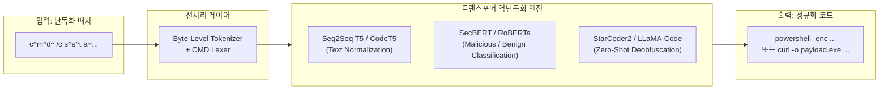

# 🤖 Hugging Face AI 모델 & 데이터셋 기반 배치/CMD 스크립트 역난독화 분석서

## 1. 개요 및 인공지능 기반 난독화 분석의 필요성
전통적인 정적 분석(Rule-based Regex, AST 파싱)은 `cmd.exe` 고유의 비결정론적 파싱 메커니즘과 극단적인 환경변수 치환(`%VAR:~0,1%`), 지연 확장(`!VAR!`), 캐럿(`^`) 탈출, 루프 토큰 언롤링 앞에서 한계를 드러냅니다. 이에 따라 최근 정보보안 커뮤니티 및 머신러닝 연구진은 **Hugging Face 오픈소스 생태계**를 활용하여 트랜스포머 기반의 시퀀스-투-시퀀스(Seq2Seq) 역난독화 및 난독화 탐지 신경망을 구축하고 있습니다.

---

## 2. Hugging Face 관련 핵심 데이터셋 분석

| 데이터셋명 / 작성자 | 데이터 유형 | 수록 내용 및 배치 스크립트 연관성 | 활용 방안 |
| :--- | :--- | :--- | :--- |
| **`tegridydev/open-malsec`** | 악성코드 실행 텔레메트리 | `batch_worm`, `cmd.exe` 기반 프로세스 생성 트리, 인라인 파이프라인 명령어 | 배치 기반 웜/드로퍼 명령줄 패턴 학습 및 분류기 피처 엔지니어링 |
| **`DeceptionPro/EDR_Telemetry_Sample`** | 실시간 EDR 로그 | 실환경 허니팟/디셉션 환경에서 수집된 실제 공격자의 `cmd.exe` 난독화 커맨드라인 | EDR 휴리스틱 탐지 우회 시도(캐럿 삽입, 환경변수 슬라이싱) 실제 데이터 확보 |
| **`clydeiii/cybersecurity`** | 보안 이벤트 로그 | `cmd /c`를 통한 다단계 배치(`install.bat`, 드로퍼) 로딩 이벤트 로그 | MITRE ATT&CK T1059.003 (Command and Scripting Interpreter: Windows Command Shell) 매핑 |
| **`alirezaaminzadeh/sigmaforge-detection-rules`** | Sigma 탐지 룰셋 | `cmd.exe` 이상 실행 탐지 시그마 규칙 및 난독화 정규식 집합 | AI 탐지 모델의 검증용 Ground Truth 라벨링 룰셋으로 활용 |
| **`tumeteor/Security-TTP-Mapping`** | 전술/기법 매핑 | 배치 스크립트를 통한 영속성(Persistence), 권한 상승, 방어 회피 TTP | 다단계 공격 체인에서 배치 파일의 역할 분석 |

---

## 3. 신경망 기반 배치 스크립트 역난독화 아키텍처

### 3.1 토크나이저(Tokenizer)의 구조적 한계와 해결책
- **문제점**:
  - 일반 NLP 모델(BPE, WordPiece, SentencePiece)은 빈도수 기반 하위단어 분절을 수행하므로, `c^m^d^.^e^x^e`나 `%a:~1,1%%b:~2,1%`와 같은 문자열을 무의미한 미등록 토큰(`[UNK]`) 또는 수백 개의 자모 토큰으로 파편화하여 어텐션 맵을 왜곡함.
- **해결책 (Character & Byte-level Tokenization)**:
  - ByT5, CANINE 등 바이트 단위(Byte-level) 인코더를 채택하여 UTF-16 BOM, 제로위드스(Zero-width), 캐럿 삽입 등 1바이트 단위의 교란 패턴을 손실 없이 임베딩.
  - `cmd.exe` 5단계 파이프라인(Phase 1: 특수문자 전처리 ➔ Phase 2: 환경변수 확장 ➔ Phase 3: 캐럿 탈출 ➔ Phase 4: 인용부호 제거 ➔ Phase 5: 파이프/리다이렉션)을 시뮬레이션하는 전처리 계층(Custom Lexer) 연동.

### 3.2 모델 아키텍처 비교

1. **Seq2Seq 텍스트 정규화 모델 (CodeT5 / T5-based)**:
   - 입력: 난독화된 1줄~수십 줄의 배치 스크립트.
   - 출력: 탈출 문자가 제거되고 변수가 치환된 원래의 순수 실행 명령어.
   - 훈련 데이터: `Invoke-DOSfuscation` 생성 샘플 100만 건을 합성하여 원문 ➔ 난독화 쌍(Pair)으로 Supervised Fine-Tuning(SFT).
2. **LLM 기반 제로샷/퓨샷 역난독화 (StarCoder, CodeLlama, Claude/GPT 계열)**:
   - 프롬프트 엔지니어링을 통해 `cmd.exe`의 인터프리터 규칙을 시스템 프롬프트로 주입하고, 단계별 사고 체인(Chain-of-Thought)을 통해 난독화된 문자열을 단계적으로 언롤링.

---

## 4. 실전 AI 역난독화 파이프라인 구현 지침
1. **1차 필터링**: Regex/AST 기반 정적 치환으로 자명한 변수(`@set x=cmd`)를 1차 해제.
2. **2차 토큰 정규화**: 바이트 레벨 모델을 통해 캐럿(`^`) 및 BOM/유니코드 더미 문자 제거.
3. **3차 딥러닝 디코딩**: Fine-tuned CodeT5 모델을 거쳐 암호화된 스트링 및 숨겨진 페이로드 URL/바이너리 복원.
4. **4차 기계 검증**: 복원된 스크립트의 구문 무결성을 Sandbox AST 파서로 검증.
