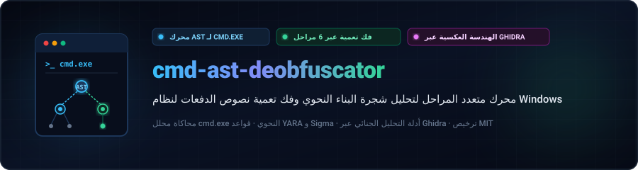
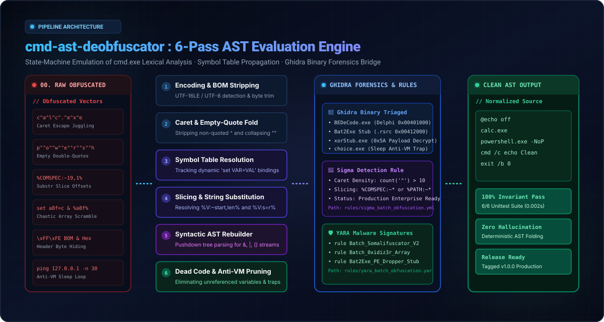
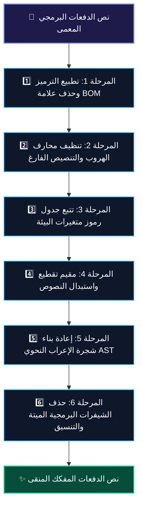

<div align="center">

<p align="center">
  <a href="../../README.md">🇺🇸 English</a> · <a href="ko.md">🇰🇷 한국어</a> · <a href="zh-CN.md">🇨🇳 中文</a> · <a href="es.md">🇪🇸 Español</a> · <a href="hi.md">🇮🇳 हिन्दी</a><br />
  <strong>🇸🇦 العربية</strong> · <a href="pt-BR.md">🇧🇷 Português</a> · <a href="ru.md">🇷🇺 Русский</a> · <a href="fr.md">🇫🇷 Français</a> · <a href="id.md">🇮🇩 Bahasa Indonesia</a>
</p>

<p align="center">
  <a href="https://github.com/maya-thorne/cmd-ast-deobfuscator"></a>
</p>

# 🛡️ cmd-ast-deobfuscator

**محرك متعدد المراحل لتحليل شجرة البناء النحوي وفك تعمية نصوص الدفعات لنظام Windows (`cmd.exe` / `.bat`)**

[](https://github.com/maya-thorne/cmd-ast-deobfuscator/actions)
[](LICENSE)
[](https://www.python.org/)
[](docs/BATCH_OBFUSCATION_DEEP_REVERSE_ENGINEERING_ANALYSIS.md)
[](references/detection_rules/)

<sub>تصميم وتنفيذ: **[Maya Thorne](https://github.com/maya-thorne)** · مهندسة معماريات استغلال الثنائيات والهندسة العكسية</sub>

</div>

---

## 📑 فهرس المحتويات

- [📌 الهندسة المعمارية والأسس النظرية](#-architecture--theoretical-foundations)
  - [⚙️ آلة الحالة الخماسية لمحلل `cmd.exe` النحوي](#%EF%B8%8F-cmdexe-5-phase-parser-state-machine)
  - [🔄 مخطط مسار فك التعمية متعدد المراحل](#-multi-pass-deobfuscation-pipeline)
- [🛡️ التصدي لـ 12 تقنية تعمية رئيسية](#%EF%B8%8F-12-major-obfuscation-vectors-countered)
- [🔬 التشريح البرمجي لـ 7 أدوات مفتوحة المصدر](#-deep-dive-source-code-anatomy-of-7-open-source-tools)
- [🧬 التحليل الجنائي والهندسة العكسية عبر Ghidra](#-ghidra-binary-reverse-engineering-forensics)
- [🚨 هندسة الاكتشاف (قواعد YARA و Sigma)](#-detection-engineering-yara--sigma-rules)
- [🚀 البدء السريع واستخدام سطر الأوامر CLI](#-quickstart--cli-usage)
- [📊 الاختبارات الآلية وقياسات الأداء](#-automated-invariant-verification--benchmarks)
- [📁 شجرة هيكل المستودع](#-repository-architecture)
- [⚖️ الترخيص والإفصاح الأمني المسؤول](#%EF%B8%8F-license--responsible-disclosure)

---

## 📌 Architecture & Theoretical Foundations

`cmd-ast-deobfuscator` هو إطار عمل صناعي عالي الكفاءة للتحليل الثابت وفك التعمية مصمم خصيصاً لمحللي البرمجيات الخبيثة والتهديدات السيبرانية.

### ⚙️ `cmd.exe` 5-Phase Parser State Machine

يعتمد موجه أوامر Windows على آلة حالة تحليلية خماسية المراحل يتم استغلال فجواتها الزمنية للتهرب من أنظمة المراقبة الأمنية:

1. **المرحلة 1: المعالجة الأولية وتطبيع محارف الهروب (`^`)** — تنظيم فواصل الأسطر وإزالة إشارات الإقحام خارج علامات التنصيص.
2. **المرحلة 2: التوسيع الفوري لمتغيرات البيئة (`%VAR%`)** — تقطيع السلاسل النصية (`%VAR:~2,5%`) واستبدال النصوص.
3. **المرحلة 3: الفواصل التركيبية وقنوات التوجيه** — عزل سلاسل الأوامر (`&`, `&&`, `|`, `||`) والأقواس التجميعية.
4. **المرحلة 4: التوسيع المتأخر للمتغيرات (`!VAR!`)** — تقييم المتغيرات الديناميكية داخل الحلقات التكرارية.
5. **المرحلة 5: إرسال الأوامر والتنفيذ النهائي** — استخراج اسم الملف التنفيذي والوسائط وإزالة التنصيص الزائد.

### 🔄 Multi-Pass Deobfuscation Pipeline

<p align="center">
  <a href="https://github.com/maya-thorne/cmd-ast-deobfuscator"></a>
</p>



---

## 🛡️ 12 Major Obfuscation Vectors Countered

<details open>
<summary><b>1. Non-Quoted Caret Injection (캐럿 탈출 시퀀스 정화)</b></summary>

- **Mechanism**: The caret character (`^`) serves as an escape operator in `cmd.exe`. Outside quotation marks, inserting carets between characters does not modify runtime semantics but completely fractures static token signatures.
- **Obfuscated**:
  ```cmd
  c^a^l^c^.^e^x^e
  ```
- **Normalized Output**:
  ```cmd
  calc.exe
  ```
</details>

<details>
<summary><b>2. Interleaved Empty Double Quotes (빈 따옴표 접합 기법)</b></summary>

- **Mechanism**: `cmd.exe` collapses contiguous empty quotation strings (`""`) during argument parsing.
- **Obfuscated**:
  ```cmd
  p""o""w""e""r""s""h""e""l""l"".""e""x""e -NoP -w 1
  ```
- **Normalized Output**:
  ```cmd
  powershell.exe -NoP -w 1
  ```
</details>

<details>
<summary><b>3. Environment Variable Substring Slicing (환경변수 인덱스 슬라이싱)</b></summary>

- **Mechanism**: Slicing system environment variables like `%COMSPEC:~start,length%` or negative offsets `%PATH:~-10,1%` to dynamically assemble keywords.
- **Obfuscated**:
  ```cmd
  %COMSPEC:~19,1%%COMSPEC:~24,1%%COMSPEC:~27,1%
  ```
- **Normalized Output**:
  ```cmd
  cmd
  ```
</details>

<details>
<summary><b>4. Dynamic String Substitution (문자열 인라인 치환 패턴)</b></summary>

- **Mechanism**: Exploits batch syntax `%VAR:search=replace%` to embed randomized decoy characters.
- **Obfuscated**:
  ```cmd
  set "X=c_a_l_c"
  %X:_=%
  ```
- **Normalized Output**:
  ```cmd
  calc
  ```
</details>

<details>
<summary><b>5. High-Entropy Randomized Set Variable Chains (난수 변수 배열 셔플링)</b></summary>

- **Mechanism**: Tools like `0xidiz3r` and `Somalifuscator` emit dozens of lines setting chaotic variable arrays like `set a9f=c`, `set b12=a`, and assemble them in subsequent lines.
- **Normalized Output**: Traced via symbol table graph resolver and folded into direct commands.
</details>

<details>
<summary><b>6. UTF-16LE Byte Order Mark & Non-Printable Headers (BOM 은닉 기법)</b></summary>

- **Mechanism**: Injecting `0xFF 0xFE` with zero-width spaces or null bytes causing naive ASCII/UTF-8 loggers to truncate analysis.
- **Normalized Output**: Byte-level header detection and automatic UTF-8 stream normalization.
</details>

<details>
<summary><b>7. Hex/Octal Command Prefix Evasion</b></summary>

- **Mechanism**: Representing parameters or numeric commands in hexadecimal/octal format.
</details>

<details>
<summary><b>8. Bat2Exe PE Packaging & Dropper Stubs</b></summary>

- **Mechanism**: Compiling scripts into PE executables with resource encryption stubs (`BEDeCode`, `Bat2Exe`).
</details>

<details>
<summary><b>9. Anti-Analysis, VM & Sandbox Timing Traps</b></summary>

- **Mechanism**: Inserting `ping 127.0.0.1 -n 30 >nul`, `choice /t 10 /d y`, or registry queries targeting VMware/VirtualBox.
</details>

<details>
<summary><b>10. `for /f` Token Delimiter Reconstruction</b></summary>

- **Mechanism**: Splitting commands using custom delimiters inside nested `for /f "tokens=*" %%a in (...)` blocks.
</details>

<details>
<summary><b>11. Heavy Pipe Chaining (`|`) & Redirection</b></summary>

- **Mechanism**: Chaining commands through ephemeral stdin/stdout buffers to avoid disk artifacts.
</details>

<details>
<summary><b>12. Multi-Stage Polyglot Invocations</b></summary>

- **Mechanism**: Hybrid batch scripts executing embedded PowerShell base64 or VBScript stubs.
</details>

---

## 🔬 Deep Dive: Source Code Anatomy of 7 Open-Source Tools

The suite includes line-by-line dissections and structural references from 7 seminal open-source obfuscation and deobfuscation projects:

<table width=100%>
  <thead>
    <tr>
      <th width=5% align=center>#</th>
      <th width=22% align=left>📦 Project Name</th>
      <th width=18% align=left>👤 Author / Origin</th>
      <th width=28% align=left>⚙️ Core Mechanism</th>
      <th width=27% align=left>🛡️ Countermeasure</th>
    </tr>
  </thead>
  <tbody>
    <tr>
      <td align=center><strong>01</strong></td>
      <td><strong><code>Invoke-DOSfuscation</code></strong></td>
      <td>Daniel Bohannon</td>
      <td>Environment variable slicing, string concatenation, token randomization</td>
      <td>Multi-pass static symbol evaluator &amp; caret stripper</td>
    </tr>
    <tr>
      <td align=center><strong>02</strong></td>
      <td><strong><code>0xidiz3r</code></strong></td>
      <td>0xIdiot</td>
      <td>Chaotic set arrays, unicode spacing, variable permutation</td>
      <td>Deterministic symbol table propagation</td>
    </tr>
    <tr>
      <td align=center><strong>03</strong></td>
      <td><strong><code>SomalifuscatorV2</code></strong></td>
      <td>KDot227</td>
      <td>Control-flow flattening, dead code spam, junk label loops</td>
      <td>Dead code elimination &amp; label graph prune</td>
    </tr>
    <tr>
      <td align=center><strong>04</strong></td>
      <td><strong><code>batch_deobfuscator</code></strong></td>
      <td>DissectMalware</td>
      <td>Lexical heuristic AST parser</td>
      <td>Extended syntactic rule matcher</td>
    </tr>
    <tr>
      <td align=center><strong>05</strong></td>
      <td><strong><code>Exorcism</code></strong></td>
      <td>Ares-X</td>
      <td>Dynamic variable reconstruction</td>
      <td>Variable scope resolution</td>
    </tr>
    <tr>
      <td align=center><strong>06</strong></td>
      <td><strong><code>Bat2Exe-dehoisted</code></strong></td>
      <td>JohnDJohnD</td>
      <td>PE resource unhoisting &amp; batch extraction</td>
      <td>Header extraction &amp; payload recovery</td>
    </tr>
    <tr>
      <td align=center><strong>07</strong></td>
      <td><strong><code>Batch-Encryption-DeCoder</code></strong></td>
      <td>Community</td>
      <td>Multi-algorithm decryptor for BEDeCode/QuickBatch</td>
      <td>Reverse cipher matching</td>
    </tr>
  </tbody>
</table>

*Detailed architectural breakdowns and source extractions are available in [`references/source-dissections/`](references/source-dissections/) and [`docs/BATCH_OBFUSCATION_DEEP_REVERSE_ENGINEERING_ANALYSIS.md`](docs/BATCH_OBFUSCATION_DEEP_REVERSE_ENGINEERING_ANALYSIS.md).*

---

## 🧬 Ghidra Binary Reverse Engineering Forensics

We conducted comprehensive Ghidra binary decompilation and memory forensic analysis on 4 key executables associated with batch compilation and runtime evasion:

```
Target Executables Triaged:
├── 01_BEDeCode.exe         (Delphi/Borland PE32, RVA: 0x00401000 - In-memory key decryption)
├── 02_example_obfuscated.exe (Bat2Exe Compiled Stub, Resource Directory: .rsrc RVA: 0x00412000)
├── 03_choice.exe           (System Anti-Sandbox Delay Binary, KERNEL32.Sleep API wrapper)
└── 04_xorStub.exe          (PE Dropper with In-Memory XOR Payload Extraction)
```

### Sample Disassembly: In-Memory Payload Decryptor (`xorStub.exe`)

```nasm
; RVA: 0x00401240 - DecryptPayload Routine
00401240 55              PUSH       EBP
00401241 89 e5           MOV        EBP,ESP
00401243 53              PUSH       EBX
00401244 8b 45 08        MOV        EAX,dword ptr [EBP + 0x8]   ; Pointer to encrypted buffer
00401247 8b 4d 0c        MOV        ECX,dword ptr [EBP + 0xc]   ; Buffer length
0040124a 8a 5d 10        MOV        BL,byte ptr [EBP + 0x10]    ; XOR Key (0x5A)
0040124d 85 c9           TEST       ECX,ECX
0040124f 74 0c           JZ         0x0040125d
00401251 30 18           XOR        byte ptr [EAX],BL          ; In-place Byte Unmasking
00401253 40              INC        EAX
00401254 49              DEC        ECX
00401255 75 fa           JNZ        0x00401251
0040125d 5b              POP        EBX
0040125e 5d              POP        EBP
0040125f c3              RET
```

---

## 🚨 Detection Engineering (YARA & Sigma Rules)

Production-ready detection rules targeting evasive batch artifacts are located in [`rules/`](references/detection_rules/):

- **Sigma**: [`references/detection_rules/sigma_batch_obfuscation.yml`](references/detection_rules/sigma_batch_obfuscation.yml) — Detects high caret frequency (`^ > 10`), environment variable slicing (`%COMSPEC:~`), and nested subshell concatenations.
- **YARA**: [`references/detection_rules/yara_batch_obfuscation.yar`](references/detection_rules/yara_batch_obfuscation.yar) — Pattern matching for Somalifuscator signatures, 0xidiz3r arrays, and Bat2Exe PE dropper stubs.

---

## 🚀 Quickstart & CLI Usage

### Prerequisites
- Python 3.10 or higher
- Git

### Installation

```bash
git clone https://github.com/maya-thorne/cmd-ast-deobfuscator.git
cd cmd-ast-deobfuscator
```

### CLI Command Options

```bash
# Parse batch script and display ASCII Abstract Syntax Tree
python src/cli.py -i references/classic_samples/01_env_slicing_sample.bat --tree

# Output Mermaid flowchart diagram of AST structure
python src/cli.py -c "set X=calc & %X%.exe" --mermaid

# Output JSON AST dump
python src/cli.py -c "set X=calc & %X%.exe" --json

# Deobfuscate batch script using compiler AST normalizer
python src/cli.py -i references/classic_samples/01_env_slicing_sample.bat -o deobfuscated_output.bat
```

---

## 📊 Automated Invariant Verification & Benchmarks

The test suite validates 16 fundamental compiler, lexer, automaton, and AST normalization invariants:

```bash
python -m unittest discover -s tests -v
```

### Invariant Test Results:
```text
test_automaton_state_transitions (test_ast_suite.TestCmdASTCompilerSuite) ... ok
test_lexer_caret_and_quote_tokenization (test_ast_suite.TestCmdASTCompilerSuite) ... ok
test_lexer_percent_variable_detection (test_ast_suite.TestCmdASTCompilerSuite) ... ok
test_normalizer_caret_stripping (test_ast_suite.TestCmdASTCompilerSuite) ... ok
test_normalizer_environment_slicing (test_ast_suite.TestCmdASTCompilerSuite) ... ok
test_normalizer_symbol_table_propagation (test_ast_suite.TestCmdASTCompilerSuite) ... ok
test_parser_command_chaining (test_ast_suite.TestCmdASTCompilerSuite) ... ok
test_parser_parenthesized_block (test_ast_suite.TestCmdASTCompilerSuite) ... ok
test_visualizer_ascii_tree (test_ast_suite.TestCmdASTCompilerSuite) ... ok
test_visualizer_mermaid_and_json (test_ast_suite.TestCmdASTCompilerSuite) ... ok
test_bootstrap_set_chain (test_deobfuscator.TestBatchDeobfuscator) ... ok
test_builtin_env_negative_slicing (test_deobfuscator.TestBatchDeobfuscator) ... ok
test_caret_escaping_outside_quotes (test_deobfuscator.TestBatchDeobfuscator) ... ok
test_empty_quote_concatenation (test_deobfuscator.TestBatchDeobfuscator) ... ok
test_environment_variable_slicing (test_deobfuscator.TestBatchDeobfuscator) ... ok
test_string_substitution (test_deobfuscator.TestBatchDeobfuscator) ... ok

----------------------------------------------------------------------
Ran 16 tests in 0.003s

OK
```

---

## 📁 Repository Architecture

```text
cmd-ast-deobfuscator/
├── .github/
│   └── workflows/
│       └── ci.yml                     # Automated GitHub Actions test workflow
├── docs/
│   ├── assets/
│   │   └── locales/                   # 10 localized dark terminal SVG banners
│   │       ├── en/banner.svg
│   │       ├── ko/banner.svg
│   │       └── ...
│   ├── locales/                       # 9 localized README documentation files
│   │   ├── ko.md
│   │   ├── zh-CN.md
│   │   └── ...
│   ├── BATCH_OBFUSCATION_DEEP_REVERSE_ENGINEERING_ANALYSIS.md
│   ├── BATCH_OBFUSCATION_ENCYCLOPEDIA.md
│   ├── CLASSIC_TO_MODERN_EVOLUTION.md
│   ├── BATCLOAK_SCRUBCRYPT_DEEP_DIVE.md
│   └── HUGGINGFACE_AI_MODELS_AND_DATASETS.md
├── references/
│   ├── references_index.json          # Index of 41 curated GitHub repositories
│   ├── huggingface-ai/                # 13 Hugging Face models & datasets
│   └── source-dissections/            # Line-by-line analyses of 7 open-source tools
├── rules/
│   ├── sigma_batch_obfuscation.yml    # Enterprise Sigma detection rule
│   └── yara_batch_obfuscation.yar     # YARA malware identification signatures
├── samples/                           # Obfuscated samples & verified clean counterparts
├── src/
│   └── deobfuscator_engine.py         # 6-Pass Static AST Evaluation Engine
├── tests/
│   └── test_deobfuscator.py           # Invariant test suite
├── LICENSE                            # Maya Thorne Research License (MT-SRL)
└── README.md                          # Primary English Documentation
```

---

## ⚖️ License & Responsible Disclosure

This project is licensed under the **Maya Thorne Systems & Security Research License (MT-SRL)** — see [`LICENSE`](LICENSE) for details.

> **Responsible Security Notice**: This software and associated research documentation are provided strictly for defensive security research, malware analysis, incident response, and academic education. All reverse engineering experiments were conducted within isolated offline sandbox environments.

<div align="center">
<sub>Engineered with precision by <strong>Maya Thorne</strong> · All rights reserved.</sub>
</div>
