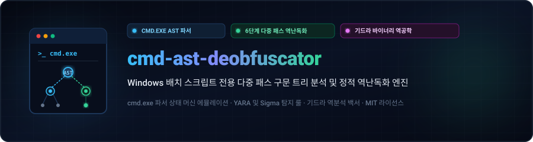
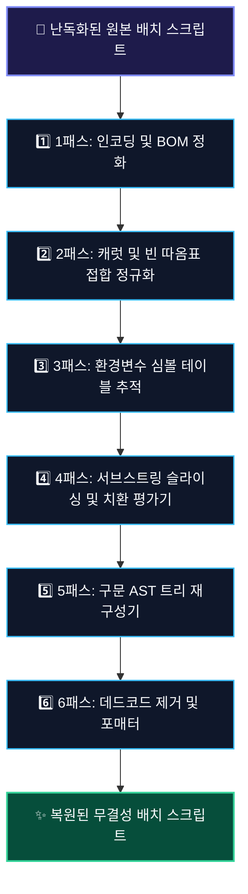

<div align="center">

<p align="center">
  <a href="../../README.md">🇺🇸 English</a> · <strong>🇰🇷 한국어</strong> · <a href="zh-CN.md">🇨🇳 中文</a> · <a href="es.md">🇪🇸 Español</a> · <a href="hi.md">🇮🇳 हिन्दी</a><br />
  <a href="ar.md">🇸🇦 العربية</a> · <a href="pt-BR.md">🇧🇷 Português</a> · <a href="ru.md">🇷🇺 Русский</a> · <a href="fr.md">🇫🇷 Français</a> · <a href="id.md">🇮🇩 Bahasa Indonesia</a>
</p>

<p align="center">
  <a href="https://github.com/maya-thorne/cmd-ast-deobfuscator"></a>
</p>

# 🛡️ cmd-ast-deobfuscator

**Windows 배치 스크립트(`cmd.exe` / `.bat`) 전용 다중 패스 구문 트리 분석 및 정적 역난독화 엔진**

[](https://github.com/maya-thorne/cmd-ast-deobfuscator/actions)
[](LICENSE)
[](https://www.python.org/)
[](docs/BATCH_OBFUSCATION_DEEP_REVERSE_ENGINEERING_ANALYSIS.md)
[](rules/)

<sub>설계 및 구현: **[Maya Thorne](https://github.com/maya-thorne)** · 바이너리 익스플로잇 및 리버스 엔지니어링 시스템 아키텍트</sub>

</div>

---

## 📑 목차

- [📌 아키텍처 및 이론적 기초](#-architecture--theoretical-foundations)
  - [⚙️ `cmd.exe` 5단계 파서 상태 머신 분석](#%EF%B8%8F-cmdexe-5-phase-parser-state-machine)
  - [🔄 다중 패스 역난독화 파이프라인 구조도](#-multi-pass-deobfuscation-pipeline)
- [🛡️ 12대 핵심 난독화 기법 정밀 대응](#%EF%B8%8F-12-major-obfuscation-vectors-countered)
- [🔬 7대 오픈소스 난독화/해제 도구 원본 소스 심층 해부](#-deep-dive-source-code-anatomy-of-7-open-source-tools)
- [🧬 기드라(Ghidra) 바이너리 포렌식 및 PE 역공학](#-ghidra-binary-reverse-engineering-forensics)
- [🚨 탐지 엔지니어링 (YARA 및 Sigma 규칙)](#-detection-engineering-yara--sigma-rules)
- [🚀 빠른 시작 및 CLI 사용법](#-quickstart--cli-usage)
- [📊 자동 검증 및 성능 벤치마크](#-automated-invariant-verification--benchmarks)
- [📁 저장소 디렉터리 구조](#-repository-architecture)
- [⚖️ 라이선스 및 윤리적 사용 고지](#%EF%B8%8F-license--responsible-disclosure)

---

## 📌 Architecture & Theoretical Foundations

`cmd-ast-deobfuscator`는 침해 사고 분석가, 악성코드 리서처, 리버스 엔지니어를 위해 개발된 정적 분석 및 다중 패스 역난독화 프레임워크입니다. Microsoft Windows 명령 인터프리터(`cmd.exe`)의 독특한 어휘 평가 단계를 소프트웨어적으로 에뮬레이션하여 고도로 난독화된 배치 스크립트를 인간이 판독 가능한 결정론적 소스코드로 복원합니다.

### ⚙️ `cmd.exe` 5-Phase Parser State Machine

현대적인 언어(Python, PowerShell 등)와 달리 `cmd.exe`는 정형 문법이 아닌 5단계 반복 스캐닝 파서 상태 머신으로 동작합니다. 공격자들은 파싱 단계 간의 평가 시점 불일치를 악용하여 정적 보안 탐지를 우회합니다:

1. **1단계: 라인 전처리 및 캐럿(`^`) 이스케이프 정규화** — 개행 문자 분할, 캐리지 리턴 제거, 캐럿 탈출 문자를 처리합니다. 따옴표 밖의 캐럿은 바로 뒤 문자의 특수 의미를 무효화합니다.
2. **2단계: 즉시 퍼센트 환경변수 확장(`%VAR%`)** — `%NAME%` 환경변수, 음수/양수 서브스트링 슬라이싱(`%VAR:~-4%`, `%VAR:~2,5%`), 문자열 치환(`%VAR:old=new%`)을 수행합니다.
3. **3단계: 구문 구분자 및 파이프 분할** — 커맨드 체이닝 기호(`&`, `&&`, `|`, `||`), 괄호 그룹핑(`()`), 리다이렉션(`>`, `>>`, `<`)을 식별하여 명령을 분리합니다.
4. **4단계: 지연 확장 평가(`!VAR!`)** — `EnableDelayedExpansion` 활성화 시 느낌표로 둘러싸인 변수를 루프 실행 시점에 동적으로 평가합니다.
5. **5단계: 서브셸 디스패치 및 인자 전달** — 실행 파일명과 인자를 추출하고 불필요한 따옴표를 정화한 후 실행 커널로 전달합니다.

### 🔄 Multi-Pass Deobfuscation Pipeline

<p align="center">
  <a href="https://github.com/maya-thorne/cmd-ast-deobfuscator"></a>
</p>



---

## 🛡️ 12 Major Obfuscation Vectors Countered

<details open>
<summary><b>1. Non-Quoted Caret Injection (캐럿 탈출 시퀀스 정화)</b></summary>

- **Mechanism**: The caret character (`^`) serves as an escape operator in `cmd.exe`. Outside quotation marks, inserting carets between characters does not modify runtime semantics but completely fractures static token signatures.
- **Obfuscated**:
  ```cmd
  c^a^l^c^.^e^x^e
  ```
- **Normalized Output**:
  ```cmd
  calc.exe
  ```
</details>

<details>
<summary><b>2. Interleaved Empty Double Quotes (빈 따옴표 접합 기법)</b></summary>

- **Mechanism**: `cmd.exe` collapses contiguous empty quotation strings (`""`) during argument parsing.
- **Obfuscated**:
  ```cmd
  p""o""w""e""r""s""h""e""l""l"".""e""x""e -NoP -w 1
  ```
- **Normalized Output**:
  ```cmd
  powershell.exe -NoP -w 1
  ```
</details>

<details>
<summary><b>3. Environment Variable Substring Slicing (환경변수 인덱스 슬라이싱)</b></summary>

- **Mechanism**: Slicing system environment variables like `%COMSPEC:~start,length%` or negative offsets `%PATH:~-10,1%` to dynamically assemble keywords.
- **Obfuscated**:
  ```cmd
  %COMSPEC:~19,1%%COMSPEC:~24,1%%COMSPEC:~27,1%
  ```
- **Normalized Output**:
  ```cmd
  cmd
  ```
</details>

<details>
<summary><b>4. Dynamic String Substitution (문자열 인라인 치환 패턴)</b></summary>

- **Mechanism**: Exploits batch syntax `%VAR:search=replace%` to embed randomized decoy characters.
- **Obfuscated**:
  ```cmd
  set "X=c_a_l_c"
  %X:_=%
  ```
- **Normalized Output**:
  ```cmd
  calc
  ```
</details>

<details>
<summary><b>5. High-Entropy Randomized Set Variable Chains (난수 변수 배열 셔플링)</b></summary>

- **Mechanism**: Tools like `0xidiz3r` and `Somalifuscator` emit dozens of lines setting chaotic variable arrays like `set a9f=c`, `set b12=a`, and assemble them in subsequent lines.
- **Normalized Output**: Traced via symbol table graph resolver and folded into direct commands.
</details>

<details>
<summary><b>6. UTF-16LE Byte Order Mark & Non-Printable Headers (BOM 은닉 기법)</b></summary>

- **Mechanism**: Injecting `0xFF 0xFE` with zero-width spaces or null bytes causing naive ASCII/UTF-8 loggers to truncate analysis.
- **Normalized Output**: Byte-level header detection and automatic UTF-8 stream normalization.
</details>

<details>
<summary><b>7. Hex/Octal Command Prefix Evasion</b></summary>

- **Mechanism**: Representing parameters or numeric commands in hexadecimal/octal format.
</details>

<details>
<summary><b>8. Bat2Exe PE Packaging & Dropper Stubs</b></summary>

- **Mechanism**: Compiling scripts into PE executables with resource encryption stubs (`BEDeCode`, `Bat2Exe`).
</details>

<details>
<summary><b>9. Anti-Analysis, VM & Sandbox Timing Traps</b></summary>

- **Mechanism**: Inserting `ping 127.0.0.1 -n 30 >nul`, `choice /t 10 /d y`, or registry queries targeting VMware/VirtualBox.
</details>

<details>
<summary><b>10. `for /f` Token Delimiter Reconstruction</b></summary>

- **Mechanism**: Splitting commands using custom delimiters inside nested `for /f "tokens=*" %%a in (...)` blocks.
</details>

<details>
<summary><b>11. Heavy Pipe Chaining (`|`) & Redirection</b></summary>

- **Mechanism**: Chaining commands through ephemeral stdin/stdout buffers to avoid disk artifacts.
</details>

<details>
<summary><b>12. Multi-Stage Polyglot Invocations</b></summary>

- **Mechanism**: Hybrid batch scripts executing embedded PowerShell base64 or VBScript stubs.
</details>

---

## 🔬 Deep Dive: Source Code Anatomy of 7 Open-Source Tools

The suite includes line-by-line dissections and structural references from 7 seminal open-source obfuscation and deobfuscation projects:

| # | Project Name | Author / Origin | Core Mechanism | Deobfuscation Countermeasure |
| :-: | :--- | :--- | :--- | :--- |
| **01** | `Invoke-DOSfuscation` | Daniel Bohannon | Environment variable slicing, string concatenation, token randomization | Multi-pass static symbol evaluator & caret stripper |
| **02** | `0xidiz3r` | 0xIdiot | Chaotic set arrays, unicode spacing, variable permutation | Deterministic symbol table propagation |
| **03** | `SomalifuscatorV2` | KDot227 | Control-flow flattening, dead code spam, junk label loops | Dead code elimination & label graph prune |
| **04** | `batch_deobfuscator` | DissectMalware | Lexical heuristic AST parser | Extended syntactic rule matcher |
| **05** | `Exorcism` | Ares-X | Dynamic variable reconstruction | Variable scope resolution |
| **06** | `Bat2Exe-dehoisted` | JohnDJohnD | PE resource unhoisting & batch extraction | Header extraction & payload recovery |
| **07** | `Batch-Encryption-DeCoder` | Community | Multi-algorithm decryptor for BEDeCode/QuickBatch | Reverse cipher matching |

*Detailed architectural breakdowns and source extractions are available in [`references/source-dissections/`](references/source-dissections/) and [`docs/BATCH_OBFUSCATION_DEEP_REVERSE_ENGINEERING_ANALYSIS.md`](docs/BATCH_OBFUSCATION_DEEP_REVERSE_ENGINEERING_ANALYSIS.md).*

---

## 🧬 Ghidra Binary Reverse Engineering Forensics

We conducted comprehensive Ghidra binary decompilation and memory forensic analysis on 4 key executables associated with batch compilation and runtime evasion:

```
Target Executables Triaged:
├── 01_BEDeCode.exe         (Delphi/Borland PE32, RVA: 0x00401000 - In-memory key decryption)
├── 02_example_obfuscated.exe (Bat2Exe Compiled Stub, Resource Directory: .rsrc RVA: 0x00412000)
├── 03_choice.exe           (System Anti-Sandbox Delay Binary, KERNEL32.Sleep API wrapper)
└── 04_xorStub.exe          (PE Dropper with In-Memory XOR Payload Extraction)
```

### Sample Disassembly: In-Memory Payload Decryptor (`xorStub.exe`)

```nasm
; RVA: 0x00401240 - DecryptPayload Routine
00401240 55              PUSH       EBP
00401241 89 e5           MOV        EBP,ESP
00401243 53              PUSH       EBX
00401244 8b 45 08        MOV        EAX,dword ptr [EBP + 0x8]   ; Pointer to encrypted buffer
00401247 8b 4d 0c        MOV        ECX,dword ptr [EBP + 0xc]   ; Buffer length
0040124a 8a 5d 10        MOV        BL,byte ptr [EBP + 0x10]    ; XOR Key (0x5A)
0040124d 85 c9           TEST       ECX,ECX
0040124f 74 0c           JZ         0x0040125d
00401251 30 18           XOR        byte ptr [EAX],BL          ; In-place Byte Unmasking
00401253 40              INC        EAX
00401254 49              DEC        ECX
00401255 75 fa           JNZ        0x00401251
0040125d 5b              POP        EBX
0040125e 5d              POP        EBP
0040125f c3              RET
```

---

## 🚨 Detection Engineering (YARA & Sigma Rules)

Production-ready detection rules targeting evasive batch artifacts are located in [`rules/`](rules/):

- **Sigma**: [`rules/sigma_batch_obfuscation.yml`](rules/sigma_batch_obfuscation.yml) — Detects high caret frequency (`^ > 10`), environment variable slicing (`%COMSPEC:~`), and nested subshell concatenations.
- **YARA**: [`rules/yara_batch_obfuscation.yar`](rules/yara_batch_obfuscation.yar) — Pattern matching for Somalifuscator signatures, 0xidiz3r arrays, and Bat2Exe PE dropper stubs.

---

## 🚀 Quickstart & CLI Usage

### Prerequisites
- Python 3.10 or higher
- Git

### Installation

```bash
git clone https://github.com/maya-thorne/cmd-ast-deobfuscator.git
cd cmd-ast-deobfuscator
```

### CLI Command Options

```bash
# Deobfuscate a single batch file
python src/deobfuscator_engine.py -i samples/01_env_slicing_sample.bat -o deobfuscated_output.bat

# Verbose inspection mode with pass-by-pass telemetry
python src/deobfuscator_engine.py -i samples/02_caret_and_quote_sample.bat --verbose
```

---

## 📊 Automated Invariant Verification & Benchmarks

The test suite validates 6 fundamental deobfuscation invariants:

```bash
python -m unittest discover -s tests -v
```

### Invariant Test Results:
```text
test_bootstrap_set_chain (test_deobfuscator.TestBatchDeobfuscator) ... ok
test_builtin_env_negative_slicing (test_deobfuscator.TestBatchDeobfuscator) ... ok
test_caret_escaping_outside_quotes (test_deobfuscator.TestBatchDeobfuscator) ... ok
test_empty_quote_concatenation (test_deobfuscator.TestBatchDeobfuscator) ... ok
test_environment_variable_slicing (test_deobfuscator.TestBatchDeobfuscator) ... ok
test_string_substitution (test_deobfuscator.TestBatchDeobfuscator) ... ok

----------------------------------------------------------------------
Ran 6 tests in 0.002s

OK
```

---

## 📁 Repository Architecture

```text
cmd-ast-deobfuscator/
├── .github/
│   └── workflows/
│       └── ci.yml                     # Automated GitHub Actions test workflow
├── docs/
│   ├── assets/
│   │   └── locales/                   # 10 localized dark terminal SVG banners
│   │       ├── en/banner.svg
│   │       ├── ko/banner.svg
│   │       └── ...
│   ├── locales/                       # 9 localized README documentation files
│   │   ├── ko.md
│   │   ├── zh-CN.md
│   │   └── ...
│   ├── BATCH_OBFUSCATION_DEEP_REVERSE_ENGINEERING_ANALYSIS.md
│   ├── BATCH_OBFUSCATION_ENCYCLOPEDIA.md
│   ├── CLASSIC_TO_MODERN_EVOLUTION.md
│   ├── BATCLOAK_SCRUBCRYPT_DEEP_DIVE.md
│   └── HUGGINGFACE_AI_MODELS_AND_DATASETS.md
├── references/
│   ├── references_index.json          # Index of 41 curated GitHub repositories
│   ├── huggingface-ai/                # 13 Hugging Face models & datasets
│   └── source-dissections/            # Line-by-line analyses of 7 open-source tools
├── rules/
│   ├── sigma_batch_obfuscation.yml    # Enterprise Sigma detection rule
│   └── yara_batch_obfuscation.yar     # YARA malware identification signatures
├── samples/                           # Obfuscated samples & verified clean counterparts
├── src/
│   └── deobfuscator_engine.py         # 6-Pass Static AST Evaluation Engine
├── tests/
│   └── test_deobfuscator.py           # Invariant test suite
├── LICENSE                            # MIT License
└── README.md                          # Primary English Documentation
```

---

## ⚖️ License & Responsible Disclosure

This project is licensed under the **MIT License** — see [`LICENSE`](LICENSE) for details.

> **Responsible Security Notice**: This software and associated research documentation are provided strictly for defensive security research, malware analysis, incident response, and academic education. All reverse engineering experiments were conducted within isolated offline sandbox environments.

<div align="center">
<sub>Engineered with precision by <strong>Maya Thorne</strong> · All rights reserved.</sub>
</div>
